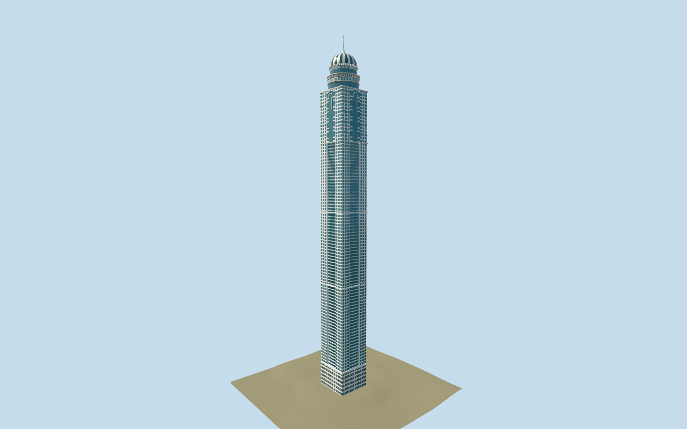

# Princess Tower

Individually modeled Dubai residential tower with inset bowed balconies, cream window piers, checkerboard upper glazing, raised keyhole-and-pediment crowns, two pointed ornamental rings and a striped dome with flared spire.

## Evidence and reconstruction

Published dimensions and reconstructed details are separated in spec.json. Primary references:

- [Reference](https://accgroup.com/our_projects/princess-tower-dubai/)
- [Reference](https://www.kone.ie/Images/factsheet-kone-princess-tower-references_tcm258-9016.pdf)
- [Reference](https://www.technosteel-uae.com/wp-content/uploads/2021/05/Structural-Steel-_PQ.pdf)
- [Reference](https://technosteelconstruction-uae.com/princess-tower)
- [Reference](https://www.skyscrapercenter.com/building/id/206)
- [Reference](https://old.skyscraper.org/EXHIBITIONS/TEN_TOPS/date.php)
- [Reference](https://www.openstreetmap.org/way/186351092)

No third-party geometry, photograph or bitmap texture is embedded. Shared surface graphs come from the central library; vertex tints carry model colors. Glazing uses PBR materials; transparent surfaces are declared per model.

## Model and axes

63,384 triangles; 182,076 vertices; 4 material groups; 7,318,040 bytes. Native bounds: -20.811, 0.000, -19.682 to 20.811, 414.000, 19.682. Source hash: `sha256:8f9c4252b79a673592b7e8d366eb11a800a62a95215f3a175733e2dab384f423`.

{"up":"+Y","longAxis":"+X northeast","shortAxis":"+Z southeast","front":"Native-X southwest reconstructed arrival frontage; exact doorway bearing remains approximate."}

Owner-directed picture/standard viewer PMTiles approximate fit. Retain exact-Q19492 shaft anchor[55.14677179,25.088646041] and heading0.775615371979: native+X northeast,+Z southeast. Existing40.003x37.744m rectangular shaft and414m tip remain. Inspected upper exterior picture confirms checkerboard upper glazing, keyhole pediments, two pointed rings and striped dome/spire. PMTiles supplies street/building context and approximate off-footprint[-70,0] ground; bounded local contact correction is separate from raw elevation. Southwest/native-X arrival frontage remains a reconstruction; exact doorway bearing and neighboring-tower identifications are not claimed. Accept this mapped shaft orientation for world-viewer placement with no footprint suppression, rather than waiting for surveyed doorway evidence. Curb thresholds, podium levels and fine crown dimensions remain approximate.

## Reproduce

Run `node packages/worldgen/scripts/generate-signature-towers.mjs --ids=princess_tower` (or add `--check`). The generator preserves manually edited masters by checking their baseline hashes. Import through the standard authored-model workflow with optimization disabled; then capture all QA cameras, including shared-surface views.

## Pending work

- Owner-directed picture/standard viewer PMTiles approximate fit. Retain exact-Q19492 shaft anchor[55.14677179,25.088646041] and heading0.775615371979: native+X northeast,+Z southeast. Existing40.003x37.744m rectangular shaft and414m tip remain. Inspected upper exterior picture confirms checkerboard upper glazing, keyhole pediments, two pointed rings and striped dome/spire. PMTiles supplies street/building context and approximate off-footprint[-70,0] ground; bounded local contact correction is separate from raw elevation. Southwest/native-X arrival frontage remains a reconstruction; exact doorway bearing and neighboring-tower identifications are not claimed. Accept this mapped shaft orientation for world-viewer placement with no footprint suppression, rather than waiting for surveyed doorway evidence. Curb thresholds, podium levels and fine crown dimensions remain approximate.
- Unchanged original buildPrincess recipe preserves699554triangles/61924732bytes. Reviewed source retains the40.003x37.744m mapped rectangular shaft, four recessed bowed balcony stacks with individual slabs and translucent guards,74lower balcony datums,16upper checkerboard courses, six-course podium, provisional entrance/doors and pediment, four keyhole-and-pediment crown reliefs/medallions, two circular glazed/slit tiers with separate pointed ornamental petal rings, closed alternating reflective/dark dome to392m, flared collar and414m tip. Repeated2cm panel-joint beams, duplicated pane-cell shells, tiny balcony rail tubes and dome seam tubes are omitted. Windows retain separate inset panes, flat cream piers/spandrels, sparse flat mullions ; tiny recess-return shells are omitted. Four-segment balcony bows retain their curvature with flat fascia strips; near omits tiny handrail strips. Petal curvature and dome use fewer finite samples; near preserves48petals per reconstructed ring. Two shared concrete/painted-metal graphs serve the shaft/base and crown/rails with rebalanced vertex tints, plus opaque vision and translucent guard palette groups, four near draw groups. Skyline has a continuous abstract shaft and eight-sided crown; district uses four-course cream bands, continuous recessed bowed glass, sparse upper courses and12petals; street preserves all74bowed balcony tiers, continuous flanking window banks and24petals; near preserves74lower/16uppercourses and48petals. Glass guards are translucent at street/near; tiny rail tubes are omitted. Source height414m follows contractor/KONE; original413.4m architectural/356.9m occupied values are retained as legacy dimensional facts and museum rounds occupied floor358m. ACC107floors includes101above+6basements in KONE, not107aboveground. Balcony pitches/bow, upper checkerboard phase, keyhole relief, petal/slit/gore count, intermediate crown datums, podium and entry hardware remain photo reconstructions. KONE PDF is unavailable to fresh web fetch; actual cached printed10–13 and crown-fabricator printed page pixels supply the primary photographic evidence. Physical-device/dense-city timings, global geometric error bounds and surveyed curb/door fit remain unmeasured.

This bundle follows the medium-fi standard. Medium-fi appearance and geographic fit are reviewed separately. Hash-bound visual acceptance is recorded separately after capture inspection.
