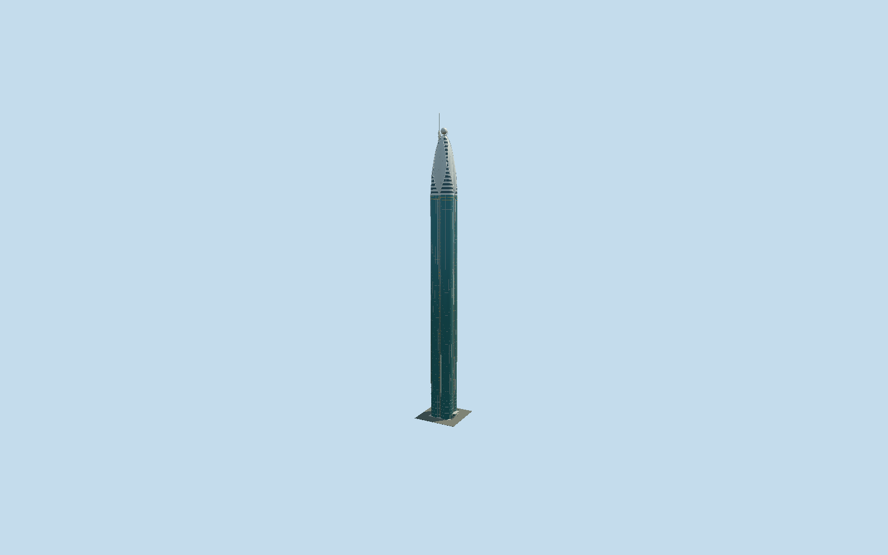

# Rose Rayhaan by Rotana

Dubai’s slender four-lobed blue-glass hotel with silver vertical recesses, physical gold eye rings and cornices, four curved silver crown petals, crossing tip ribbons, a sphere and offset northeast spire.

## Evidence and reconstruction

Published dimensions and reconstructed details are separated in spec.json. Primary references:

- [Reference](https://www.rotana.com/rayhaanhotelandresorts/unitedarabemirates/dubai/roserayhaanbyrotana)
- [Reference](https://www.manntech.com/project/the-rose-rayhaan-by-rotana/)
- [Reference](https://gxulighting.com/product/rose-rayhaan-hotel-by-rotana-2/)
- [Reference](https://www.skyscrapercenter.com/building/wd/369)
- [Reference](https://www.openstreetmap.org/way/64890199)

No third-party geometry, photograph or bitmap texture is embedded. Shared surface graphs come from the central library; vertex tints carry model colors. Glazing uses PBR materials; transparent surfaces are declared per model.

## Model and axes

61,560 triangles; 174,400 vertices; 3 material groups; 7,019,452 bytes. Native bounds: -16.850, 0.000, -12.062 to 13.351, 333.000, 13.500. Source hash: `sha256:d0e0109e26ce749bfe49417a7ffbc79233ef8364aedccd37a0d844251684417e`.

{"up":"+Y","longitudinal":"+X northeast","front":"-X southwest road/entry","origin":"Mapped rectangular envelope at reconstructed street datum"}

Fresh OSM API on 2026-10-10 confirms exact Q648338 whole 64890199 and sub-millimeter agreement with the stored prior georeferencing outline. Signed heading 1.011171401094 puts +X northeast, -X southwest toward Sheikh Zayed Road and +Z southeast. Operator aerial 0 looks southeast along the road toward the independently identified Burj Khalifa, fixing the northeast offset mast behind its petal. Mast [5.7,0], doorway/canopy and lobed radii remain photo reconstructions, not separately surveyed mapped features. Source Y=0 is reconstructed street entry and tip 333 m follows current operator/CVU; mapped 315 m is a roof-era envelope. Accept 2 m main-envelope / 1 degree reconstruction allowance, excluding projecting canopy; automatic footprint replacement disabled.

## Reproduce

Run `node packages/worldgen/scripts/generate-signature-towers.mjs --ids=rose_tower` (or add `--check`). The generator preserves manually edited masters by checking their baseline hashes. Import through the standard authored-model workflow with optimization disabled; then capture all QA cameras, including shared-surface views.

## Pending work

- Original 623480-triangle, 52717200-byte master remains exactly reproducible from unchanged recipe. Reviewed source/four browser levels retain four intersecting convex blue-glass lobes, silver vertical recesses, gold eyes/cornices, four curved silver crown petals and pale boundary ribs, alternating dark/light neighboring bands, crossing tip ribbons, sphere, offset northeast mast and southwest entry canopy. The original 245–246 m gap is closed with a shoulder panel. Whole facade backing panels and continuous strips replace per-pane beams; thin eye rings use planar ribbons rather than tubular segments. Skyline averages trim colour and omits small eyes/collars/door frames, district/street aggregate eyes and panel cadence and omit/aggregate fine crown seams; skyline/district use shallow curved petal boundary strips while street/close-up retain solid ribs; close-up retains all 248 eye rings at reduced arc sampling, 128 angular samples and closed boundary ribs. Two canonical shared graphs approximate stone and silver/gold coated metal; three draw groups and zero embedded images. Lobed radii, intermediate crown heights, leaf phase, entry/canopy and 5.7 m mast offset are photo reconstructions; only rectangular site envelope is mapped. Operator 72 / CVU 71 storeys remain distinct; their shared 333 m architectural height sets tip. Moving access equipment, signage, interiors and animated lighting excluded. Finite along-ray 1.5/.75/.3/.1 m allowances exclude omitted narrow eyes, mullions and collars; no global surface-distance, surveyed grade or physical-device claim.

This bundle follows the medium-fi standard. Medium-fi appearance and geographic fit are reviewed separately. Hash-bound visual acceptance is recorded separately after capture inspection.
