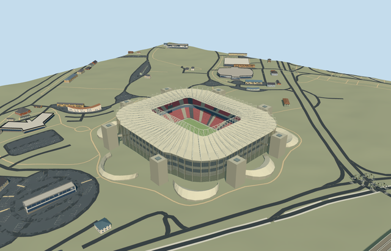

# ahmad_bin_ali_stadium — Ahmad bin Ali Stadium

Reviewed 2026-10-20 in one continuous author/build/inspect/fix round.

## Appearance

Inspected48 current views: source turntable/details, shared-surface placement, noon/late economy/high, all four LODs, native placement and failed load. Specific Ahmad bin Ali envelope, pale closed canopy/flying inner truss/radial frames and stays, open warm rosette screen/stand-off frame/recessed glazing/galleries, red-dark two-tier bowl/closed hospitality band/pale aisles/neutral football field/supported displays, eight native service cores/rooftop wells/concourse links and eight separate crescent dune pavilions. Corrected the initial radial-fill assumption for concave crescents, hidden repeated caps, camera obstruction/duplicate camera labels, roof-to-upper-bank clearance and display hanger connection within this one author/build/inspect pass. The broad canopy shelters much of the upper bank in close ground views; whole/native views and actual mesh checks establish both bands. Under-roof color and glazing are shared-material approximations, not photograph-exact optical matching.

## Shared materials and browser levels

Six shared256px graphs: concrete_plain, metal_painted, membrane, fabric_canvas, window_grid and new reusable metal_rosette_screen. No embedded images or unique atlas. The original analytic2m circular/eight-point rosette with100mm working strips uses actual alpha apertures/filtered coverage; baked mean alpha0.3267788756127457, transparent center/corners and opaque ring checks pass. All70 previous graph files remain byte-identical. Runtime binds each required graph once; six near draws/one skyline draw. Separate position/normal streams and equal CPU/GPU accounting avoid duplicate uploads.

| Level | Triangles | Bytes | Draws |
| --- | ---: | ---: | ---: |
| skyline | 928 | 83792 | 1 |
| district | 3582 | 332256 | 6 |
| street | 14894 | 1342372 | 6 |
| closeup | 49678 | 4626616 | 6 |

Four LODs retain the own roof aperture, flying ring, screen/body, two-tier bowl, eight service cores and eight crescent dune footprints. Far levels merge repeated rows/framing and omit hidden dune floors, small rooftop equipment and roof undersides. Initial skyline plus district416048 bytes is below3MB phone/6MB laptop targets. This establishes asset budgets and repeatable automated browser renders; physical laptop/phone/tablet and dense-city performance measurements remain pending. Levels928/3582/14894/49678 triangles; at most six draws.

## Approximate map fit

RetainedQ401643, named native stadiumPOI35184527125656, own parent52776560216314 and pitch35185393982237 establish identity. Own anchor[51.34232461452484,25.329593544582735]/heading0/native east-south/internal X[0.16516299613578334,-0.9862662848883416]/Z[0.9862662848883416,0.16516299613578334] follows the measured114.500589x72.806638m field surround. Retained reference is about148m away and is not the placement origin. Only17 main/core/dune records are replaced using17 whole-feature outlines with99.5percent coverage. All70 independent resident inputs of87 originals/all165 wider independent inputs remain unchanged. Original6m grid/native roads/172.84078433783725m2 water unchanged; the bounded main-floor opening preserves outside terrain and native component contacts. Actual PMTiles13/14 generalized complexes use bounded area clipping;15 removes all17 owned parents. All19 map-level cases pass. Failure retains87 originals/original ground; every unload restores ground/water/zero live geometry.

## Limits

Three structural pictures actually viewed on the architect gallery: exterior aerial, bowl panorama and external rosette closeup. A fourth furnished hospitality interior is supplemental context only; hidden furnished rooms are excluded. No pixels, seat lettering, event art or temporary pitch rigs copied. Native29-point outer/eight-point roof aperture and individual core/crescent footprints control the particular forms. Field4m below original anchor datum, facade/roof34.5/38.5m and flying ring48.5m above field, two-tier heights/rows/core equipment and crescent roof curves are picture-led estimates. Raised canopy clearance is verified at sampled upper-row triangles; no engineering/access certification is implied. One reusable rosette motif approximates the more varied photographed screen, rather than reproducing its entire motif inventory. Native datum/contacts remain original; dune plinths stay within individual footprints. Completed-reference era and fine20degree/2m facing are approximate; media upload timestamps do not establish exposure dates or current condition.

## Selected checks

Six Khronos files: zero errors/warnings.16053 actual mesh/material/contact checks; 48 current inspected views. Scene validation/sim30 and strict selected medium-fi audit pass. Source/runtime/LOD hashes and material bindings verified.

Rebuild: node packages/worldgen/scripts/generate-additional-landmarks.mjs --ids=ahmad_bin_ali_stadium; node packages/worldgen/scripts/import-structure-models.mjs --ids=ahmad_bin_ali_stadium; node packages/tooling/scripts/generate-landmark-lods.mjs --ids=ahmad_bin_ali_stadium --force.

Source: sha256:49cb962570eba5c6de80e94bf1c1b390b0809a97b7a5126ddb9464a8d2c9f0c6

Runtime: sha256:f65e109b5ccbd2fa9e35bf7dafb39573f66a1559b79895e536b819aea452fd61

Input: sha256:96fe942c5a1306627ee8467d6275f16efcae605fd59146fc6e91d2920823d252

## Viewed ordinary pictures

https://www.bdp.com/uk/projects/ahmad-bin-ali-stadium — https://www.bdp.com/_vercel/image?url=https:%2F%2Fbdp.payloadcms.app%2Fapi%2Fmedia%2Ffile%2Fahmad-bin-ali-stadium-06-migrated.jpg?u=2025-01-14T17:20:06.207Z&w=1536&q=90; BDP project gallery; individual photographer unspecified on inspected page; Copyright retained; viewed only/no photograph pixels copied. Viewed only; no pixels copied.

https://www.bdp.com/uk/projects/ahmad-bin-ali-stadium — https://www.bdp.com/_vercel/image?url=https:%2F%2Fbdp.payloadcms.app%2Fapi%2Fmedia%2Ffile%2Fahmad-bin-ali-stadium-14-migrated.jpg?u=2024-11-14T01:33:00.292Z&w=1536&q=90; BDP project gallery; individual photographer unspecified on inspected page; Copyright retained; viewed only/no photograph pixels copied. Viewed only; no pixels copied.

https://www.bdp.com/uk/projects/ahmad-bin-ali-stadium — https://www.bdp.com/_vercel/image?url=https:%2F%2Fbdp.payloadcms.app%2Fapi%2Fmedia%2Ffile%2Fahmad-bin-ali-stadium-08-migrated-1330x831.jpg?u=2024-11-14T01:33:00.301Z&w=1024&q=90; BDP project gallery; individual photographer unspecified on inspected page; Copyright retained; viewed only/no photograph pixels copied. Viewed only; no pixels copied.

https://www.bdp.com/uk/projects/ahmad-bin-ali-stadium — https://www.bdp.com/_vercel/image?url=https:%2F%2Fbdp.payloadcms.app%2Fapi%2Fmedia%2Ffile%2Fahmad-bin-ali-stadium-11-migrated.jpg?u=2024-11-14T01:33:00.318Z&w=1536&q=90; BDP project gallery; individual photographer unspecified on inspected page; Copyright retained; viewed only/no photograph pixels copied. Viewed only; no pixels copied.
