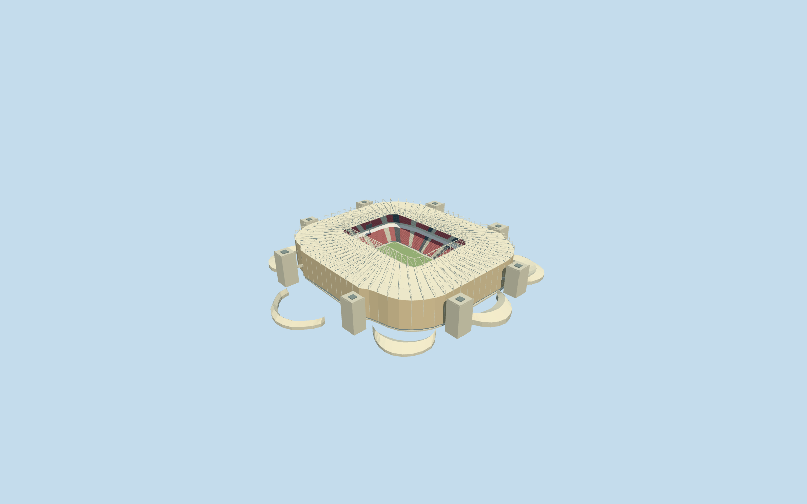

# Ahmad bin Ali Stadium

Specific completed-reference Ahmad bin Ali Stadium: own mapped rounded envelope/central roof aperture, warm open circular/eight-point star rosette enclosure with real shared alpha apertures/stand-off frames/recessed glazing and concrete galleries, closed pale canopy/deep flying inner truss/radial beams and stays/upper ring, two red-dark seating tiers/closed hospitality belt/pale aisles/neutral sunken football field/goals/supported displays, eight individually mapped projecting service cores/rooftop wells/concourse links and eight native-footprint curved dune pavilions. Six shared graphs including reusable analytic rosette screen; no private facade atlas/copied seat lettering/event imagery/hidden furnished rooms/whole precinct slab.

## Evidence and reconstruction

Published dimensions and reconstructed details are separated in spec.json. Primary references:

- [Reference](https://www.bdp.com/uk/projects/ahmad-bin-ali-stadium)

Specific completed-reference Ahmad bin Ali Stadium: own mapped rounded envelope/central roof aperture, warm open circular/eight-point star rosette enclosure with real shared alpha apertures/stand-off frames/recessed glazing and concrete galleries, closed pale canopy/deep flying inner truss/radial beams and stays/upper ring, two red-dark seating tiers/closed hospitality belt/pale aisles/neutral sunken football field/goals/supported displays, eight individually mapped projecting service cores/rooftop wells/concourse links and eight native-footprint curved dune pavilions. Six shared graphs including reusable analytic rosette screen; no private facade atlas/copied seat lettering/event imagery/hidden furnished rooms/whole precinct slab.

## Model and axes

49,678 triangles; 149,034 vertices; 6 material groups; 5,965,252 bytes. Native bounds: -162.839, -6.720, -147.321 to 132.613, 44.725, 145.703. Source hash: `sha256:49cb962570eba5c6de80e94bf1c1b390b0809a97b7a5126ddb9464a8d2c9f0c6`.

{"x":"east","y":"up","z":"south"}

The geographic proposal uses exact-QID OpenStreetMap evidence. Map-derived orientation and estimated architectural details require real-site visual review; preview eligibility is distinct from geographic/fidelity approval. Map attribution: © OpenStreetMap contributors, ODbL-1.0.

## Reproduce

Run `node packages/worldgen/scripts/generate-additional-landmarks.mjs --ids=ahmad_bin_ali_stadium` (or add `--check`). The generator preserves manually edited masters by checking their baseline hashes. Import through the standard authored-model workflow with optimization disabled; then capture all QA cameras, including shared-surface views.

## Pending work

- Specific completed-reference Ahmad bin Ali Stadium: own mapped rounded envelope/central roof aperture, warm open circular/eight-point star rosette enclosure with real shared alpha apertures/stand-off frames/recessed glazing and concrete galleries, closed pale canopy/deep flying inner truss/radial beams and stays/upper ring, two red-dark seating tiers/closed hospitality belt/pale aisles/neutral sunken football field/goals/supported displays, eight individually mapped projecting service cores/rooftop wells/concourse links and eight native-footprint curved dune pavilions. Six shared graphs including reusable analytic rosette screen; no private facade atlas/copied seat lettering/event imagery/hidden furnished rooms/whole precinct slab.
- RetainedQ401643 and named stadiumPOI35184527125656 identify native main parent52776560216314; separate pitch35185393982237 supplies114.500589x72.806638m own field-surround axis. Retained reference51.341279,25.330538 is about148m from the native field center and is not used as the model origin. Own anchor[51.34232461452484,25.329593544582735]/heading0/native east-south/internal X[0.16516299613578334,-0.9862662848883416]/Z[0.9862662848883416,0.16516299613578334]. Main29-point outer/eight-point roof hole are retained, approximately228x201m/125x86m; working lower opening is93percent roof aperture and neutral105x68m field remains separate. Eight rectangular mapped service cores35185257969357..364 and eight distinct native dune pavilions35185257969356/365..371 match the ordinary aerial. No exact-QID field in PMTiles; named point/own geometry/retained identity are the stated basis. Fine20degree/2m facing and component inventory remain approximate.
- No qualified native architectural height. Working field4m below original anchor datum is a visualization allocation; outer canopy34.5m/inner canopy38.5m/flying ring48.5m above field, two tiers1.4..13m/18..28m and closed belt13..18m/galleries7/16/26m/core tops34.7..36m above field are picture-led. Dune plinths retain their own footprints and extend below original minimum sample; roof eaves1.3m/rounded crest6.8m above highest boundary sample avoid terrain piercing. Rosette2m pitch/100mm strips and single eight-point motif approximate the more varied photographed facade. Structural counts/profiles/core equipment/bridges/optical transmission/current condition/hidden furnished hospitality rooms are not survey or engineering claims. Completed2020-reference era is modeled; upload timestamps are not photo dates.
- Original standard6m Mapzen grid/native roads/water and independent surrounding building inputs remain intact. Original datum38.77580361792348m defines modelY0; field is4m below it. Main-floor retaining base reaches below minimum original grade and a bounded opening stays inside the main body/all-level occupied floor. Core and dune foundations retain only their own footprints/individual original contacts, with no precinct-wide platform or terrain edits. Only17 owned main/core/dune records are replaced using99.5percent whole-feature coverage; generalized lower-zoom complexes use bounded area clipping. Failure/unload retains or restores original ground/native context.

This bundle follows the medium-fi standard. Medium-fi appearance and geographic fit are reviewed separately. Hash-bound visual acceptance is recorded separately after capture inspection.
