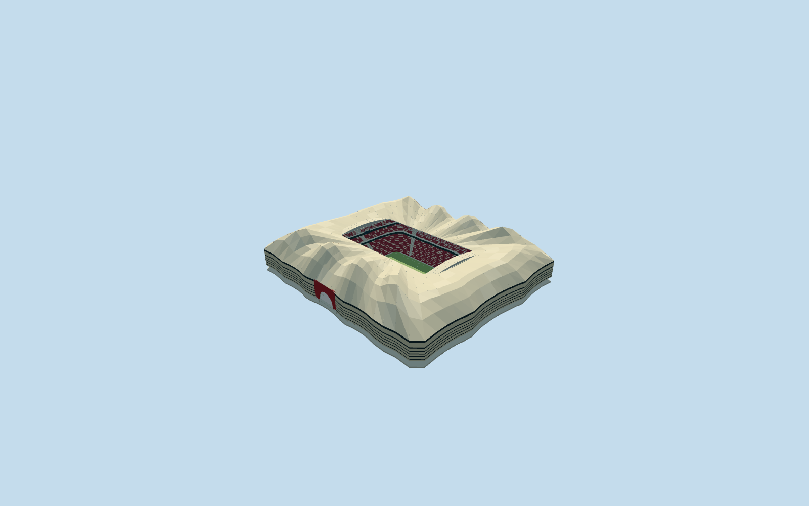

# Al Bayt Stadium

Specific Al Bayt Stadium: own native wavy rectangular tent body and rectangular open roof aperture, peaked pale fabric canopy/four principal peaks along each long side and connected curves/renderable red-dark-pale abstract woven lining, two parked arched retractable-roof packets/deep inner truss/radial lattice, horizontal cream/dark fabric stripes/two real recessed red arched entrances/closed glazed services/individual supports and decks, three burgundy-cream bowl bands/two closed box belts/open neutral football floor and supported displays/lights/marks/goals. Four existing shared concrete/paint/canvas/window-grid graphs. Coarsest level expands the simplified seating opening to retain the entire neutral field and merges peak/stripe repetitions. Static open-roof state, no unique texture atlas/copied graphics/hidden furnished rooms/mechanical movement simulation. Independent arrival-loop bridge, exhibition/site buildings, landscape/plaza/water are outside stadium-envelope scope.

## Evidence and reconstruction

Published dimensions and reconstructed details are separated in spec.json. Primary references:

- [Reference](https://dar.com/work/project/al-bayt-stadium)
- [Reference](https://www.webuildgroup.com/en/projects/stadiums/al-khor-sports-complex/)

Specific Al Bayt Stadium: own native wavy rectangular tent body and rectangular open roof aperture, peaked pale fabric canopy/four principal peaks along each long side and connected curves/renderable red-dark-pale abstract woven lining, two parked arched retractable-roof packets/deep inner truss/radial lattice, horizontal cream/dark fabric stripes/two real recessed red arched entrances/closed glazed services/individual supports and decks, three burgundy-cream bowl bands/two closed box belts/open neutral football floor and supported displays/lights/marks/goals. Four existing shared concrete/paint/canvas/window-grid graphs. Coarsest level expands the simplified seating opening to retain the entire neutral field and merges peak/stripe repetitions. Static open-roof state, no unique texture atlas/copied graphics/hidden furnished rooms/mechanical movement simulation. Independent arrival-loop bridge, exhibition/site buildings, landscape/plaza/water are outside stadium-envelope scope.

## Model and axes

50,900 triangles; 152,700 vertices; 5 material groups; 6,111,436 bytes. Native bounds: -133.335, -4.270, -155.911 to 133.271, 63.995, 151.133. Source hash: `sha256:569a092da07ce9f6a2b77fc8b6a37ad1e7175a5ce6e476620fda1045afa0b875`.

{"x":"east","y":"up","z":"south"}

The geographic proposal uses exact-QID OpenStreetMap evidence. Map-derived orientation and estimated architectural details require real-site visual review; preview eligibility is distinct from geographic/fidelity approval. Map attribution: © OpenStreetMap contributors, ODbL-1.0.

## Reproduce

Run `node packages/worldgen/scripts/generate-additional-landmarks.mjs --ids=al_bayt_stadium` (or add `--check`). The generator preserves manually edited masters by checking their baseline hashes. Import through the standard authored-model workflow with optimization disabled; then capture all QA cameras, including shared-surface views.

## Pending work

- Specific Al Bayt Stadium: own native wavy rectangular tent body and rectangular open roof aperture, peaked pale fabric canopy/four principal peaks along each long side and connected curves/renderable red-dark-pale abstract woven lining, two parked arched retractable-roof packets/deep inner truss/radial lattice, horizontal cream/dark fabric stripes/two real recessed red arched entrances/closed glazed services/individual supports and decks, three burgundy-cream bowl bands/two closed box belts/open neutral football floor and supported displays/lights/marks/goals. Four existing shared concrete/paint/canvas/window-grid graphs. Coarsest level expands the simplified seating opening to retain the entire neutral field and merges peak/stripe repetitions. Static open-roof state, no unique texture atlas/copied graphics/hidden furnished rooms/mechanical movement simulation. Independent arrival-loop bridge, exhibition/site buildings, landscape/plaza/water are outside stadium-envelope scope.
- RetainedQ1050220 reference and named native stadium POI35185087967817 identify Al Bayt at the sole approximately311x273m wavy rectangular native parent52776568079586. No exact-QID map field was present in extracted tiles. Own anchor[51.48781031370163,25.6521097622253]/heading0/native east-south; internal X[0.0033955661288077896,0.9999942350487151]/Z[-0.9999942350487151,0.0033955661288077896] follows158.570336x90.436016m native opening, not outer undirected footprint. Working1.5m aperture corner radius smooths a coarse six-point map opening; separate118x82m rounded bowl-surround and neutral105x68m field are not roof scale. Native source coordinates retained. Source designer page describes a larger372.5x310m tent/exhibition scope; that is not substituted for this mapped roof envelope. Fine20degree/2m facing/peak/stripe/row inventory remains approximate.
- No qualified architectural height in native parent. Working field3m below original anchor datum, field-relative tent hem7m/eave31m/ridge valleys51m/high peaks up to67m/inner aperture45m, parked roof packets45.1..49.8m, decks7/15/23m and tiers1.4..16/19..24/27..44m are picture-led allocations, not a survey. Four peaks per long side/catenary proxy/stripe and woven strip spacing/arch14m radius/portal44m width/row and framing counts are approximations. Shared opaque canvas/glazing do not reproduce exact fabric print or optical transmission. Photos are undated/include site works; later/current condition or planned tier changes are not inferred.
- Original standard6m Mapzen samples/native roads/water/independent site inputs remain unchanged. Original anchor datum defines modelY0; working field3m below it is a visual allocation, each outer support retains its own original contact. Occupied retaining floor and bounded opening within90percent body/common supported floor address coarse ground without sample/outside/water edits. Only the mapped stadium parent is replaced, no whole arrival plaza/landscape platform. Independent arrival-loop bridge and site works remain native context. Failure/unload retain or restore original ground/native context.

This bundle follows the medium-fi standard. Medium-fi appearance and geographic fit are reviewed separately. Hash-bound visual acceptance is recorded separately after capture inspection.
