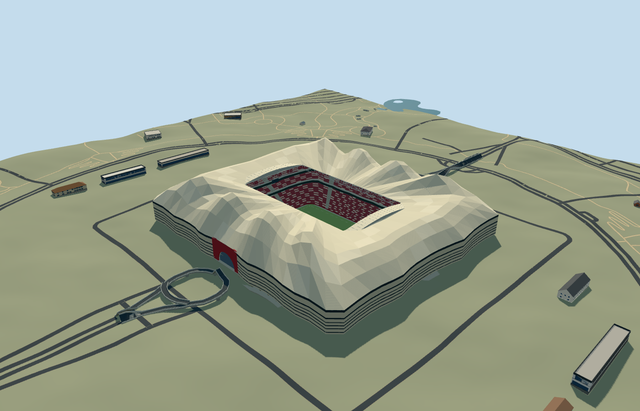

# N0720 — Al Bayt Stadium

Reviewed 2026-10-20 in one continuous author/build/inspect/fix round.

## Appearance

Inspected48 current portable/shared/sky-reflected medium-fi/native-Al-Khor views in one ordinary-picture/PMTiles/build/inspect/fix pass, plus full-size arch and bowl views. Own wavy rectangular tent body/open rectangular aperture, pale peaked fabric roof, cream/dark horizontal stripes/two red arched entrances/recessed glazing/services/supports/decks, red-dark-pale abstract woven lining/deep inner truss/radial lattice, two parked arched roof packets and three burgundy-cream bowl tiers/closed box belts/open neutral field/supported displays/lights/goals are present. Corrected roof-frame penetration, arch-front/roof-edge attachment, skyline field-corner clipping and excessively dark district stripe merging. No duplicate native stadium or missing facade. Individual seats and woven motifs are broad shared-surface/model patches, not copied lettering or photograph textures. Portable/synthetic flat context is separate from native fit.

## Shared materials and browser levels

Four existing256-square graphs: concrete_plain, metal_painted, fabric_canvas and window_grid. Concrete supplies services/decks/supports/retaining floor; tinted paint supplies tiers/frames/neutral marks/screens; shared canvas supplies pale tent/striped enclosure/red entrance/red-dark-pale lining/parked roof packets/turf grain; window-grid supplies opaque recessed glazing. Roof and wall canvas slots create five near draws; zero embedded images/unique atlas/copied pixels. Each shared graph read once. Metric repeats/linear tints/separate POSITION and NORMAL uploads/equal reported CPU and GPU geometry bytes pass. Shared canvas/closed glazing approximate fabric weave and optical appearance; no bespoke printed atlas or transmission simulation.

| Level | Triangles | Bytes | Draws |
| --- | ---: | ---: | ---: |
| skyline | 998 | 91336 | 1 |
| district | 3900 | 347684 | 5 |
| street | 14924 | 1378044 | 5 |
| closeup | 50900 | 4799272 | 5 |

Inspected24 noon/late Economy/High street/block/skyline/silhouette/matched-level/transition views with the viewer sky reflections enabled. All levels preserve mapped rectangular tent mass/open field/field axis/red entrance and burgundy bowl; nearer levels refine four principal peaks per long side, narrow fabric bands, arched roof packets, tier treads/aisles/box belts/radial framing and lining stripes. Coarsest level merges peak/stripe repetitions and expands its simplified seating opening to retain the full neutral pitch; its declared12m error allowance is intentionally larger than district/street/closeup. Initial skyline plus district439020bytes, below3MB phone/6MB laptop targets. Synthetic neighbors are not geographic evidence. Final district-only band adjustment reran district geometry/native placement; five byte-identical source/runtime/other LOD files carried their existing geometry checks. Physical ordinary-laptop/phone/tablet/dense-city timing remains pending. Levels998/3900/14924/50900 triangles; at most five draws.

## Approximate map fit

RetainedQ1050220 reference plus named native stadium POI35185087967817 and sole approximately311x273m native wavy rectangular parent52776568079586 establish individual identity. No exact-QID field was present in extracted map data. Own anchor[51.48781031370163,25.6521097622253]/heading0/native east-south; internal X[.0033955661288077896,.9999942350487151]/Z[-.9999942350487151,.0033955661288077896] follows158.570336x90.436016m native opening. Working1.5m aperture corners/separate118x82m lower bowl surround/neutral105x68m field are distinct. Native parent fully removed with zero residual record or area. All30 independent resident inputs of31 originals/40 wider records, original6m samples/native roads/12489.525014426283m2 source water unchanged; all39 wider independent footprints disjoint from mask.50mm native vertex guards/adaptive decomposition handle narrow original returns. Original datum3.986793244172882m/individual supports/occupied floor and bounded opening inside90percent body handle coarse terrain. Failure retains31 originals; every level unload restores ground/water/zero live model geometry. Independent approach-loop bridge/landscape/water remain native context; no whole park/plaza platform.

## Limits

Five ordinary project-gallery photographs actually viewed: four Dar exterior/approach/roof/oblique photos and Webuild finished bowl photograph. No individual photographer or exposure date was named; uploads are not exposure dates and site-work imagery does not certify later/current condition or planned upper-tier changes. Viewed only; no seat lettering/emblems/adverts/fabric print copied. Designer372.5x310m tent/exhibition scope is not substituted for the mapped approximately311x273m roof envelope. Native building has no qualified height. Working field3m below original datum, field-relative hem7m/eave31m/ridge valleys51m/peaks up to67m/aperture45m, parked packets45.1..49.8m, decks7/15/23m and tiers1.4..16/19..24/27..44m are picture-led allocations. Four peaks per long side/curve proxy/stripe and lining pattern/14m arch radius/44m portal width/row/light/support inventory and20degree/2m fine facing remain estimates. Shared opaque fabrics/glazing are not exact optical/print specifications. Static open roof, no mechanical animation/hidden furnished rooms/engineering or access certification. Independent arrival-loop bridge/exhibition buildings/site landscape are outside stadium-envelope scope; native paths are retained rather than reengineered. Original DEM/contact and bounded opening are visual controls, not a terrain survey or excavation design. Physical laptop/phone/tablet/dense-city timing remains pending.

## Selected checks

Six Khronos files: zero errors/warnings.27450 actual mesh/material/contact checks; 48 current inspected views. Scene validation/sim30 and strict selected medium-fi audit pass. Source/runtime/LOD hashes and material bindings verified.

Rebuild: node packages/worldgen/scripts/generate-additional-landmarks.mjs --ids=N0720; node packages/worldgen/scripts/import-next-1000-models.mjs --ids=N0720; node packages/tooling/scripts/generate-landmark-lods.mjs --ids=N0720 --force.

Source: sha256:569a092da07ce9f6a2b77fc8b6a37ad1e7175a5ce6e476620fda1045afa0b875

Runtime: sha256:a7c09e4ce22a3906e46490df2c51f94c4c6a5b759bc683bdf4532897c1206f12

Input: sha256:fae49c6a91fa33d8600d5e79c2a6eb1d1e7a94629d8d43bca184802ad8f682c6

## Viewed ordinary pictures

https://dar.com/work/project/al-bayt-stadium — https://dar.com/CMS/Content/ResizedImages/1287x10000xi/211227023137364~HeroImage.jpg; Dar Al-Handasah project gallery; individual photographer not named on inspected page; Copyright retained by rights holder; viewed only/no photograph pixels copied. Viewed only; no pixels copied.

https://dar.com/work/project/al-bayt-stadium — https://dar.com/CMS/Content/ResizedImages/1287x10000xi/211227023154307~Image1.jpg; Dar Al-Handasah project gallery; individual photographer not named on inspected page; Copyright retained by rights holder; viewed only/no photograph pixels copied. Viewed only; no pixels copied.

https://dar.com/work/project/al-bayt-stadium — https://dar.com/CMS/Content/ResizedImages/1287x10000xi/211227021545495~Image1.jpg; Dar Al-Handasah project gallery; individual photographer not named on inspected page; Copyright retained by rights holder; viewed only/no photograph pixels copied. Viewed only; no pixels copied.

https://dar.com/work/project/al-bayt-stadium — https://dar.com/CMS/Content/ResizedImages/1287x10000xi/211227021546542~Image2.jpg; Dar Al-Handasah project gallery; individual photographer not named on inspected page; Copyright retained by rights holder; viewed only/no photograph pixels copied. Viewed only; no pixels copied.

https://www.webuildgroup.com/en/projects/stadiums/al-khor-sports-complex/ — https://www.webuildgroup.com/_next/image/?q=75&url=https%3A%2F%2Fmedia.webuildgroup.com%2Fsites%2Fdefault%2Ffiles%2F2023-05%2FAl%252520Bayt%252520Stadium%252520-%252520Al%252520Khor%252520City%25252013-ridotta_edited.jpg&w=3840; Webuild project gallery; individual photographer not named on inspected page; Copyright retained by rights holder; viewed only/no photograph pixels copied. Viewed only; no pixels copied.
