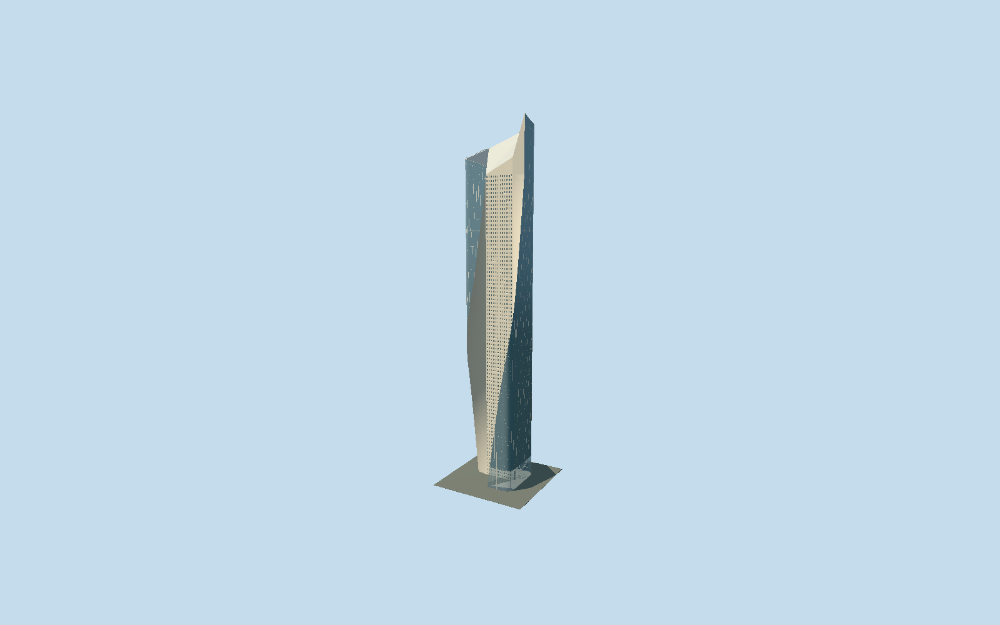

# Al Hamra Tower

Kuwait’s sculpted tower with a fixed rounded glass envelope, southwest-to-southeast moving courtyard cut, two continuous limestone flares, deep angled south-wall windows, sloping east blade and24m lamella-framed north entrance.

## Evidence and reconstruction

Published dimensions and reconstructed details are separated in spec.json. Primary references:

- [Reference](https://www.som.com/projects/al-hamra-tower/)
- [Reference](https://efficiencylab.org/media/EL-Portfolio-1.pdf)
- [Reference](https://usmodernist.org/AR/AR-2012-05.pdf)
- [Reference](https://www.skyscrapercenter.com/building/building/208)
- [Reference](https://www.openstreetmap.org/way/188381326)

No third-party geometry, photograph or bitmap texture is embedded. Shared surface graphs come from the central library; vertex tints carry model colors. Glazing uses PBR materials; transparent surfaces are declared per model.

## Model and axes

50,250 triangles; 147,856 vertices; 4 material groups; 5,928,528 bytes. Native bounds: -30.082, 0.000, -41.012 to 30.106, 412.592, 29.380. Source hash: `sha256:59f5ca998d6ae6d4d3ef459aeacfdca2f7852cdddf7c25c9a063f5baa7eb9927`.

{"up":"+Y","longitudinal":"+X east-southeast","front":"+Z south-southwest courtyard; -Z north entrance","origin":"Reconstructed street-level tower frame"}

Fresh OSM API on 2026-10-10 confirms exact Q557933 whole way 188381326; independently retained map-parts geometry is unchanged. Signed heading -0.16301785935 puts native +X east-southeast, +Z south-southwest and -Z north-northeast. Architectural Record printed page 152 site/lobby plans with north arrows independently establish the northern entry, southern shopping mall and eastern parking block. Printed page 150 sections establish the courtyard moving southwest at grade to southeast near the top; a coarse whole rectangle is not the occupied floor shape. Native Y=0 is reconstructed street entry; no measured local grade. Accept 2 m footprint / 1 degree reconstruction allowance; automatic replacement disabled. Separate shopping mall, parking block, neighbouring towers and road grade are outside this tower scope.

## Reproduce

Run `node packages/worldgen/scripts/generate-signature-towers.mjs --ids=al_hamra_tower` (or add `--check`). The generator preserves manually edited masters by checking their baseline hashes. Import through the standard authored-model workflow with optimization disabled; then capture all QA cameras, including shared-surface views.

## Pending work

- Original 155029-triangle, 18088600-byte master remains exactly reproducible from the unchanged original recipe. Reviewed source and four browser levels keep the fixed filleted glass envelope, continuously moving southern courtyard, two ruled limestone flares, deeply angled south-wall windows, inclined closed roof/east blade, 24 m north lamella and supported canopy. Whole backing panels with long trim strips replace independent framed cells; adjacent stone windows share continuous piers. Skyline averages thin glazing trim, omits individual apertures/door frames/hidden lamella and makes lobby glazing opaque. District uses twenty south-window rows/six columns and aggregates thin trim; street retains all 960 deeply splayed openings but aggregates facade rails; close-up restores finer rails and curved canopy branches. Canonical limestone approximates Jura/trencadis; painted metal approximates canopy stainless to share the glazing-trim graph. Near lobby and canopy clear glass uses distinct explicit portable/runtime references and a single transparent group, required to see the lamella; other glazing is opaque. Fixed non-planar roof triangulation is shared across levels; sampled ruled flares retain courtyard geometry. Far copings use flat strips. Canopy support bases are repaired from mistaken size-as-bounds arguments. Exact fillet radius, window schedule/reveal depth, lamella members, parapet profile and canopy dimensions are reconstructions from published photos/plans. Designer 74, Architectural Record 77 and CTBUH 80 storeys use different counts and remain recorded; 412.6 m top and 351.2 m occupied heights follow CTBUH. Mall, parking block, interior fittings, signage and animated lighting are excluded. Finite along-ray allowances 1.5/.75/.3/.1 m exclude thin mullions, coping edges and omitted/aggregated district apertures; they are not global surface-distance bounds. No physical-device or surveyed grade claim.

This bundle follows the medium-fi standard. Medium-fi appearance and geographic fit are reviewed separately. Hash-bound visual acceptance is recorded separately after capture inspection.
