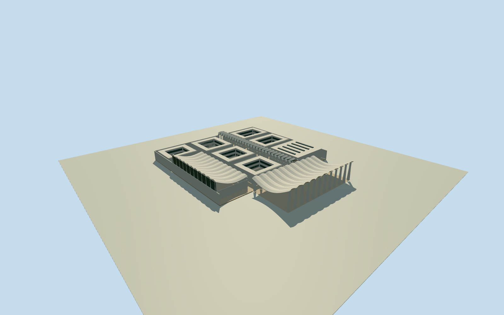

# Kuwait National Assembly Building (2021)

Whole original Utzon National Assembly, approximate2021: orthogonal courtyard office compound, complete assembly and conference volumes, seaward public shell canopy, covered central street and photographed entrance. Native154717742 merges original and later southwest curved construction; original rectangular core/junction is an explicit estimate around the exact building/story coordinate. Retain the five native seaward canopy/NE boundary controls and eastern rear edge; exclude curved southwest HOK Members extension, separate Information Centre, northeast National Museum and all neighbors. No single entrance-only substitute.

Authoring state: **review-in-qa.json**. Current completion evidence is in [qa.json](qa.json) and the [completion ledger](../../../../qualla-structures/batches/qualla-002.PROGRESS.md).

- [Kuwait National Assembly Building](https://qualla.com/kuwait-national-assembly-building/)

Whole original Utzon National Assembly, approximate2021: orthogonal courtyard office compound, complete assembly and conference volumes, seaward public shell canopy, covered central street and photographed entrance. Native154717742 merges original and later southwest curved construction; original rectangular core/junction is an explicit estimate around the exact building/story coordinate. Retain the five native seaward canopy/NE boundary controls and eastern rear edge; exclude curved southwest HOK Members extension, separate Information Centre, northeast National Museum and all neighbors. No single entrance-only substitute.

Only the clear government2021 entrance original supplies photographic architectural detail. Whole roof/court layout uses primary architectural text and approximate native registration; no whole-exterior photography or exact hidden census claimed.

Original field/frame chosen before all floors/roof/main sections; preserve without refit after viewing.

The generic native6storey/30m tag is not applied to the original two-level courtyard offices. Existing northeast Museum group explicitly excluded.

Original/extension join near southwest edge is an explicit geometric estimate. Native154717742 includes later curved construction and is not extruded as a solid original building; exactoriginal151.58x130.879m compound proportions, courts and interior partitions are approximate. No certified native component segmentation.

All numeric heights, shell curvature/thickness, six patio positions, hidden walls, column dimensions/census, screen mullion spacing and historical registration are estimates. Photo supports only smooth white entry concrete/chevron screen/stone threshold; primary architecture establishes whole building typology.

Original coastal terrain has large composite DEM artifacts, absolute-40.5917..29.7003m; field15.9095m datum preserved. Context may obscure floors or lower walls; no ground-contact/survey/current2026 claim.

Exclude separate HOK extension/Information Centre, National Museum, mosques, site landscape, guards/people, flags/emblems, protected archive images, copied ornament and photographic textures. Public plaza and empty intrinsic assembly volume have structural floors/roof/supports only.

Build: `node content/worldgen/source/places/tj/tj4/kuwait_national_assembly_building/models/generate-house.mjs`. Add `--check` to verify exact regeneration. 20986 triangles; 4 materials; no embedded photographs.
