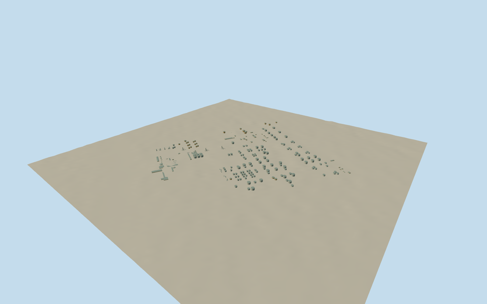

# Abadan Refinery

Complete mapped refinery structure layout:204native oil-storage tanks and74halls/other structures, using full original ways/nodes and tagged heights. Pale metal cylinders, low conical roofs, concrete footings, industrial halls, ladders, vessel catwalks and pipe racks interpret two cleared1970NIOC photographs. Unmapped process equipment is approximate and explicitly identified; adjacent city and detached river industry excluded.

Authoring state: **review-in-qa.json**. Current completion evidence is in [qa.json](qa.json) and the [completion ledger](../../../../qualla-structures/batches/qualla-002.PROGRESS.md).

- [Abadan Refinery](https://qualla.com/abadan-refinery/)

Full original native ways/nodes locate204tagged oil-storage tanks and74other mapped structures. Tagged heights/levels are retained; missing heights, small roof falls, ladders, hall openings and material colors are photographic medium-fi estimates. Fine components retire in distant LODs while large tank-farm groups and principal halls remain.

Two Qualla-published NIOC photographs explicitly dated1970-09 and carrying PD Iran control industrial form/material typology. The native plan is current mapping, not a claim that every1970equipment item survives unchanged. Original pixels are not textures.

Three compact process-column/rack/vessel groups in the open process quarter are photographic interpretations of intrinsic refinery equipment absent from mapping. Their exact locations, inventory, pipe routing and heights are approximate, not an engineering or current as-built survey. No branded labels, people, flame/smoke or active process simulation.

The site spans about2.8by3.1km. Host terrain and foundation contact use one approximate shared dry-yard datum; source terrain is preserved and no whole-site platform or blanket ground cutout is introduced. City, hospital, airport and detached river industry are excluded.

Build: `node packages/worldgen/scripts/generate-authored-places.mjs --ids=abadan_refinery`. Add `--check` to verify exact regeneration. 62886 triangles; 4 materials; no embedded photographs.
