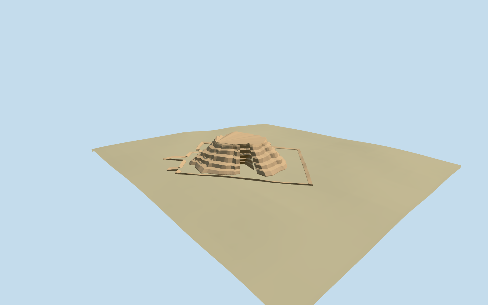

# eanna — Eanna

Reviewed2026-10-19 in one continuous author/build/inspect/fix round.

## Appearance

Inspected all48 final current source/shared/medium-fi/native-site/fallback views. The specific irregular mapped Eanna ziggurat core has broken brick shelves, eroded side notches/runoff grooves and a low uneven open crown. The separate mapped lower perimeter is a low weathered edge around retained native ground. Same-round images led to a broader irregular crown, varied ledges, removal of a continuous slab and redundant internal endcaps that caused repeated seam artifacts. The two ordinary photographs guide exposed-earth/brick appearance; no intact summit shrine or restored ancient staircase is modeled.

## Shared materials and browser levels

Two reused256-square graphs: earth_adobe and brick_longformat. Metric UVs with muted linear ochre/earth tints; both graphs read once through the production material resolver. No embedded images or unique atlas. Four levels682 /1904 /3440 /5472triangles, at most two draws, initial285944bytes. Separate GPU streams and matching CPU/GPU byte accounting; all geometry, draw and initial-download budgets pass. Eviction disposes all model geometry.

| Level | Triangles | Bytes | Draws |
| --- | ---: | ---: | ---: |
| skyline | 682 | 76372 | 1 |
| district | 1904 | 209572 | 2 |
| street | 3440 | 376396 | 2 |
| closeup | 5472 | 597284 | 2 |

Inspected current noon/late, economy/high, silhouette, three architectural views, all authored levels and transitions. Skyline retains the low irregular core/crown and mapped perimeter; district restores the broken shelf profile and shared brick surfaces. Street/close levels refine the outlines and erosion. Flat stages expose buried lower feet; native site/source terrain views establish contact. The native integration fixture uses green fallback ground and existing procedural buildings, which prove terrain/context preservation rather than actual desert landcover or neighboring facade style.

## Approximate map fit

Candidate Q706970 denotes the Eanna complex. Its broad reference point is roughly455m southwest of the named mapped ziggurat constituent; the nearby Eanna District point and inspected ordinary Eanna photograph establish the reviewed constituent association. Model only that surviving ziggurat at native controls35185683624247 and35185683624248, preserving their irregular lower/core footprints (about74x70m outer native extent). Native east/south at heading0 with mapped architectural axis about+0.828849rad; no signed doorway orientation claimed. Replace just those two overlapping procedural shells using2cm numeric margin. All six independent native buildings remain byte-equivalent; original six-meter terrain and water stay unchanged. Local buried perimeter/core feet retain grade. Four loaded levels keep six native buildings; failure keeps all eight originals; unloading restores ground/water and releases geometry.

## Limits

Accepted medium-fi visualization of the dominant exposed Eanna/Inanna ziggurat constituent from two ordinary photos and standard PMTiles/Mapzen data. The larger Eanna precinct and other temple remains are not reconstructed; unmodeled context remains native terrain. About9.6m core height, shelf survival, low perimeter height/width, individual erosion slots, crown and foot thresholds are explicit visual approximations. The close photograph has a generic Uruk title and supplies surface/profile vocabulary; the explicitly named Eanna view and named map controls establish location. No exact brick inventory, surveyed excavation model, summit temple, ancient staircase, buried room grid or modern summit marker is claimed. Physical-device and dense-city timing measurements remain pending.

## Selected checks

Six Khronos files: zero errors/warnings.174 actual geometry/contact probes; 48 current inspected views. Scene validation/sim30 and strict selected medium-fi audit pass. Source and runtime hashes/material bindings/LOD caps verified.

Rebuild: node packages/worldgen/scripts/generate-additional-landmarks.mjs --ids=eanna; node packages/worldgen/scripts/import-structure-models.mjs --ids=eanna; node packages/tooling/scripts/generate-landmark-lods.mjs --ids=eanna --force.

Source: sha256:289b714ba0f09df1f0cdd1253a4074f808ba823e139576a1912c39bf0c8c6975

Runtime: sha256:6e55664a24bb841db015b61371c9fcf7b9f89f30e087347b3ebb62dc32eaea6f

Input: sha256:4dacabbe8f087bdf0d3d11c61c0161e6c98652c022978847bc0026d6804fc0a5

## Viewed ordinary pictures

https://commons.wikimedia.org/wiki/File:Eanna_Ziggurat_West_Corner_Far_View.jpg — Marjon Verburg; CC0-1.0; viewed only. Viewed only; no pixels copied.

https://commons.wikimedia.org/wiki/File:Uruk_ziggurat_(1).jpg — tobeytravels; CCBYSA2.0; viewed only. Viewed only; no pixels copied.

## Source binding maintenance — 550 checkpoint

Exact prior input reconstructed using prior recipe list and preserved helper text. Seven helper edits change only the first comment line, making existing source recipes explicit. All six approved model files are unchanged. Existing visual acceptance is retained through byte-equivalent rebuilding; this is not a new visual review.

Previous input: sha256:4dacabbe8f087bdf0d3d11c61c0161e6c98652c022978847bc0026d6804fc0a5

Current input: sha256:9cf5ce0716fd93737e601b5ff9987698755494d35854b12f8f149be7990c1203
