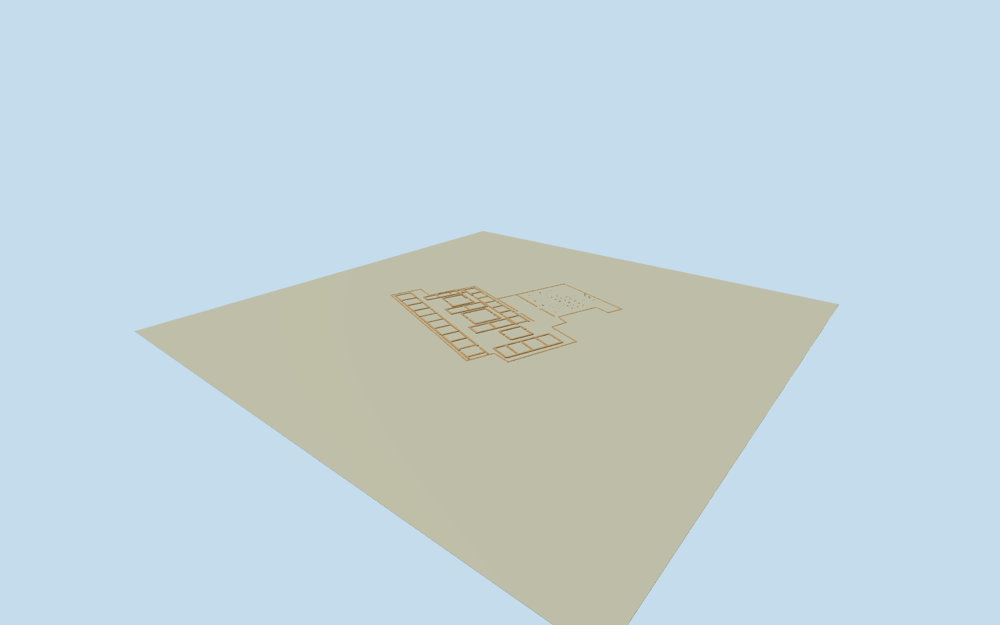

# Palace of Darius in Susa

Whole surviving Palace of Darius in Susa/Q1729938 ruins: complete named palace footprintway378357186/all16uniquecontrols, intrinsic separate Darius Gate foundationway378357152/allfourcontrols, and all four mapped historic wall lines380592011/012/018/063. Low roofless mud-brick room/courtyard foundations, Apadana hypostyle hall with pale broken column bases/stumps, northern bell-shaped fluted remnants and exposed excavated foundation face; surviving condition from six clear Qualla creatorPD photographs. No reconstructed tall palace/hypostyle roof/full intact columns. Whole physical ruins retained, not a decorative isolated column. Eroded sections, exact individual wall/stone survival census and unseen/excavated detail are bounded estimates, with metric room/column plan confidence recorded before construction. Exclude later Shush Castleway378357151, Susa Museum378357783, wider RoyalCity378357184, Acropolis/whole tepe/landscape/roads/vegetation, Louvre reconstruction/museum objects and private interiors.

Authoring state: **review-in-qa.json**. Current completion evidence is in [qa.json](qa.json) and the [completion ledger](../../../../qualla-structures/batches/qualla-002.PROGRESS.md).

- [Palace of Darius in Susa](https://qualla.com/palace-of-darius-in-susa/)

Actual named palace archaeological footprintway378357186 and separate named Darius Gate foundation378357152 are architectural boundary controls, not roof outlines or vertical wall heights. All16 palace/four gate native controls preserved; allfour historic wall lines retained in original positions. Exact Wikipedia identityQ1729938 confirms palace; nearby labelnode6390306285 is reference only. WiderRoyalCity heritagearea378357184 and ShushCastle378357151 are distinct exclusions. Fixed wholepalace+gate bbox midpoint/+Xeast/+Zsouth/heading0, working axes along southern native palace edge. Native outlines alone do not measure each excavated room/column location or surviving wallheight; no modern protected plan is silently copied.

Original1000m field/16641samples/four rawtiles frozen before any floor or geometry. Fixed SWdatum84.5893m; main floor+3m and gatefloor−2m are separate flat structural reference estimates chosen after viewing the immutable field, not terrain edits or survey certification. Palace wall bands/room foundations about.4–1.2m high, broad2.4m low mud-brick walls and three open courtyard groupings, main square/bell stone remnants andtwo taller broken northern shafts follow clear2007ruin photos. Full native boundaries and four mapped wall lines retained. Unmapped room passages/survival census/absolute historical grid origin/individual chipped-stone shapes/2.6m excavation lining are original bounded estimates. No intact ancient roof, full-height colonnade, whole tepe mesh or neighboring ShushCastle. Groundgrid/PNG/rawtiles unchanged; exact floor/footing/host contact unresolved/replacementfalse.

Whole low roofless palace/gate ruin model: all16 palace/four gate native boundary controls and allfour original historic wall lines, low broad mud-brick room foundations/three open courtyard groupings, exposed intrinsic excavation lining, low square stone remnants/bell bases/two taller broken northern shafts. Native archaeological boundaries are overall extents, not proof that every perimeter wall survives. Unmapped room partitions/door gaps/surviving stone census and erosion are bounded original estimates from the clear ruin family; no claim of a complete measured current excavation plan.

Six exact published Qualla Pentocelo April2007 Own/PD-self original exteriors/column/foundation views individually inspected/nativeSHA1matched. Museum friezes/reconstruction display/unknown artifact views excluded. Original1857 library text/NOT_IN_COPYRIGHT and exact native text hash supplies factual6x6 organization/8.3058m axis pitch/2.4384m square pedestals, three original12-column porticoes; no book image/modern protected drawing used.21 low central remnants andsix portico bell remnants are bounded surviving-family estimates, not72 restored intact columns or a certified present census.

The ruins have no intact hypostyle roof, tall palace facade or complete ancient bull capitals at this site. Northern short fluted shafts/bell remnants stay broken/low. Later ShushCastle, SusaMuseum, widerRoyalCity/Acropolis/tepe, vegetation/roads/landscape/people/signs/ropes and private museum interiors are absent. Only constructed courtyard/gate floor patches and foundation masonry, no whole-site terrain plate.

Independent1000m129x129field/16641samples/four rawTerrariumtiles frozen before all floor/section/geometry decisions and unchanged. Mainfloor+3m/gatefloor−2m relative to fixed84.5893mSWdatum are unsurveyed separate architectural references. The flat portable/context fixture near mainfloor can hide the lowergate/deep excavation; transparent-background whole turntables and additional model-only detail show all geometry. Exact native mound/floor/threshold/excavation contact remains unresolved; geographicpreview/replaceFootprintfalse, no artificial tepe or source terrain changes.

Build: `node packages/worldgen/scripts/generate-authored-places.mjs --ids=palace_of_darius_in_susa`. Add `--check` to verify exact regeneration. 20578 triangles; 5 materials; no embedded photographs.
