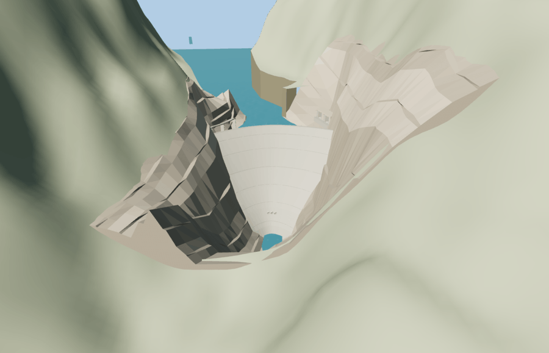

# Dez Dam

The original model includes the thin double-curvature wall and its horizontal construction bands, two recessed east-bank spillway mouths, the west-bank intake ledge, three irrigation outlet collars and a local layered canyon collar.

The native viewer shows a 317 m partial fill below the approximately 354 m crest. The mapped river line clears the crest and arch face, and a small 187.4 m receiving pool sits below the outlet collars. The adjusted opening lets the native shoulders meet the modeled canyon and keeps both mapped buildings and all 24 roads.

Failed loading preserves the native layers. Eviction restores the ground and releases model geometry.

| Detail level | Triangles | Download bytes | Draws |
| --- | ---: | ---: | ---: |
| skyline | 956 | 99,300 | 1 |
| district | 2,008 | 210,252 | 4 |
| street | 3,952 | 410,216 | 4 |
| closeup | 9,166 | 983,204 | 4 |

Skyline and district total 309,552 bytes. Six GLBs pass Khronos validation and contain zero embedded images. Four shared material graphs bind in the viewer. The review covers 78 renders and 85 geographic samples.

The reservoir and receiving-pool heights are representative static stages. The coarse terrain shapes the upstream banks. The modeled rock layers and bank contacts remain simplified, with visible seams at some angles.

The outlet pool represents the immediate foot of the dam. Operating discharge and the underground tunnel network are outside this exterior model.

[Mapped site frame](map-frame.json) · [Terrain and water fit](site-fit.json) · [QA evidence](qa.json)
