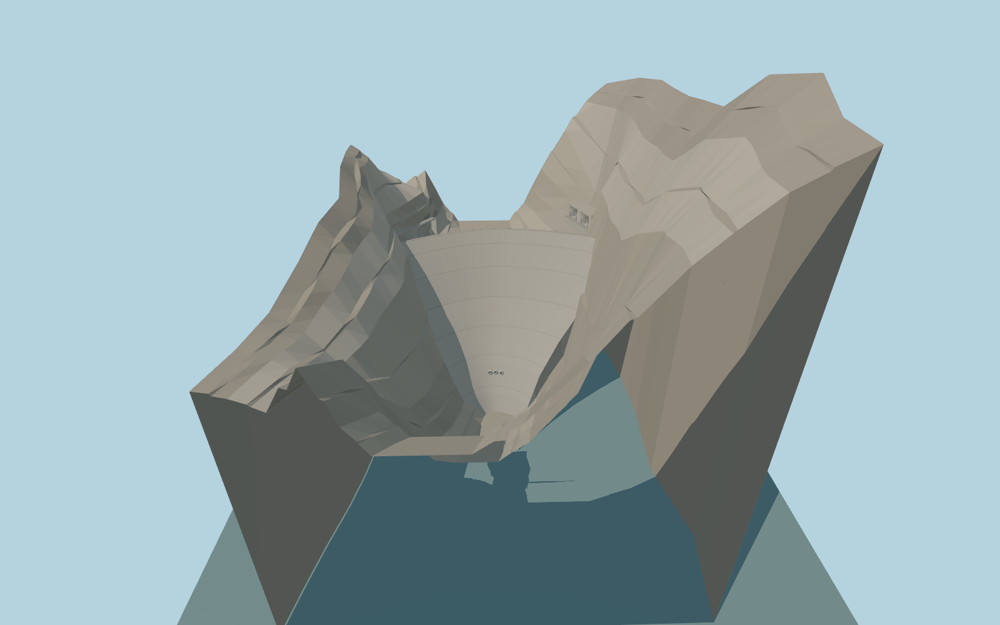

# Dez Dam

Dez Dam’s thin double-curvature concrete arch, two east-bank spillway tunnel mouths and ledge, west-bank intake gallery, irrigation outlet mouths and occupied canyon contacts.

Rebuild: `node packages/worldgen/scripts/generate-dez-dam.mjs`;append `--check` for exact source bytes. Select import/LOD/placement with `--ids=dez_dam`. Detailed source and four browser tiers are separate ignored GLB outputs.

The model uses a nominal 354 m crest. An unchanged west-bank Terrarium sample at model-local [−182, −44] gives the matching model contact. The partial-fill review plane is 317 m. The production water sampler gives 364.72–377.19 m in the retained reservoir windows.

The 206 m chord follows nine PMTiles reservoir-edge vertices. The builder describes the 203.5 m maximum wall height, 4.5 m crest thickness and 21 m base thickness.

The reviewed local canyon collar replaces the overly high terrain immediately surrounding the arch. Its cliff profiles, partial-fill water plane and exact equipment details are illustrative. The adjacent native land heights remain available.

Default runtime water estimates exceed the nominal crest by 10.7–23.2 m. The downstream map supplies a river line and no local water polygon. The viewer placement therefore remains a preview pending the runtime reservoir datum and canyon fit.

Original geometry:repository license. Map:© OpenStreetMap contributors,ODbL-1.0;Protomaps. Standard terrain:terrain-grid.json. Ordinary pictures stay local and are not redistributed or used as textures. Current acceptance:qa.json.
