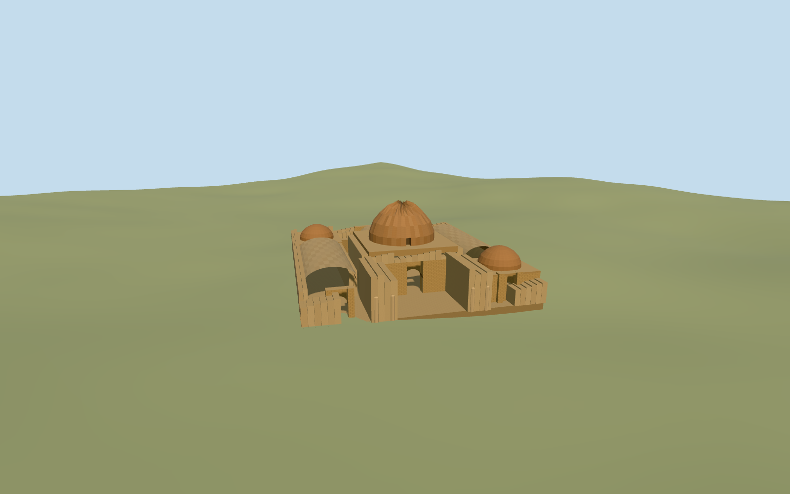

# Sarvestan Palace

Standing Sarvestan ruin with the fractured masonry of the front iwans, an exposed brick dome, vaulted side chambers and open court.

Authoring state: **review-in-qa.json**. Current completion evidence is in [qa.json](qa.json) and the [completion ledger](../../../../qualla-structures/batches/qualla-003.PROGRESS.md).

- [Sarvestan Palace](https://qualla.com/sarvestan-palace/)

The model represents the standing and restored ruin with exposed masonry, no theoretical original roof reconstruction.

Roof and wall losses, decayed ornament, secondary room dividers, roof profiles and elevations are approximate. Modern maintenance equipment and visitor infrastructure are excluded.

Original terrain stays unchanged and fixes approximate grade, not survey thresholds.

Build: `node content/worldgen/source/places/tj/tjj/sarvestan_palace/models/generate-sarvestan-palace.mjs`. Add `--check` to verify exact regeneration. 5164 triangles; 7 materials; no embedded photographs.
