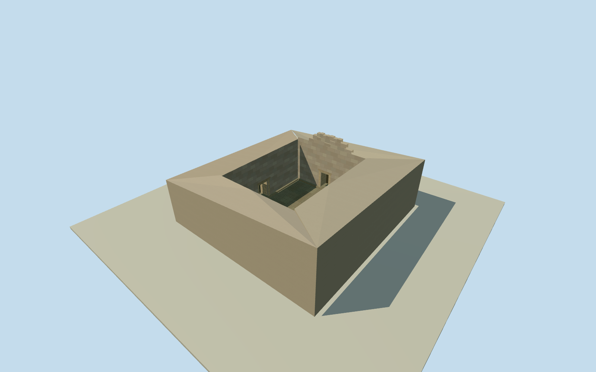

# Temple of Anahita, Bishapur

Surviving stone walls, excavated paved court and rectangular doorways of the Temple of Anahita at Bishapur.

Authoring state: **review-in-qa.json**. Current completion evidence is in [qa.json](qa.json) and the [completion ledger](../../../../qualla-structures/batches/qualla-003.PROGRESS.md).

- [Temple of Anahita: Where Water Was Worship](https://qualla.com/temple-of-anahita-bishapur/)

The March 2025 excavated ruins are represented as found. The precise depth and wall-top elevations are approximate.

The courtyard opening follows the mapped excavation with a small overlap into the stone. The original elevation field remains unchanged.

Roof reconstruction, underground passages, adjacent ruins and uncertain ancient details are outside this model.

Build: `node content/worldgen/source/places/tj/tjk/temple_of_anahita_bishapur/models/generate-temple.mjs`. Add `--check` to verify exact regeneration. 1676 triangles; 4 materials; no embedded photographs.
