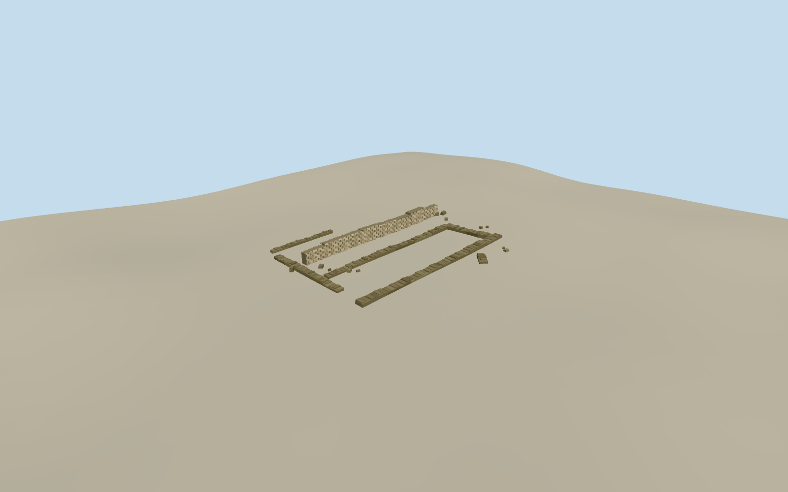

# Valerian Palace

Valerian Palace in Bishapur, with an exposed wall of squared stone, an open excavated passage, fallen blocks and low stone foundations.

Authoring state: **review-in-qa.json**. Current completion evidence is in [qa.json](qa.json) and the [completion ledger](../../../../qualla-structures/batches/qualla-003.PROGRESS.md).

- [Valerian Palace: The Emperor's Gilded Cage](https://qualla.com/valerian-palace/)

The mapped envelope describes the site extent. The precise placement of individual surviving walls, sandstone tones, course heights and trench grade are estimates from two close views.

The geometry depicts the exposed ruin as photographed in 2025. The neighboring Anahita Temple, Mosaic Porch, monumental reliefs and the proposed historical palace volume are outside the modeled extent.

The original elevation field is a composite DEM, which cannot resolve the excavated trench. Some low foundation courses may be obscured when it is viewed with the original field.

Build: `node content/worldgen/source/places/tj/tjk/valerian_palace/models/generate-valerian-palace.mjs`. Add `--check` to verify exact regeneration. 8100 triangles; 2 materials; no embedded photographs.
