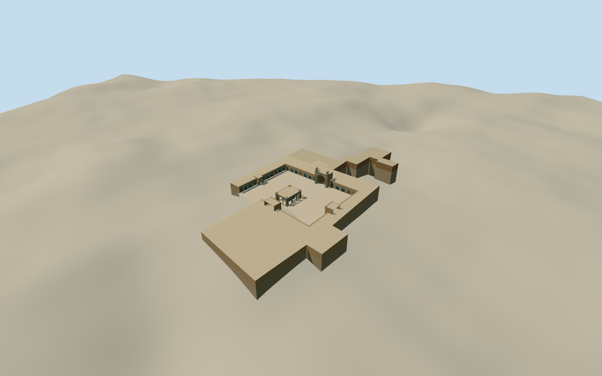

# Atiq Jameh Mosque of Shiraz

The Atiq Jameh Mosque in Shiraz with its open court, four ranges, north entrance turrets and the central Khuda Khane pavilion.

Authoring state: **review-in-qa.json**. Current completion evidence is in [qa.json](qa.json) and the [completion ledger](../../../../qualla-structures/batches/qualla-003.PROGRESS.md).

- [The Oldest Mosque in Shiraz: Built on Fire, Rebuilt by Time](https://qualla.com/ancient-congregational-mosque-of-shiraz/)

The mosque outline, attached north range and separate courtyard pavilion are mapped. The partition of the prayer halls and the positions and heights of the west, south and east inner portals are estimates.

The public-domain north iwan and pavilion photos guide the architectural features, colors and material contrast. Tile designs, the calligraphic frieze, roofs and ornamental detail are simplified. No text is reproduced.

The exterior includes the open courtyard as the mosque’s architectural setting. The adjacent Shah Cheragh shrine and other separate sites are excluded.

Build: `node content/worldgen/source/places/tj/tjm/ancient_congregational_mosque_of_shiraz/models/generate-ancient-congregational-mosque-of-shiraz.mjs`. Add `--check` to verify exact regeneration. 9739 triangles; 8 materials; no embedded photographs.
