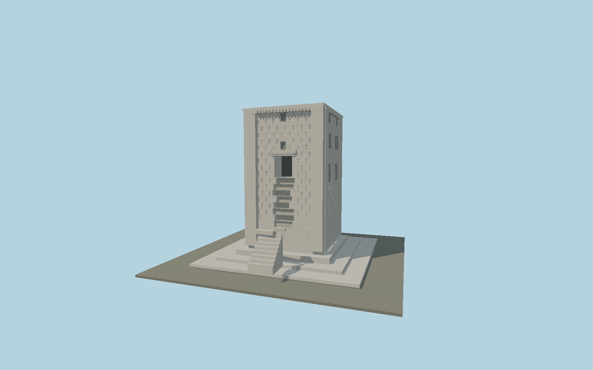

# Ka'ba-ye Zartosht

Surviving limestone tower at Naqsh-e Rustam with engaged corners, shallow staggered recesses, dark false windows, 17-dentil cornices, broken access flight and low pyramidal stone roof.

## Identity and geometry

Catalog ka_ba_ye_zartosht, [Q2363092](https://www.wikidata.org/wiki/Q2363092). Schmidt / Oriental Institute field measurements and elevations, Persepolis III (1970), figures 5-15 and pp. 35-37. Surviving eight-step remnant is retained; the hypothetical complete thirty-step stair is excluded.

Measured tower center on original/excavated floor; Y=0 excludes the modern surrounding excavation grade.. +Z north-northwest entrance; +X west-southwest; +Y is up. The geographic proposal identifies its anchor and orientation evidence separately from remaining terrain and azimuth uncertainty.

Source facts and measured references are recorded in spec.json. References: [1](https://isac.uchicago.edu/publications/persepolis-iii-royal-tombs-and-other-monuments), [2](https://isac-assets.s3.amazonaws.com/isac-publications/oip70.pdf), [3](https://www.iranicaonline.org/articles/kaba-ye-zardost/), [4](https://www.openstreetmap.org/way/235636110). Reference pages and images are not redistributed.

## Original source and shared materials

Geometry is authored in `packages/worldgen/scripts/heritage-tower-models.mjs`. Shared material graphs with metric repeat UV0 and original vertex tints; GLB PBR fallback remains self-contained. No per-model texture duplication. No third-party mesh or photograph is embedded.

21,884 triangles; 43,768 vertices; 1 material groups; 1,839,804 source bytes. Source hash: `sha256:bb3fd192425f3cf427b74b722aabd39606f67a570ac3bf3e2883baecdad5b7d8`. Geometry validation checks finite Float32 coordinates, indices, triangle area and winding before export.

Regenerate with `node packages/worldgen/scripts/generate-heritage-towers.mjs ka_ba_ye_zartosht`; add `--check` for reproducibility. The generator refuses to overwrite a master whose hash differs from source.json. Import uses `--no-optimize` to preserve facade recesses.

## Remaining detail and review

- Static medium-fi exterior based on Schmidt1970 measured elevations/plans and inspected2010/2016 photographs. Original14038-triangle draft remains unchanged. Reviewed source adds jagged stair scar, raised eight-step remnant/rubble and the north roof slab displaced60cm at its west end.14.12m maximum height/7.30m nominal side retain measured original dimensions; slight settled/sloping base differences are simplified. Eight preserved original steps are distinguished from missing original lower/upper access; stair datum1.08m and rubble shapes are approximate. Twenty-one large-block courses average irregular historic jointing; local repairs/cracks and exact engravedGreek/Parthian/Pahlavi text are omitted rather than fabricated. Roof cramp marks are original geometric indications, not a measured cavity survey. Hidden chamber, buried foundations, detached archaeological fragments, modern railings and the entire excavation cut are outside the individual monument exterior. The host terrain must supply the excavated floor datum; a coarse surrounding-gradeDEM will bury the base. Ground0 does not certify the hostDEM or site cut. Footprint replacement disabled.

Named near/far cameras are included for lit visual review. A valid export is not maximum-fidelity certification.
