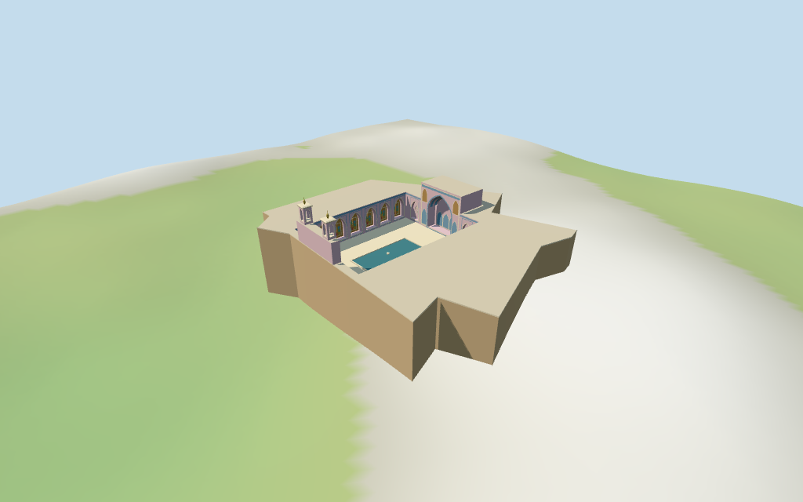

# N0438 — Nasir-ol-Molk Mosque

Reviewed 2026-10-17 against current bytes. Accepted for the stated medium-fi courtyard exterior and approximate map-axis fit. Exact retained Q1962312 relation identity. Heights, whole opposite-façade profile, unseen fabric, current finish and precise terrain joins remain approximate or unverified.

## Exterior and shared surfaces

Inspected all 11 current portable frames, including the 1024×640 summary. Irregular low courtyard complex, open paved court and rectangular pool, unequal pointed blind iwans, short twin square open pavilions and gold finials at the southern end, pink/blue fields and timber gallery doors. Replaced disconnected vault tiles with connected faceted vault bands; aligned pavilion floors above the window sills and removed an overlapping large back-wall diamond. Reduced the southern pocket to1.3 m to keep it behind the mapped outer wall, and moved pavilion bases inward onto their mapped roof support. Removed duplicate lower iwan faces on the outer masonry; the raised block now owns only its upper exterior and lower court face. Actual-GLB rays at three offsets confirm a single outer wall surface. Fine floral tile art and calligraphy are abstracted rather than copied. Outside walls, unseen roof fabric, opposite-façade subdivisions, current finish and exact ground joins remain approximate or unverified.

Inspected all 11 current shared/geographic-flat frames. Six existing 256² brick, mosaic, limestone, lime plaster, plain wood and cast bronze graphs; seven merged material groups. Pink fields and blue bands share the same mosaic graph with linear vertex tints. Selected glass and pool use the shared local window group. Metric UVs, no embedded images, unique atlases, baked light or copied tile art. All six graphs read once; eviction leaves zero live model geometry. The shared southern façade detail crops its pavilion tops; whole-model and dedicated pavilion views cover them. Flat geographic fixture verifies map-axis positioning; portable/medium-fi retain standard DEM. Nearby houses and streets remain host context.

## Browser levels

| Level | Triangles | Bytes | Draws |
| --- | ---: | ---: | ---: |
| skyline | 950 | 89,824 | 1 |
| district | 1,791 | 184,228 | 7 |
| street | 4,340 | 451,764 | 7 |
| closeup | 5,978 | 635,584 | 7 |

Initial skyline plus district: **274,052 bytes**. Master **847,916 bytes / 7,031 triangles**; runtime **847,280 bytes**. Six shared 256² graphs, seven merged material groups, zero embedded images; shared textures are additional.

Inspected all 27 current medium-fi frames: Economy/High, noon/late, three distances, silhouette, six details, four matched LODs and four transitions. Whole skyline also inspected full size. Skyline950 retains the irregular open court, pool, opposite pointed iwans and twin open pavilion heads; thin trim, gallery fields, coloured glazing and vault subdivisions drop out. District1791 adds flat gallery/backing proxies and coarse pavilion arches. Street4340/close5978 add true shallow gallery pockets, selected coloured glazing and connected faceted vault bands. Intentional field/trim/vault changes remain visible in matched near comparisons. Initial274052 bytes plus shared textures; one/seven draws. Separate attribute streams and equal CPU/GPU reservations. Synthetic neighbours and physical-device performance remain unverified.

## Placement and scope

Retained exact relation/2982490 / Q1962312 agrees with current encoded whole52776561115738 (3*2^44+2982490) and named Nasir-ol-Molk POI. Original anchor[52.54852508,29.608537155] and heading-0.827584810078 rad retained. Current13-point whole and4-point courtyard are the standard viewer generalized map outline;retained19-point whole/four-point court remain recorded. No horizontal rescale. Courtyard edge positions,roof subtraction and opposite iwan forms follow this mapped shell. Southern short twin pavilions are assigned to the southwest/positive-local-z court end from the pictured south-façade identity;precise facade handedness and orientation retain180-degree uncertainty. Neighbouring Nasir al-Molk House and surrounding separate buildings remain host context. Retained height/width/length fact arrays are empty;current whole supplies no height or min_height. Picture-based visualization estimates:low wings7.2 m,southern iwan11.7 m,opposite iwan11.4 m,twin square pavilion roofs15.5 m/finial tips17 m. Courtyard galleries have pointed openings about5.6 m;central blind iwan pockets9.7/9.5 m. Heights,unseen roofs and exact north-façade subdivisions are approximate,about±2 m;not measurements. Pink/blue mosaic fields,pointed recesses,wood lattice doors,short open pavilion heads and rectangular pool follow inspected pictures. Fine tile patterns,calligraphy,unseen interiors/current finish and precise ground joins unverified. Standard viewer DEM datum 1536.859621 m;working floor 3.427106 m from maximum whole-footprint1 m bilinear samples plus0.25 m. Relative samples -5.804..3.177 m. Terrain remains unflattened;terrain-adapted footings cross Y=0. Exact court/pool/threshold/terrace contact and walking unverified. All768 viewer-footprint checks cover the selected whole and preserve127 nearby separate map buildings across six files. Current13-point shell/four-point court independently reunited from PMTiles; raised iwan polygons remain inside the mapped shell and low roof subtraction is independently recomputed. Retained exact Q1962312 relation agrees with the named current POI. All2448 bilinear samples verify the declared working floor. Accepted for the stated approximate courtyard exterior and map-axis fit; facade correspondence retains180-degree uncertainty.

Individual medium-fi Nasir-ol-Molk Mosque:irregular mapped low courtyard complex,open paved court and rectangular pool,two unequal opposite pointed blind iwan pockets,short twin open square pavilions/gold finials at the southern end,rose/blue mosaic bands and selected stepped vault relief,pointed side galleries with timber lattice/selected coloured glazing. Shared materials,four authored browser levels,reproducible source. Current13-point whole/four-point court preserved;raised iwan roof areas clipped to the mapped shell. All heights,opposite façade subdivisions and exact ground joins estimated or unverified. Retained height/width/length fact arrays are empty;current whole supplies no height or min_height. Picture-based visualization estimates:low wings7.2 m,southern iwan11.7 m,opposite iwan11.4 m,twin square pavilion roofs15.5 m/finial tips17 m. Courtyard galleries have pointed openings about5.6 m;central blind iwan pockets9.7/9.5 m. Heights,unseen roofs and exact north-façade subdivisions are approximate,about±2 m;not measurements. Pink/blue mosaic fields,pointed recesses,wood lattice doors,short open pavilion heads and rectangular pool follow inspected pictures. Fine tile patterns,calligraphy,unseen interiors/current finish and precise ground joins unverified. Standard viewer DEM datum 1536.859621 m;working floor 3.427106 m from maximum whole-footprint1 m bilinear samples plus0.25 m. Relative samples -5.804..3.177 m. Terrain remains unflattened;terrain-adapted footings cross Y=0. Exact court/pool/threshold/terrace contact and walking unverified. Vertical numbers are visualization estimates. Iwans close on patterned backs with connected faceted heads; gallery pockets close on wood or mosaic backing; short pavilion heads are open through four sides with raised stone floors and caps. Pool is a static blue-green surface. No navigable prayer halls, copied floral art/calligraphy, surveyed thresholds or interiors are established. Exact tile motifs, whole opposite-façade profile, unseen outside walls/roofs, current finish, handedness, terrain joins, walking and physical-device timings remain unverified. Three useful pictures show the south court and one minor north niche; they do not establish a full survey. No bespoke sources or redistributed pixels.

## Verification

**49 current views inspected; 408 geometry probes; 768 footprint checks.** Six Khronos validations: zero errors/warnings/images. Targeted byte reproduction, scene validation, 30-tick simulation and current source/input/recipe/runtime/LOD/capture/material bindings pass. Six graphs read once; unload zero live model geometries. Existing package builds reused; next full source checkpoint N0432–N0449.

Source: sha256:7437c68b00fb16325961e36b7b9627a5c03b09628b99440fb98e6e102fb1ab03

Runtime: sha256:84e26af02a7c5cc718928f951ae86ab39b26a93cd253aac9a20cabcd62fc157a

Input: sha256:9edc3d7be16b6ac5a0b06609a302c94a1ae446a9e40bf2f595487a15945ce945

Simulation: sha256:5fb48557e4a1ff494b21f86333ffe54a090015fd1f70d1edf16b1a1c29db490d

Commands: targeted generate/import/LOD/register --ids=N0438; generate --check; portable reflections/antialias/fitted shadows; shared reflections/adaptive clipping/bounded placement; medium-fi reflections; scene validate/sim30; recipe-only Biome check. Bulk captures ignored.

## Inspected pictures

[Fabien Dany (Fabienkhan) — 2005-05](https://commons.wikimedia.org/wiki/File:Masjed_Nasir_ol_Molk_shiraz_iwan.jpg). CC-BY-SA-2.5. Actually viewed southern court façade:two short square open pavilion heads with gold finials above tall central pointed blind iwan,side recessed fields,blue inscription band,rose-toned mosaic fields,stone base,pointed side galleries and rectangular raised-edge pool. Original broad geometric bands stand in for floral tilework;no picture pixels,calligraphy or copied art used.

[dynamosquito — 2008-10-03 (metadata;description says April2008)](https://commons.wikimedia.org/wiki/File:Nasr_ol_Molk_mosque2.jpg). CC-BY-SA-2.0. Actually viewed south façade and both long courtyard ranges:pointed gallery openings with recessed timber/lattice doors or shadowed backs,tall central blind iwan with patterned stepped vault and three pointed bottom fields,low flat parapets,twin open square pavilions and long rectangular pool. This is a court view,not evidence of the unseen outside walls or winter prayer-hall interior.

[DAVID HOLT — 2007-10-10](https://commons.wikimedia.org/wiki/File:Iran_2007_097_Nasir-ol-molk_mosque_Shiraz.jpg). CC-BY-SA-2.0. Actually viewed a north-side minor niche:deep pointed arch,stepped muqarnas-like cells,pink/yellow/blue floral tile fields and closed lower backing with a shallow pointed doorway. Selected stepped vault pieces and broad pink/blue bands abstract this relief;the picture does not establish the entire opposite façade.
