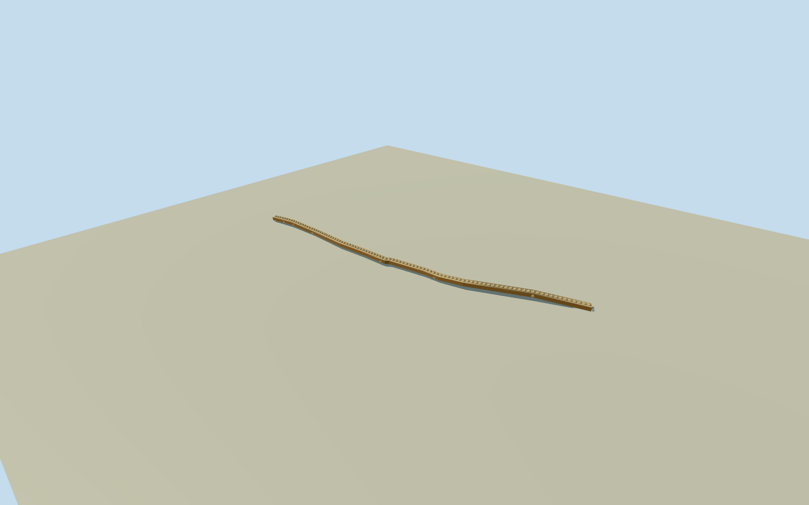

# Bazarcheh Now, Isfahan

Whole629.49m continuousBazarchehNowcoveredmarket, bothoriginalways/all19nativecontrols/bends, completeouterwalls/sidegalleryroofs/vaultedmainhall, bothendsopen andmappedjunctionsideportals. Originalfield-informedfloorprofile fixedbeforegeometry. Width/sections/roofbaycensus/oculi/facadefinishestimated fromclearCostevaultvocabulary; no currentwholewingphotosurvey. NotwholeGrandBazaarproxy.

Authoring state: **review-in-qa.json**. Current completion evidence is in [qa.json](qa.json) and the [completion ledger](../../../../qualla-structures/batches/qualla-002.PROGRESS.md).

- [Grand Bazaar, Isfahan](https://qualla.com/grand-bazaar-isfahan/)

WholecontinuousBazarchehNowwesterncoveredmarketbuilding, both originalcoveredpedestrianways1126772566/206969827 andall19nativecenterlinecontrols. Bothendportals, allouterwalls/sidegalleryroofs/entirecontinuousvaultedhallroofandoriginalbends. Crossstreetjunctionsareoriginalnumericalcontext; transverseportalsestimatedatmappedjunctions. Fullphysicalwidth/floorprofile/exteriorsection/roofbaycensus/oculicount andfinishareboundedestimates; mapdoesnotprovideabuildingfootprintor surveyedwidth. Distinctcontinuouscoveredstreetarchitecture, neverwholeGrandBazaarproxy.

Whole629.493579m originalcoveredstreet/all19centrelinecontrols, bothendopenings/continuousvaultedhallroof/sidegalleryroofs and outerwalls. Nativeproviderrecordscovered=yes/name/highway establishthefullroute; no numericbuildingwidthorheightgiven. Full11mexternalwidth/5mcentralhall/6mroof/8.6mvaultcrown andhiddenbaycensus/finish/colors areboundedestimates with3mwidth/height and4mcomponentuncertainty. Adjacentindependentcourts/mosques/shops beyondtheestimatedcoveredbuildingwidth excluded.

Original1024m129x129field/16641values/4rawtiles, datum1575.4278m/range1563.8454..1588.1894m acquired beforefloors/sections/geometry. Flooratall19nativecontrols chosenonce asoriginalbilinearsourcegrade+.25m, joined bylineararchitecturalinterpolation; width/roofsectionsfixedafterfield. Floorsareunsurveyedsource-informedestimates, notmeasuredstoreythresholds. No groundcut/mask/flatten/refetch/refit orsurveyedverticalregistration.

OneexactpublishedQuallaCoste1840interiorengraving/death1879/1867publication/PD-Artexpirygrantbound. Itestablishesvaultvocabulary, not a whole2026photographicrecordofthiswing. Court/cityplatesandETHaerialsnotadoptedforroofcensus. Roofandfacadebaycount/oculidistribution/closedshopfrontpatterns/sideportalshapes are originalestimates; transverseportalscorrespondtonativeconnectedjunctionpositions, precisehistoricopeningcensusunverified.

Owncontinuouscoveredstreetasset/actualnativeposition andbends, ordinaryregionalidentity bazarcheh_now_isfahan. ParentGrandBazaarwhole2kmroute/membercoverageunfinished. Dated2026preview/currentWorldEligiblefalse. FourLODs retainwholecontinuousbody/majorroofvolume/realendandsideopenings. Smallvaultbaydivisions/oculi/closedshopfronts/trimreduceatdistance. No internalmerchantstock,workinginteriors orstreettrafficclaimed.

Build: `node content/worldgen/source/places/tj/tju/bazarcheh_now_isfahan/models/generate-house.mjs`. Add `--check` to verify exact regeneration. 47129 triangles; 5 materials; no embedded photographs.
