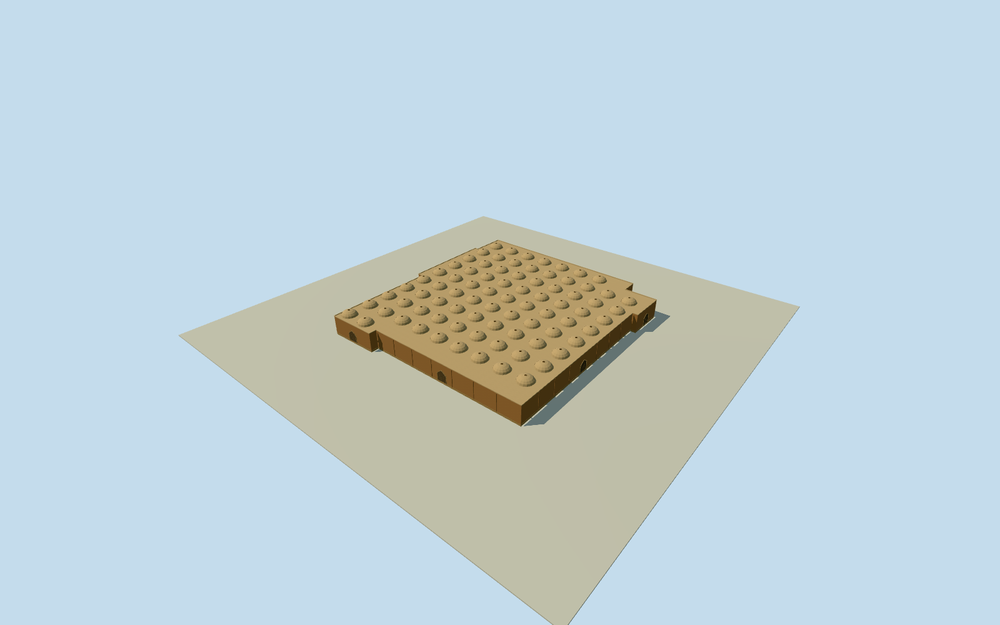

# Coppersmiths Bazaar, Isfahan

Whole14cornerCoppersmithsBazaar/allouterwalls/fullroof/base.81estimatedbrick/plaster lowvaults/oculi andclosedarchedentries fromclearedCosteconstructionvocabulary; exactrooflayout/heights/hiddeninnercourts/currentfinish unmeasured. Separatewholemarket, notGrandBazaar2kmproxy.

Authoring state: **review-in-qa.json**. Current completion evidence is in [qa.json](qa.json) and the [completion ledger](../../../../qualla-structures/batches/qualla-002.PROGRESS.md).

- [Grand Bazaar, Isfahan](https://qualla.com/grand-bazaar-isfahan/)

Whole independent native244276167/CoppersmithsBazar14corner steppedmarket building: allouterwalls/fullroof/base and estimatedbrick/plaster lowvault-roof grid/smallrooflights/closedarchedentries. Nativewayhasnocourtholes/containingrelation; hiddenunmappedinternalcourts not asserted surveyedabsent. Exactrooflayout/heights/entriesandhistoricalconstructionfamily carryover estimated. SeparateQeysarieh/BazarchehNow/mosques/palaces/publicsquare/whole2kmGrandBazaar remain separate.

Originalnamed CoppersmithsBazar/بازارمسگرها marketbuildingway244276167: all14wholebuildingoutercontrols retained; no containingmultipolygon/explicitcourthole found. Heading follows native4to5longedge, exactsignedprojection/anchor fixed beforeindependentfield. Contemporaryhorizontalplan is actualnumericalmapping; heights/roofvaultgrid/oculi/hiddeninnercourt/closedentries/facade/finish are explicitoriginal estimates usingalreadyclearednearbyCosteconstructionfamily, not photographedCoppersmiths elevations.

Wholeoriginalnamed14cornersteppedmarketbuilding preserved; no containingrelation/explicitcourtholes or enclosedindependentfeatures in savednumericcontext. Possibleunmappedinternalcourts/roomlayout not surveyed; contiguousroof matchesmappedbuildingoutline but is an explicitboundedhiddenroofinterpretation. No wholeGrandBazaar2kmcompletion fromthismember.

6m wall/roofbase abovefloor and1.8m shallowvault rise are originalestimates with3m heightuncertainty.81authored8m-grid vaultedbays/2.6mradii/.35moculi, closedperimeterarchedentries/pilasters/parapets andplainbrick/plaster/wood finishes are not observedroof/facadecensuses. ClearedCoste1840interior suppliesnearbyconstructionvocabulary only, not modernCoppersmithsappearance/colour/survey.

Fullbody/allwalls/roof retained. Skylinecaps tinyoculiconically; higherLODsrestore81actualmodelopenoculi and innerroofskins. Closedarchedentries are shallowgeometricalinterpretations againstouterwall, not openinteriorpassageorstructuralportalstudy. Paintedmotifs/sculpture/people/marketgoods andotherbuildings excluded.

Independent256m129x129field/16641heights/2rawtiles/datum1574.1196m fixed BEFORE floor.2/foundation-.5..+.2/roof6.2/parapet6.45/vaulttopsabout8m. Sourcegrade/verticalcontact approximate; no fieldflatten/mask/refetch/reframe/refit.

Qualla-first38families/zero conflicts alreadyscreened; sameexactalreadyclearedCoste1840/1867engraving/death1879/nativeSHA1/expirygrant. Originalonly personallyinspected for vault/pointedarch constructionvocabulary. No questionablemodern/aerialsource adopted orphototextures.

Build: `node content/worldgen/source/places/tj/tju/coppersmiths_bazaar_isfahan/models/generate-house.mjs`. Add `--check` to verify exact regeneration. 26862 triangles; 4 materials; no embedded photographs.
