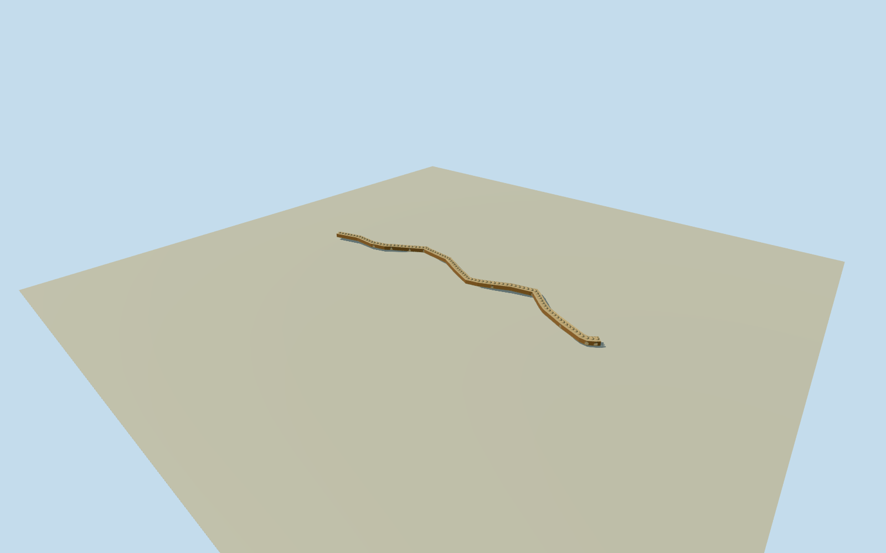

# Darbagh Market, Isfahan

Whole original named Darbagh covered market passage, all 27 mapped route controls, continuous vaulted hall/side galleries/outer walls, open ends and mapped cross-passage portals. Original field-informed floor profile frozen before geometry. Widths/heights/roof bay census/facades/finish estimated from already-cleared local Coste construction vocabulary; parent Grand Bazaar unfinished.

Authoring state: **review-in-qa.json**. Current completion evidence is in [qa.json](qa.json) and the [completion ledger](../../../../qualla-structures/batches/qualla-002.PROGRESS.md).

- [Grand Bazaar, Isfahan](https://qualla.com/grand-bazaar-isfahan/)

Whole named Darbagh Bazaar covered building passage, original way 435328915 and all 27 centreline controls. Continuous vaulted hall, outer side galleries and walls, open ends and mapped junction portals. Width/heights/roof-bay census/facade/finish are explicit estimates. Separate courts, mosques, and other Grand Bazaar members remain separate. Qualla-first 38 families and zero conflicts already screened. Exact cleared Coste engraving/native SHA1/creator lifespan/1867 publication and expiry grant retained. Original named pedestrian route supplies exact horizontal controls; covered bazaar continuity is an explicit architectural inference from written descriptions, not a native covered tag; section widths/heights/roof divisions and hidden facades are original estimates. No new questionable imagery. Parent Grand Bazaar remains unfinished. Written MIT4.175 Streets & Squares PDFpage14 and Qualla story identify the roofed main bazaar route toward the old square. Individual Darbagh roof intervals, width, section and frontage remain architectural estimates; no modern roof survey or native covered=yes claim.

Whole 577.3661m original named pedestrian bazaar route with estimated roof coverage, all 27 native centreline controls, both end openings, continuous vaulted hall roof, side gallery roofs and outer walls. Original named pedestrian route supplies the horizontal plan. Covered architectural continuity is an explicit inference from the main bazaar street described in the Qualla story and MIT4.175 Streets & Squares PDFpage14, not a native covered tag or a measured current roof survey. No original numerical width or height supplied. Authored 11m outer width, 5m central hall, 6m roof and 2.6m shallow vault rise have 3m width/height uncertainty; 89 roof bays, oculi, hidden shop-front patterns and finishes are estimates with 4m component uncertainty. Adjacent independent courts and mosques outside the estimated section are excluded.

Independent 1024m 129x129 field/16641 values/4 raw tiles, datum 1573.9258m, original range 1564.9888..1582.0483m frozen before floor/sections/geometry. All 27 floor controls chosen once as bilinear original source grade +.25m, linearly interpolated along the architecture. These are unsurveyed source-informed estimates. No field masking, flattening, refetching, floor refit or verified surveyed vertical registration.

Same exact already-cleared published Coste 1840/1867 engraving, creator died 1879, supplies local pointed brick arch/vault/rooflight vocabulary only. No modern Darbagh roof or elevation photo claimed. Roof census/section widths/hidden elevations/finish remain original estimates. Junction opening positions follow original connected route nodes; precise historical portal count/size are not measured.

Whole continuous independent covered market, ordinary geographic identity. Parent Grand Bazaar remains unfinished. Four LODs preserve whole route, side gallery roof volumes, open ends and cross-passage openings. Fine roof lights and shop fronts simplify at distance. No merchant stock, artwork, people or photo textures.

Build: `node content/worldgen/source/places/tj/tju/darbagh_bazaar_isfahan/models/generate-house.mjs`. Add `--check` to verify exact regeneration. 43750 triangles; 5 materials; no embedded photographs.
