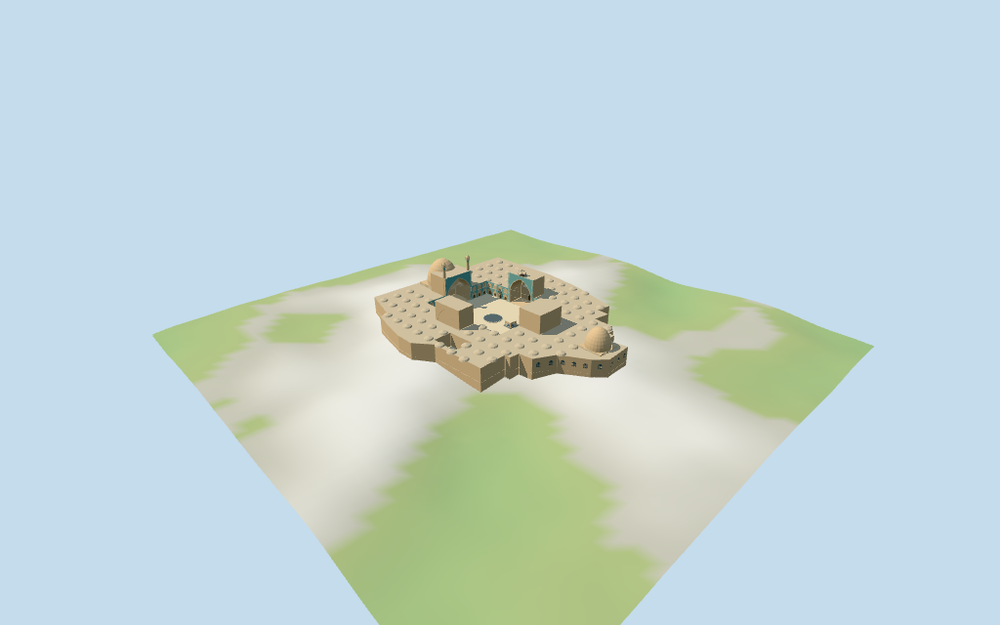

# jameh_mosque_of_isfahan — Jameh Mosque of Isfahan

Reviewed2026-10-16 against current bytes. Accepted for the stated medium-fi exterior and approximate horizontal fit. All untagged heights and architectural subplans are picture estimates;unseen roof divisions,current finish and exact ground/threshold contacts remain unverified.

## Exterior and shared surfaces

Inspected all11 current portable views including the1024×640 summary. Irregular low brick complex,two mapped open courts,four individually oriented deep pointed iwans with closed rear fields,larger south and smaller north brick domes,twin south minarets,two-storey court bays,west open timber lookout,blue-grey basin and arched small court pavilion/basin. North barrel remains plain;other near iwans use sparse original broad muqarnas facets. Added sparse external north lattice fields. Corrected initial DEM penetration of courtyard by changing the declared working floor from median perimeter to maximum retained footprint-affecting DEM sample plus0.25m. Current finish,unseen roof layout and exact site joins unverified.

Inspected all11 current shared/geographic views. Five existing256² longformat brick,sandstone,lime plaster,mosaic and plain wood graphs;six merged groups. Untiled domes/shafts/walls share pale brick,low vault roofs shared plaster,cyan court/portal fields generic mosaic,paving/arch trim sandstone and west lookout/doors wood. Pane/water tints are local and share a merged group. Metric UVs/linear tints,zero embedded images,baked lighting or copied facade art. Graphs read once;unload leaves zero live model geometries. Shared placement fixture uses flat terrain;portable and medium-fi retain the standard DEM. Placement is approximate horizontal fit,not a surveyed altitude or full ground-contact proof.

## Browser levels

| Level | Triangles | Bytes | Draws |
| --- | ---: | ---: | ---: |
| skyline | 882 | 89,848 | 1 |
| district | 3,850 | 382,244 | 6 |
| street | 9,891 | 1,012,356 | 6 |
| closeup | 14,126 | 1,437,296 | 6 |

Initial skyline plus district: **472,092 bytes**. Master **1,808,808 bytes /15,042 triangles**;runtime **1,808,236 bytes**. Five shared256² graphs,six groups,zero embedded images;shared runtime textures are additional.

Inspected all27 current medium-fi views:Economy/High,noon/late,three distances,silhouette,six details,four matched levels and four transitions. Skyline882 keeps irregular two-court mass,two brick domes,four deep iwan portals,twin shafts,west cap and small pavilion. District3850 adds coarse court bays,roof-vault cadence and external fields. Street9891 and close14126 add finer dome/shaft facets,arched bands,closed door/lattice fields,broad muqarnas cells and open lookout supports. One/six draws and initial472092bytes. Browser POSITION/NORMAL separate;CPU/GPU reservations equal. Final courtyard remains clear of the retained DEM in the inspected views. Outer foundation exposure is a consequence of the explicit working floor,not a surveyed plinth claim. Synthetic neighbor placement and physical-device timing unverified.

## Placement and scope

Retained exact relation/5730508 /Q1256501 matches current PMTiles whole52776563863756 (3×2^44+5730508). One fragment retains29 outer points and two4-point courtyard holes,with all raw properties;there are no separately mapped roof parts or building heights in this extract. Anchor[51.685304841,32.669782786] and heading0.933690517117rad unchanged,no horizontal rescale. Main70×57m court follows its mapped skew quadrilateral;the60m width fact is explicitly courtyard-qualified,not a whole-building dimension. Native−X southwest south/prayer iwan and larger dome,+X northeast north iwan/Taj al-Mulk dome;−Z northwest west iwan/lookout,+Z southeast east iwan/small mapped court. Pictures resolve facing to about3°. Four iwans/domes/minarets/roof vaults/fountain/pavilion are picture-estimated subplans within about4m working uncertainty;unseen roof divisions remain unverified. Adjacent bazaar,roads and separate buildings remain host assets. No numerical height claims in retained Wikidata facts and no mapped height/min_height bands. Retain nominal70m length and courtyard-qualified60m width without rescaling the172×148m whole footprint. Working low range9.8m/two-storey court facade11m,four portal frames23–24m,open vault crowns20.5–21.3m,south dome31m/north dome23m,twin minaret tips36m and west lookout28.5m are picture-estimated proportions above the declared floor,not surveyed dimensions. Roof vault cadence,muqarnas cells,drum transitions,portal depth,shaft/cap profiles and secondary court elevations are working approximations. Current finish/interiors/engineering and exact ground contacts unverified. Standard viewer DEM datum1575.420164m;whole perimeter-2.58..1.76m relative to anchor. Floor3.910m clears the maximum retained DEM grid sample affecting the footprint,including an8.5m interpolation margin,plus0.25m. The initial median-perimeter floor allowed coarse DEM to protrude into the court;this explicit working platform plane corrects that visible burial without flattening or deleting terrain. Adaptive brick footings crossY=0 and extend below retained ground. Raw DEM retained without flattening/cutout;coarse building contamination may expose or bury base margins. Exact altitude,ground/court/threshold/stair/street joins and walking unverified;no road replacement. All12 actual viewer-footprint checks cover the single whole-building control and preserve one separate nearby host in all six files. Current raw geometry/properties independently reunited from the viewer tiles. The declared floor clears every retained DEM grid sample affecting the footprint with an8.5m interpolation margin;raw DEM is unchanged. Horizontal fit accepted within the stated scope;exact thresholds,outer ground contacts and walking remain unverified.

Individual medium-fi Jameh Mosque of Isfahan:map-exact irregular low brick complex and two courtyards,four distinct deep pointed iwans/two-storey court arcade fields,larger south and smaller north pale-brick domes,twin south minarets,west timber lookout,blue central basin and low arched pavilion. Five shared256² brick/mosaic/plaster/stone/wood graphs,six merged groups,four browser levels. All untagged vertical dimensions and subplans explicitly picture-estimated;fine facade art,interiors and exact terrain/threshold joins omitted or unverified. No numerical height claims in retained Wikidata facts and no mapped height/min_height bands. Retain nominal70m length and courtyard-qualified60m width without rescaling the172×148m whole footprint. Working low range9.8m/two-storey court facade11m,four portal frames23–24m,open vault crowns20.5–21.3m,south dome31m/north dome23m,twin minaret tips36m and west lookout28.5m are picture-estimated proportions above the declared floor,not surveyed dimensions. Roof vault cadence,muqarnas cells,drum transitions,portal depth,shaft/cap profiles and secondary court elevations are working approximations. Current finish/interiors/engineering and exact ground contacts unverified. Standard viewer DEM datum1575.420164m;whole perimeter-2.58..1.76m relative to anchor. Floor3.910m clears the maximum retained DEM grid sample affecting the footprint,including an8.5m interpolation margin,plus0.25m. The initial median-perimeter floor allowed coarse DEM to protrude into the court;this explicit working platform plane corrects that visible burial without flattening or deleting terrain. Adaptive brick footings crossY=0 and extend below retained ground. Raw DEM retained without flattening/cutout;coarse building contamination may expose or bury base margins. Exact altitude,ground/court/threshold/stair/street joins and walking unverified;no road replacement. Five actually inspected2011–2018 courtyard/iwan/north-exterior pictures guide working subplans within about4m and facing within about3°. Main37 raw ring/hole points retained unchanged. Courtyard-qualified60m width is kept separate from the172×148m whole footprint. Low roof-vault grid,domes,minarets,portal depths,muqarnas cells and secondary-court elevations are regularized picture estimates. Fine calligraphy/tile/lattice art,portraits/banners,fixtures,interiors,unseen roofs,current finish,engineering and exact terrain/door/street joins omitted or abstracted. Gallery fields and iwan backs close;vaults/courts/lookout/pavilion are exterior spaces,no enclosed interior/free traversal claim. Adjacent bazaar/roads/separate buildings remain host content. No bespoke surveys or redistributed photographs.

## Verification

**49 current frames inspected;428 geometry probes;12 footprint checks.** Six Khronos validations:zero errors/warnings/images. Targeted byte reproduction,scene validation,30-tick simulation and current input/recipe/model/LOD/capture/report/material bindings pass. Shared graphs read once;unload leaves zero live model geometries. Full source checkpoint saigon_notre_dame_basilica–jameh_mosque_of_isfahan follows this round.

Source: sha256:38c35c54019a0ee03a6089fc8996b9762120cd835e1f242639d4a9f69c133430

Runtime: sha256:fa20c77f57869532fd211ae747f1c60ca59940c915c398716b92bd641c5485fd

Input: sha256:ddb336a3f6bb57ef2a4d9b669b5cad66e2c7b8a77846bdc181c21f49a0862143

Simulation: sha256:2c140bf54c7688ab7ebf9e8fed933707ce05d4972fa1abb36a71aa8c2f0e5884

Commands:targeted generate/import/LOD/register --ids=jameh_mosque_of_isfahan;generate --check;portable reflections/antialias/fitted shadows;shared reflections/adaptive clipping/bounded placement;medium-fi reflections;scene validate/sim30. Bulk captures remain ignored.

## Inspected pictures

[Hamidespanani — 2018-03-01](https://commons.wikimedia.org/wiki/File:20180301124354_IMG_4179And6more_Interior_3.jpg). CC-BY-SA-4.0;viewed only,not redistributed. Inspected960×639 courtyard overview:three visible monumental pointed iwans,south twin cylindrical minarets,two-storey pointed arcade ranges,blue/cyan tile fields and pale brick walls. Large blue court basin;raised low gallery walk. East iwan is more bare brick with layered muqarnas;west tile-clad iwan has tiny timber lookout. Facade art/portraits/banners omitted.

[Bernard Gagnon — 2016-10-29](https://commons.wikimedia.org/wiki/File:Jameh_Mosque_of_Isfahan_-_Northern_Iwan.jpg). CC-BY-SA-4.0;viewed only,not redistributed. Inspected960×640 north iwan:wide deep pointed brick barrel vault with plain planar flanks and small lower side recesses;tile border/geometric spandrels,large rectangular portal frame. Adjacent two-storey narrow pointed blind/open bays with lattice panes and generic tiled spandrels. Fine lattice,inscriptions and actual brick patterns abstracted.

[Fabian Balles — 2011-01-05](https://commons.wikimedia.org/wiki/File:Masjed-e_J%C4%81m%C3%A9_of_Isfahan.jpg). CC-BY-SA-4.0;viewed only,not redistributed. Inspected960×640 historical dusk courtyard:whole south iwan/twin capped shafts,brick-colored rounded south dome behind its left shoulder;west iwan with projecting timber lookout;small arched court pavilion. Used for silhouette/depth only;night illumination is not baked into the model.

[Hamed fattahi — 2015-03-28](https://commons.wikimedia.org/wiki/File:Exterior_and_north_dome_Jameh_Mosque_of_Isfahan.jpg). CC-BY-SA-4.0;viewed only,not redistributed. Inspected960×640 north exterior:unpainted pale tan brick,pointed lattice fields in plain outside wall,rounded low-shouldered brick dome above faceted/square transition with shallow pointed panels. Small parapet/coping and projecting drain ends;no turquoise tiled principal dome. Dimensions and unseen roof arrangement remain estimates.

[Bernard Gagnon — 2016-10-29](https://commons.wikimedia.org/wiki/File:Jameh_Mosque_of_Isfahan_-_Western_Iwan_01.jpg). CC-BY-SA-4.0;viewed only,not redistributed. Inspected960×646 west iwan:deep broad pointed recess with a few large faceted muqarnas cells,cyan/cream patterned rectangular frame,projecting open timber lookout with little pyramidal cap. Two-storey tiled arcade bays and low arched square stone/brick court pavilion over blue basin. Abstract cell geometry and shared generic mosaic,not copied facade artwork.
