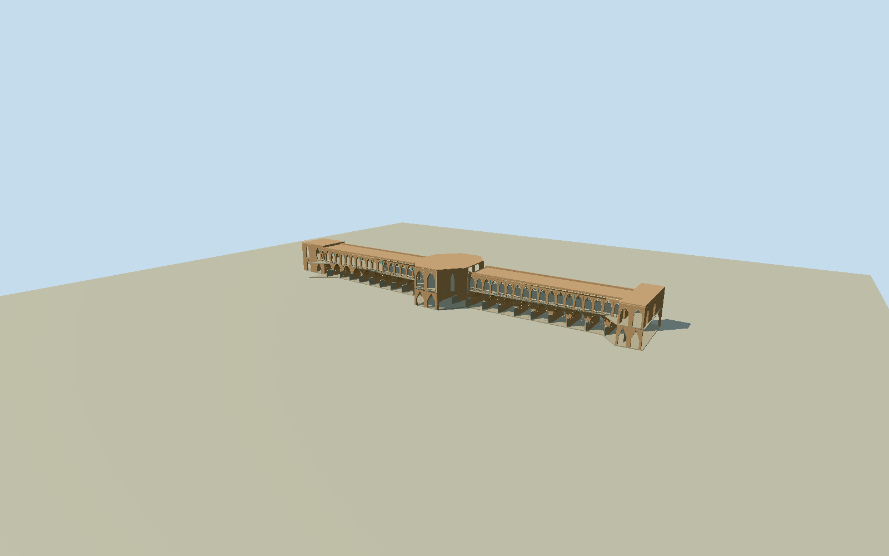

# Khaju Bridge

Whole surviving Khaju stone/brick bridge-dam: exact original22vertex mapped bridge outline and native crossing alignment; complete lower pointed flow-vaults/piers/breakwaters, intrinsic weir/platform/stepped aprons, upper open pedestrian gallery and narrow pointed bays on both faces, projecting central royal pavilion with its different face divisions, square endpavilions and parapet/flatroof. Exclude river/riverbanks/moderncity/landscape/people/flags/floodlight/reflections and standalone shrines/artifacts; no opaque block spanning archvoids. The two exact original photos already inspected show different central pavilion face divisions:2009oblique two-big-archface and2023nearfront threebig/twosmallface. Preserve both side elevations, their pointed outerarches and real transverse flow/corridor passages; central royalbelvedere, endpavilions, local tile/brick trim and stone weir/step apron are intrinsic. Main longaxis and all22foot vertices remain native. Use currentphoto to count principal flowarches versus smaller approach/upperchamber bays; source texts use incompatible18/23/26span definitions, not an exact universally agreed census. Do not choose baycount from polygon vertexcount. Photographic fine/census/hidden underwater section can be bounded. Daylight brick/stone/plaster palette must not inherit amber floodlights. Freeze independent bank/river field first; datumY0at north approach, archpiers descend belowwalkway. Whole exterior, no end-only/flatdeck proxy.

Authoring state: **review-in-qa.json**. Current completion evidence is in [qa.json](qa.json) and the [completion ledger](../../../../qualla-structures/batches/qualla-002.PROGRESS.md).

- [Khaju Bridge](https://qualla.com/khaju-bridge/)

Exact named native man_madebridgeway757378378, all22original perimeter vertices, plus named crossingway199084002/Q1740490 two original endpoints. Fixed model+Xsouth-southeast along crossing and+Zwest-southwest; no fit/stretch. The original ground outline includes central/end projections and intrinsic apron widths; do not replace it with an arbitrary rectangle. Vertical vault/step/deck dimensions and bay partitions remain photographic estimates. Native walking centerline extends past the masonry envelope; bank datum is the original north approach point, not riverbed/sea level.

Complete original medium-fi exterior. Native22vertex bridge-dam outline and fixed native crossing alignment retained. Main lower flow-vaults, pointed upper arcades, true5.7m-ish longitudinal corridor, opposite two/three-arch royal facades, flank openings, square endpavilions, low open balustrades and intrinsic stone weir/steps.23principal lower flowvaults plus smaller projecting pavilion/enddivisions and36wing upper bays perface are photographic subdivisions; primary counts18/26use incompatible definitions and are not certified exact chamber census.

Two inspected exact originals: already published Qualla2009Gire3pich2005ownPD-self with special thanks to HosseinMajidi, and2023Ali.Alirezaei666ownCC0. Both are twilight/floodlit: their geometry informs the model but orange emission/reflections are not baked into daylight brick/stone/plaster. No photograph textures, generated bitmaps or downloaded mesh.

Heights/sections estimated from photographs: walkway0, pierbase-6.15, lowercrown-.65, wingroof5.43, pavilionroof7.6m. Exact submerged weir/sluice machinery, hidden chamber partitions, tile patterns/brick census and current fine repairs are bounded. Skyline uses single-sided thin arcade faces while retaining actual holes and full bay layout.

River, riverbed/banks/landscape, citybuildings, flags, people and lights excluded. Only intrinsic native-outline foundation/platform and structural deck belong to GLB; no site floor. Raw360m129x129field/16641values/oneTerrariumtile unchanged. Only exact bridge-footprint ground overlap is clipped in the viewer so coarse river DEM does not bury the lower arches. Source datum1566.8751m at original north-bank point, compatible host water/ground contact remains unverified geographic preview/replaceFootprint=false.

Build: `node packages/worldgen/scripts/generate-authored-places.mjs --ids=khaju_bridge`. Add `--check` to verify exact regeneration. 36668 triangles; 5 materials; no embedded photographs.
