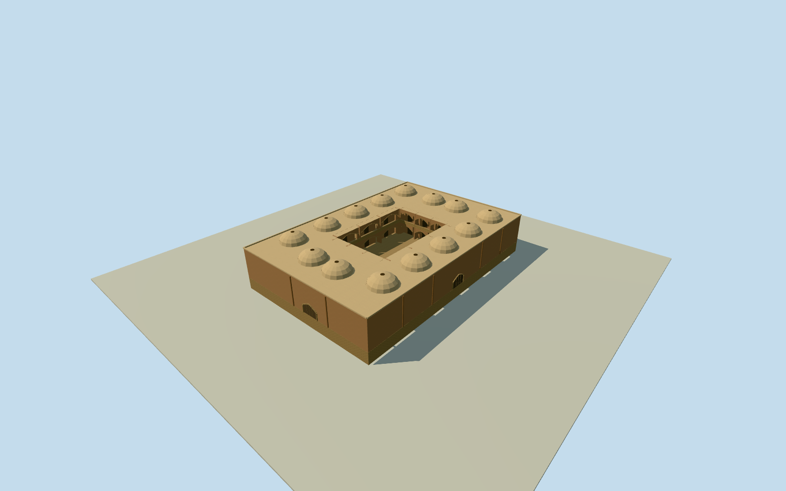

# Malek Market, Isfahan

Whole5cornerMalekMarket/allouterwalls/fullroof/base.14 estimated peripheral vaults, an estimated open central court with two storeys of arcaded galleries, and closed arched exterior entries fromclearedCosteconstructionvocabulary; exactrooflayout/heights/hiddeninnercourts/currentfinish unmeasured. Separatewholemarket, notGrandBazaar2kmproxy.

Authoring state: **review-in-qa.json**. Current completion evidence is in [qa.json](qa.json) and the [completion ledger](../../../../qualla-structures/batches/qualla-002.PROGRESS.md).

- [Grand Bazaar, Isfahan](https://qualla.com/grand-bazaar-isfahan/)

Whole independent native244295013/Malek5corner steppedmarket building: allouterwalls/fullroof/base and estimatedbrick/plaster lowvault-roof grid/smallrooflights/closedarchedentries. Nativewayhasnocourtholes/containingrelation; hiddenunmappedinternalcourts not asserted surveyedabsent. Exactrooflayout/heights/entriesandhistoricalconstructionfamily carryover estimated. SeparateQeysarieh/BazarchehNow/mosques/palaces/publicsquare/whole2kmGrandBazaar remain separate.

Originalnamed Malek/Malek marketbuildingway244295013: all5wholebuildingoutercontrols retained; no containingmultipolygon/explicitcourthole found. Heading follows native0to1longedge, exactsignedprojection/anchor fixed beforeindependentfield. Contemporaryhorizontalplan is actualnumericalmapping; heights/roofvaultgrid/oculi/hiddeninnercourt/closedentries/facade/finish are explicitoriginal estimates usingalreadyclearednearbyCosteconstructionfamily, not photographedMalek elevations.

Wholeoriginalnamed5cornersteppedmarketbuilding preserved; no containingrelation/explicitcourtholes or enclosedindependentfeatures in savednumericcontext. Original map supplies no court hole. An open court and surrounding galleries are explicit authored hidden-layout estimates, not a mapped or photographed observation. No wholeGrandBazaar2kmcompletion fromthismember.

6m wall/roofbase abovefloor and1.8m shallowvault rise are originalestimates with3m heightuncertainty.14authored8m-grid vaultedbays/2.6mradii/.35moculi, closedperimeterarchedentries/pilasters/parapets andplainbrick/plaster/wood finishes are not observedroof/facadecensuses. ClearedCoste1840interior suppliesnearbyconstructionvocabulary only, not modernMalekappearance/colour/survey.

Fullbody/allwalls/roof retained. Skylinecaps tinyoculiconically; higherLODsrestore14actualmodelopenoculi and innerroofskins. Closedarchedentries are shallowgeometricalinterpretations againstouterwall, not openinteriorpassageorstructuralportalstudy. Paintedmotifs/sculpture/people/marketgoods andotherbuildings excluded.

Independent256m129x129field/16641heights/1rawtiles/datum1579.076m fixed BEFORE floor.2/foundation-2.25..+.2/roof6.2/parapet6.45/vaulttopsabout8m. Sourcegrade/verticalcontact approximate; no fieldflatten/mask/refetch/reframe/refit.

Qualla-first38families/zero conflicts alreadyscreened; sameexactalreadyclearedCoste1840/1867engraving/death1879/nativeSHA1/expirygrant. Originalonly personallyinspected for vault/pointedarch constructionvocabulary. No questionablemodern/aerialsource adopted orphototextures.

Original boundary source heights range -1.9303..+.511m around the fixed centre datum. Foundation bottom-2.25m was chosen once before geometry as an estimated buried masonry skirt below those controls, floor.2 and main roof6.2; exact historic basement/ground contact unmeasured. This named Malek marketplace uses an authored12x18m open court/two gallery storeys/upper floor3.2m/gallery depth1.2m/three arches per side per floor and14peripheral vault bays. General Isfahan sarai/timcheh court-and-gallery typology comes from MIT4.175 Streets & Squares 2005 writtenPDFpages16-17, not a specific measured Malek plan. Exact courtyard existence/coverage/dimensions, storeys, roof layout, frontage and finishes are explicit architectural estimates; five original outside controls remain actual numerical mapping. No report image, map or diagram pixels used. Floor.2/base-2.25/roof6.2/parapet6.45/independent field remain fixed before geometry.

Build: `node content/worldgen/source/places/tj/tju/malek_market_isfahan/models/generate-house.mjs`. Add `--check` to verify exact regeneration. 8573 triangles; 4 materials; no embedded photographs.
