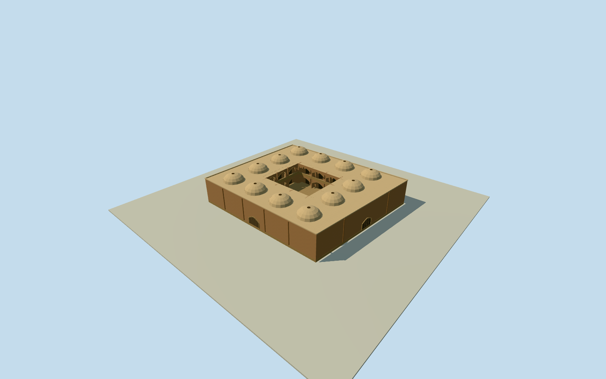

# Malek Timcheh, Isfahan

Whole4cornerMalekTimcheh/allouterwalls/fullroof/base.12 estimated peripheral vaults, an estimated open central court with two storeys of arcaded galleries, and closed arched exterior entries fromclearedCosteconstructionvocabulary; exactrooflayout/heights/hiddeninnercourts/currentfinish unmeasured. Separatewholemarket, notGrandBazaar2kmproxy.

Authoring state: **review-in-qa.json**. Current completion evidence is in [qa.json](qa.json) and the [completion ledger](../../../../qualla-structures/batches/qualla-002.PROGRESS.md).

- [Grand Bazaar, Isfahan](https://qualla.com/grand-bazaar-isfahan/)

Whole independent native435328911/MalekTimcheh4corner steppedmarket building: allouterwalls/fullroof/base and estimatedbrick/plaster lowvault-roof grid/smallrooflights/closedarchedentries. Nativewayhasnocourtholes/containingrelation; hiddenunmappedinternalcourts not asserted surveyedabsent. Exactrooflayout/heights/entriesandhistoricalconstructionfamily carryover estimated. SeparateQeysarieh/BazarchehNow/mosques/palaces/publicsquare/whole2kmGrandBazaar remain separate. Axis labels clarified before floor/sections; original anchor, heading, geometry and independently sampled field unchanged.

Originalnamed MalekTimcheh/ملک تیمچه marketbuildingway435328911: all4wholebuildingoutercontrols retained; no containingmultipolygon/explicitcourthole found. Heading follows native0to1longedge, exactsignedprojection/anchor fixed beforeindependentfield. Contemporaryhorizontalplan is actualnumericalmapping; heights/roofvaultgrid/oculi/hiddeninnercourt/closedentries/facade/finish are explicitoriginal estimates usingalreadyclearednearbyCosteconstructionfamily, not photographedMalekTimcheh elevations.

Wholeoriginalnamed4cornersteppedmarketbuilding preserved; no containingrelation/explicitcourtholes or enclosedindependentfeatures in savednumericcontext. Inner courtyard and two gallery levels follow newly consulted written typological evidence; their dimensions and exact coverage are estimates. No wholeGrandBazaar2kmcompletion fromthismember.

6m wall/roofbase abovefloor and1.8m shallowvault rise are originalestimates with3m heightuncertainty.12authored8m-grid vaultedbays/2.6mradii/.35moculi, closedperimeterarchedentries/pilasters/parapets andplainbrick/plaster/wood finishes are not observedroof/facadecensuses. ClearedCoste1840interior suppliesnearbyconstructionvocabulary only, not modernMalek Timchehappearance/colour/survey.

Fullbody/allwalls/roof retained. Skylinecaps tinyoculiconically; higherLODsrestore12actualmodelopenoculi and innerroofskins. Closedarchedentries are shallowgeometricalinterpretations againstouterwall, not openinteriorpassageorstructuralportalstudy. Paintedmotifs/sculpture/people/marketgoods andotherbuildings excluded.

Independent256m129x129field/16641heights/1rawtiles/datum1572.3539m fixed BEFORE floor.2/foundation-.5..+.2/roof6.2/parapet6.45/vaulttopsabout8m. Sourcegrade/verticalcontact approximate; no fieldflatten/mask/refetch/reframe/refit.

Qualla-first38families/zero conflicts alreadyscreened; sameexactalreadyclearedCoste1840/1867engraving/death1879/nativeSHA1/expirygrant. Originalonly personallyinspected for vault/pointedarch constructionvocabulary. No questionablemodern/aerialsource adopted orphototextures.

MIT 4.175 Streets & Squares, 2005, PDF pages16-17, written architectural descriptions identify Malek as a two-storey timcheh with court-facing roofed galleries, with the court possibly open or roofed. No report photographs, drawings or map pixels used. Authored open 14x12m central courtyard, upper floor3.2m, 1.2m deep galleries, three arches per side per floor and12 peripheral vault bays are explicit unsurveyed choices. They preserve the original full four-corner footprint/floor.2/roof6.2/parapet6.45/independent source field and datum. This is a factual typology correction to an unaccepted draft, never a terrain-contact refit; no accepted model reopened.

Build: `node content/worldgen/source/places/tj/tju/malek_timcheh_isfahan/models/generate-house.mjs`. Add `--check` to verify exact regeneration. 7944 triangles; 4 materials; no embedded photographs.
