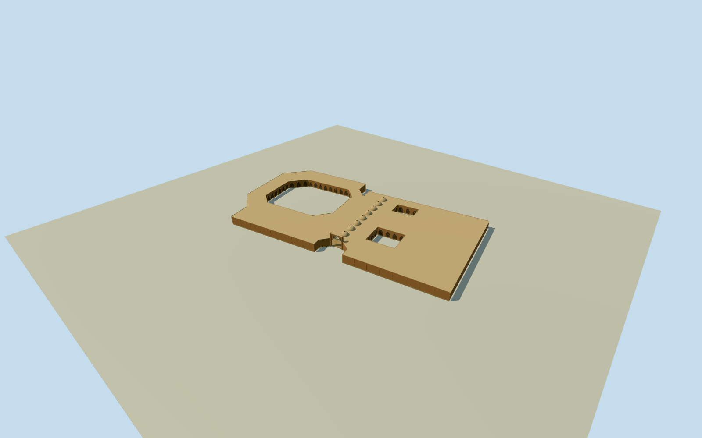

# Qeysarieh Bazaar, Isfahan

Wholeoriginal18cornerQeysariehbuilding/allthreeopencourts/allouterandinnerelevations/fullroof,8oculihallvaultsandrealmainportalopening. Exactcurrentnumericplan; clearedCoste1840vaultvocabulary. Heights/baycensus/portal/roof/finish/colors estimatesexplicit. Separatephysicalbuilding, notwholeGrandBazaar2kmproxy.

Authoring state: **review-in-qa.json**. Current completion evidence is in [qa.json](qa.json) and the [completion ledger](../../../../qualla-structures/batches/qualla-002.PROGRESS.md).

- [Grand Bazaar, Isfahan](https://qualla.com/grand-bazaar-isfahan/)

Whole original Qeysarieh entrance bazaar building relation3366393: all18 outer corners, complete perimeter walls and roof, allthree originalopen courtyard holes and their inner elevations, full coveredmainhall/oculus roof vocabulary, real southentrance notch and northernexit. Independent architecture within the longer GrandBazaar; cannot complete the whole2km citybazaar alone. Mainhall/gateway section and shoparcades are bounded estimates from original clearCoste1840 interior and current numeric envelope; no current surveyed finish or exact baycensus.

Original18cornerouteroutline and8/4/4cornercourtyardholes unchanged. All threecourtsremainopen, everyouter/inner elevation andwholeroofretained. Ground-levelmainportal is an actual modeledopening, not a blackrectangle. Courtyardshopfronts are closedrecesses, not claims of accessibleinteriors.

Original256m129x129 field/16641 heights/1 rawtiles, datum1572.0331m/range1570.9361..1581.2805m frozenbeforefloor/mainsections/geometry. Floor.2m/base-.5m/standardroof6m/parapet6.25m/hallvaultcrown8.6m/portal10.4m fixedonceafterfield. No groundmask/cut/flatten/refetch/reframe/refit; providergrade/verticalregistration unsurveyed.

Currentnativeheight6m is nominalproviderdata, not asurvey. Vaultprofile/baycount/oculusdiameter, facadebaycensus, portalheight/section/recessdepth, doorpositions/ornament/finish/colors and hiddenroofs are original boundedestimates;3mheight/3mcomponentuncertainty. Survivingvaultvocabulary from1840Costeengraving, not a claim of surveyed2026state.

Exactly one already-clearedpublishedQuallaCoste1840engraving, originalnativeSHA1matched andPD-Art/PD-old-auto-expired/death1879/1867publication verified. Quallamedia/articles/rightsmetadata unchanged. SmithsonianCC0booksource andETHclearaerials reviewed forscopeonly; not adoptedasexteriorphotometrictextures. SouthernShahMosqueplate not gatewayevidence. No questionableimagery orcommercialbasemap.

IndividualQeysariehbuilding/actualplacement; wholeGrandBazaar2kmroute/courtcollection remainsunfinished. No whole-cityslab or core-only parentcompletion. Dated2026approximatepreview/currentWorldEligiblefalse. FourLODskeepfullnativeplan/allcourts/entirephysicalbody, mainportalopening andhallvault/oculi; smallerrecess/rib/trimdetails reduce atdistance.

Build: `node content/worldgen/source/places/tj/tju/qeysarieh_bazaar_isfahan/models/generate-house.mjs`. Add `--check` to verify exact regeneration. 16754 triangles; 5 materials; no embedded photographs.
