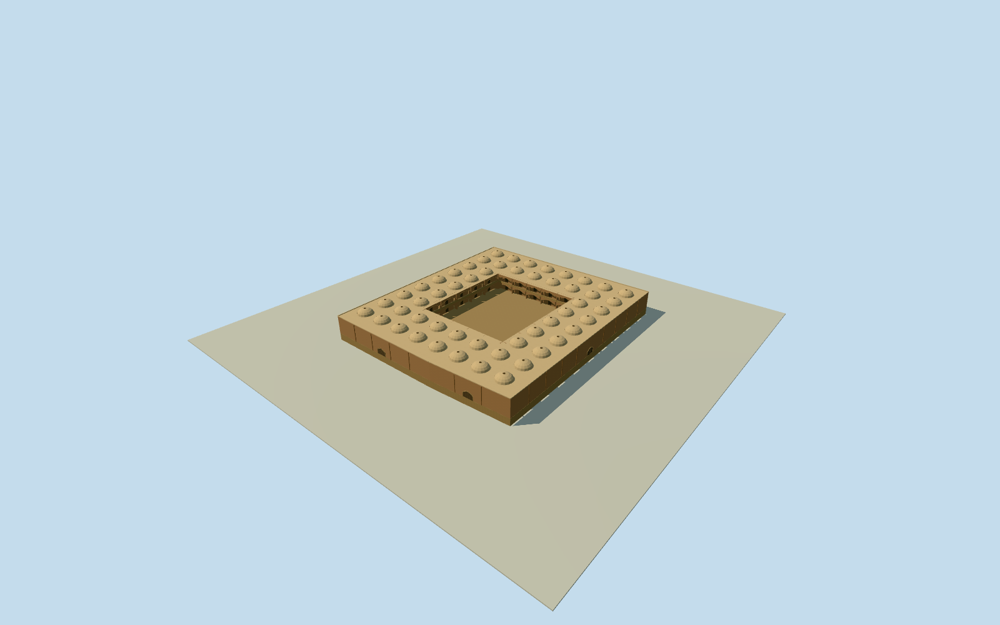

# Qeysarieh West Market, Isfahan

Whole independent unnamed five-corner building/marketplace way244295114 west of Qeysarieh, with all original outer controls and complete walls/base/roof volumes. Descriptive geographic model name, not a claim of native proper name. Internal court, galleries, storeys, roof divisions and facades are estimated from local construction vocabulary; native record contains no courtyard hole. Separate footprint checked against all10 existing/current bazaar members, no overlap. Existing bazaar members and reserved Jameh Mosque remain separate. Original unnamed building/marketplace way244295114, all5 whole-building outer controls retained. No containing relation or explicit mapped courtyard hole. Fixed signed projection from original0to1 edge and original bbox centre before independent field/floor/court/sections/geometry. Actual numerical horizontal outline; roof/court/storeys/facades/heights/finish are original unsurveyed estimates. Whole independent unnamed five-corner building/marketplace244295114 preserved. Ordinary geographic descriptive identity, not native proper name. No explicit court hole or containing relation in original numeric records. Authored32x36m open court/two gallery storeys/upper floor3.2m/gallery depth1.2m/five arches per side per floor are unsurveyed hidden-layout estimates, including court existence and coverage. General Isfahan sarai/timcheh typology from written MIT4.1752005PDFpp16-17 only; no report image/map/diagram pixels used. Original6m wall/roof height above floor and1.8m shallow vault rise have3m uncertainty. 52 estimated8m-grid peripheral roof vaults/2.6m radii/.35m oculi, plain brick/plaster/wood finishes/closed perimeter arched entries have3m component uncertainty. Exact modern west-market roof/storeys/facades not photographed. Already-cleared Coste1840/1867engraving supplies local pointed brick arch/vault/oculus vocabulary only. Independent256m129x129field/16641heights/1original rawtile/datum1574.0783m acquired before floor.2/foundation-2.2/roof6.2/parapet6.45/upperfloor3.2. Original outer-corner grades-.1? exact range-1.77514..1.53724m relative centre. Foundation-2.2 chosen once as estimated buried masonry skirt below these controls; actual basement/threshold vertical tie unmeasured. No fieldmasking/flattening/refetch or geometry-driven terrain/floor refit. All four LODs retain whole outer body/roof ring/open court/two gallery levels. Skyline simplifies galleries to two broad arches per side and omits tiny rooflight holes in the continuous roof base; all estimated vault masses remain. Higher LODs restore five arches/open rooflights/plain recessed shop fronts. No artwork, people, stock or photo textures. Existing accepted bazaar geometry unchanged; reserved Jameh Mosque excluded.

Authoring state: **review-in-qa.json**. Current completion evidence is in [qa.json](qa.json) and the [completion ledger](../../../../qualla-structures/batches/qualla-002.PROGRESS.md).

- [Grand Bazaar, Isfahan](https://qualla.com/grand-bazaar-isfahan/)

Whole independent unnamed five-corner building/marketplace way244295114 west of Qeysarieh, with all original outer controls and complete walls/base/roof volumes. Descriptive geographic model name, not a claim of native proper name. Internal court, galleries, storeys, roof divisions and facades are estimated from local construction vocabulary; native record contains no courtyard hole. Separate footprint checked against all10 existing/current bazaar members, no overlap. Existing bazaar members and reserved Jameh Mosque remain separate.

Original unnamed building/marketplace way244295114, all5 whole-building outer controls retained. No containing relation or explicit mapped courtyard hole. Fixed signed projection from original0to1 edge and original bbox centre before independent field/floor/court/sections/geometry. Actual numerical horizontal outline; roof/court/storeys/facades/heights/finish are original unsurveyed estimates.

Whole independent unnamed five-corner building/marketplace244295114 preserved. Ordinary geographic descriptive identity, not native proper name. No explicit court hole or containing relation in original numeric records. Authored32x36m open court/two gallery storeys/upper floor3.2m/gallery depth1.2m/five arches per side per floor are unsurveyed hidden-layout estimates, including court existence and coverage. General Isfahan sarai/timcheh typology from written MIT4.1752005PDFpp16-17 only; no report image/map/diagram pixels used.

Original6m wall/roof height above floor and1.8m shallow vault rise have3m uncertainty. 52 estimated8m-grid peripheral roof vaults/2.6m radii/.35m oculi, plain brick/plaster/wood finishes/closed perimeter arched entries have3m component uncertainty. Exact modern west-market roof/storeys/facades not photographed. Already-cleared Coste1840/1867engraving supplies local pointed brick arch/vault/oculus vocabulary only.

Independent256m129x129field/16641heights/1original rawtile/datum1574.0783m acquired before floor.2/foundation-2.2/roof6.2/parapet6.45/upperfloor3.2. Original outer-corner grades-.1? exact range-1.77514..1.53724m relative centre. Foundation-2.2 chosen once as estimated buried masonry skirt below these controls; actual basement/threshold vertical tie unmeasured. No fieldmasking/flattening/refetch or geometry-driven terrain/floor refit.

All four LODs retain whole outer body/roof ring/open court/two gallery levels. Skyline simplifies galleries to two broad arches per side and omits tiny rooflight holes in the continuous roof base; all estimated vault masses remain. Higher LODs restore five arches/open rooflights/plain recessed shop fronts. No artwork, people, stock or photo textures. Existing accepted bazaar geometry unchanged; reserved Jameh Mosque excluded.

Build: `node content/worldgen/source/places/tj/tju/qeysarieh_west_market_isfahan/models/generate-house.mjs`. Add `--check` to verify exact regeneration. 22674 triangles; 4 materials; no embedded photographs.
