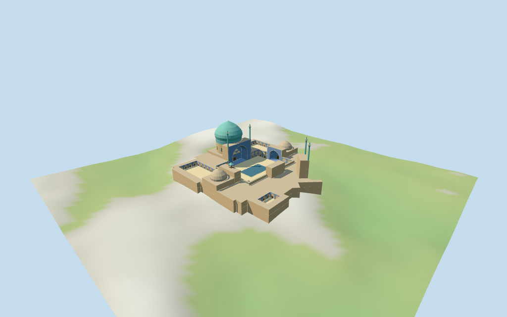

# Shah Mosque

Individual medium-fi Shah Mosque compound:large turquoise bulbous dome/pale transition,two smaller side caps,four slender tiled minarets/open upper galleries,angled square-facing entrance iwan plus four court iwans,closed two-tier central courtyard fields/single-tier madrasa fields,large rectangular court basin and open timber pavilion on the southeast side iwan. Four existing shared256² graphs,six merged groups,four browser levels. Five portal frames and all18 current controls retain mapped identity/plan/heights separately from estimated profiles and retained qualified54/52m facts. Fine tile/calligraphic art,unseen roofs,precise terrace/planting/current finish,interiors and engineering omitted or unverified.

## Evidence and reconstruction

Published dimensions and reconstructed details are separated in spec.json. Primary references:

- [Reference](https://commons.wikimedia.org/wiki/File:Entrance_iwan_and_dome_of_Shah_Mosque_Isfahan_2014_(1).jpg)
- [Reference](https://commons.wikimedia.org/wiki/File:Courtyard_iwans_Shah_Mosque_Isfahan_2014_(2).jpg)
- [Reference](https://commons.wikimedia.org/wiki/File:Madrasa_and_dome_exterior_of_Shah_Mosque_Isfahan_2014_(2).jpg)
- [Reference](https://commons.wikimedia.org/wiki/File:Entrance_iwan_muqarnas_of_Shah_Mosque_Isfahan_2014_(2).jpg)

Four existing shared256² longformat brick,sandstone,mosaic and wood graphs;six merged groups. Blue portal frames and turquoise dome/minaret tiles use original vertex tints on the same generic mosaic graph. Metric UVs/linear colors,zero embedded images,baked lighting or copied facade/calligraphy art. Broad original facets abstract muqarnas.

## Model and axes

17,105 triangles; 51,315 vertices; 6 material groups; 2,056,360 bytes. Native bounds: -74.131, -10.934, -73.097 to 74.225, 54.826, 73.233. Source hash: `sha256:57b1a42aa022c60b0dba168c51f6f00b89655562ed48337bcdefdcfc1e832fe6`.

{"x":"northeast angled square entrance,opposite southwest prayer hall/main dome","y":"up","z":"southeast side iwan/pavilion,opposite northwest iwan"}

Standard viewer DEM datum1581.578325m;whole perimeter-10.58..-2.33m relative to anchor. Working floor2.826m is maximum bilinear sample over the core at2m spacing plus0.3m;not surveyed paving elevation. Raw DEM retained without cutout/flattening;adaptive footings extend below it and crossY=0. Model court paving stays inside whole footprint. Exact altitude,street/threshold/terrace/terrain joins,planting and walking unverified;adjacent square and city remain host content.

## Reproduce

Run `node packages/worldgen/scripts/generate-additional-landmarks.mjs --ids=shah_mosque` (or add `--check`). The generator preserves manually edited masters by checking their baseline hashes. Import through the standard authored-model workflow with optimization disabled; then capture all QA cameras, including shared-surface views.

## Pending work

- Retained exact relation/1627974 /Q643098 matches current PMTiles whole52776559761222 (3*2^44+1627974). Earlier retained outline/four courtyard holes remain separate from current25-point outer/four four-point holes and18 raw building/part controls. Anchor[51.677832934,32.654893778] and heading1.006149928764rad unchanged,no horizontal rescale. Native−X southwest prayer hall/main dome,+X northeast angled square entrance;+Z southeast side iwan/pavilion,−Z northwest side iwan. The entrance front follows its mapped diagonal rather than rotating it onto the prayer axis. Exact components locate52m main dome,overlapping38m dome component,two22m side caps,27m entrance/prayer frames,three18m side frames,four48m minarets and6/9/12m ranges. Adjacent Naqsh-e Jahan square arcades,roads and city buildings remain host content. Opening/cornice/pavilion/roof profiles are picture estimates within about2.5m/facing about3°.
- Retained height claims54m and52m carry P518 part qualifiers Q12493 andQ48356;preserve the original qualifier objects and references without treating either as a blanket whole-building height. Current PMTiles controls specify whole low ranges6m,central U-range9m,prayer/side halls12m,overlapping main dome component38m and outer envelope52m,two side caps22m,entrance/prayer iwan frames27m/three side frames18m and all four minarets48m above min_height27m. Working model follows these tagged envelopes. Main dome pale transition12–25m/tiled drum25–30m/bulb30–51m/finial52m;side caps12–22m,minaret gallery43–45m/cap45–47.4m/tip48m. Main prayer opening24m high and24.5m wide,entrance opening23.3m by12.5m,three side openings15.6m by14.8m,pavilion top24m,arcade tier heights and roof vaults are untagged picture estimates. Dome shape,closed recesses,steps,bands,muqarnas and unseen roofs are approximate,current finish/interiors and engineering unverified.
- Standard viewer DEM datum1581.578325m;whole perimeter-10.58..-2.33m relative to anchor. Working floor2.826m is maximum bilinear sample over the core at2m spacing plus0.3m;not surveyed paving elevation. Raw DEM retained without cutout/flattening;adaptive footings extend below it and crossY=0. Model court paving stays inside whole footprint. Exact altitude,street/threshold/terrace/terrain joins,planting and walking unverified;adjacent square and city remain host content.
- Individual medium-fi compound from four inspected2014 entrance/court/madrasa/muqarnas pictures. Large turquoise dome,two smaller side caps,four minarets,five iwans,central two-tier/madrasa single-tier fields,rectangular basin and southeast timber lookout. Angled entrance retains mapped bearing. Iwan/arcade/drum fields close before interiors;minaret/pavilion upper stages open. Skyline uses closed minaret gallery bands;district opens coarse stages and simplifies bays. Smaller cap finish,unseen roofs/terrace/interior plans,planting,current finish/fixtures,precise street/ground contacts and engineering unverified. Coarse standard DEM has a pronounced urban height variation;working floor/foundations are a clearance approximation,not a surveyed podium. Fine tile/calligraphy,flags/scaffolding/fixtures/railings omitted. Adjacent square arcades/streets/city buildings remain host content. Physical-device timing unmeasured.

This bundle follows the medium-fi standard. Medium-fi appearance and geographic fit are reviewed separately. Hash-bound visual acceptance is recorded separately after capture inspection.

## Additional geographic data

©OpenStreetMap contributors;Protomaps;Mapzen/USGS terrain tiles.
