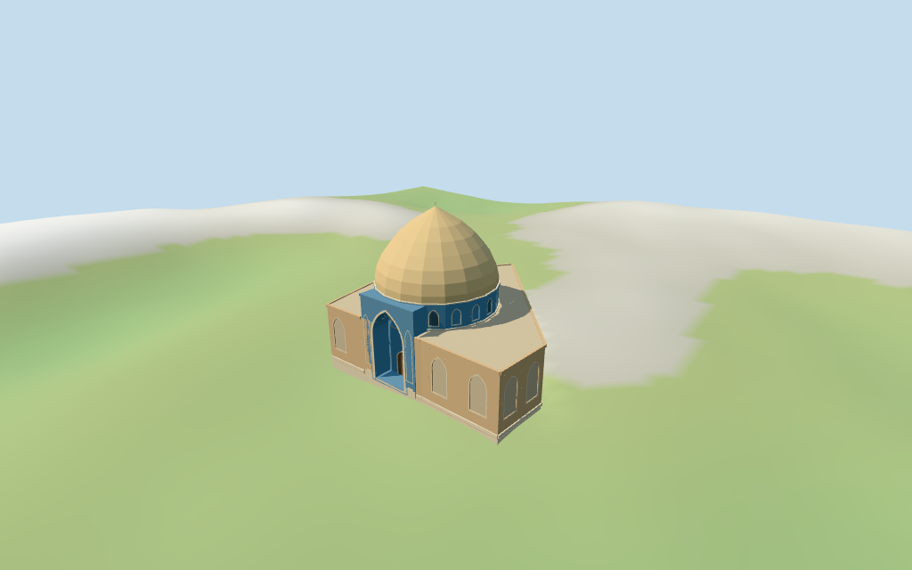

# Sheikh Lotfollah Mosque

Individual medium-fi Sheikh Lotfollah Mosque exterior: warm pointed dome on blue cylindrical drum, small bead finial, recessed blue pointed entrance with broad original faceted vault cells, pale base and low brick body. Exact main outline and mapped rounded roof-part retained; main mapped total 32 m guides top. Five existing shared 256² graphs, seven merged material roles and four budgeted browser LODs. Bazaar, square, exact tile artwork, hidden passage/interiors and precise terrain joins remain outside this asset.

## Evidence and reconstruction

Published dimensions and reconstructed details are separated in spec.json. Primary references:

- [Reference](https://commons.wikimedia.org/wiki/File:Sheikh_Lotfollah_Mosque_jb1.jpg)
- [Reference](https://commons.wikimedia.org/wiki/File:Lotfollah_mosque,_isfahan_(1).jpg)

Five existing shared 256² longformat brick, sandstone, lime plaster, generic mosaic and wood graphs serve seven merged roles including opaque blue-grey fields. Dome and blue facade reuse the same generic mosaic graph with different linear tints. Metric UVs; zero embedded images, baked lighting, copied calligraphy or unique facade atlases.

## Model and axes

5,171 triangles; 15,513 vertices; 7 material groups; 624,732 bytes. Native bounds: -22.154, -2.511, -21.784 to 22.213, 31.626, 21.996. Source hash: `sha256:9aff3e5e8ff7c664e8420ebf2775a1074aff3dfcee68b0d19e939cddf1aebb3a`.

{"x":"south-southeast frontage","y":"up","z":"west-southwest entrance"}

Normal viewer DEM datum 1572.0794094897037 m; working floor -0.37405241159531216 m is the median of 50 outside-perimeter samples at 1 m offset plus 0.3 m. 142 raw main-footprint samples span -2.1642793043172333..1.4588514007439244 m. Adaptive footings follow the mapped outline. Preview terrain seats the footprint and 1.5 m margin; model paving covers the exact main-outline cutout. Exact raised entrance steps, thresholds, street/paving levels, basement levels and terrain joins remain unverified.

## Reproduce

Run `node packages/worldgen/scripts/generate-additional-landmarks.mjs --ids=sheikh_lotfollah_mosque` (or add `--check`). The generator preserves manually edited masters by checking their baseline hashes. Import through the standard authored-model workflow with optimization disabled; then capture all QA cameras, including shared-surface views.

## Pending work

- Retained exact way 244271852 / Q856356 is current viewer building 35184616360684. Its six current outer vertices, original anchor and heading remain fixed. Current rounded building part 35185027499279 / way655410447 has 19 outer vertices and guides the drum/dome plan. Positive Z points approximately west-southwest toward the square and entrance; positive X approximately south-southeast along the frontage. Two pictures guide the signed entrance, dome and blue drum. The entrance is centered approximately at local [-2.55,21.4]. Detailed roof divisions, entrance dimensions and side/rear bays are estimates. Long neighboring bazaar building 35184756945754 and the square remain host content; they are not absorbed into this mosque model.
- Retained map and current PMTiles main-building height are 32 m; retained dome-height statement is also 32 m. Use 32 m as whole-model finial top above the working floor, not as an eaves height. There is no independently mapped roof-part height or datum. Visualization subdivisions: main low roof 11.8 m, front flanks 11.8 m, blue drum 11.8–16.8 m, warm pointed dome 16.8–30.8 m and small bead finial to 32 m; blue entrance frame 16.5 m with pointed recess top 14.7 m. Detailed subheights and roof profiles are estimates. No minarets or open courtyard are added. Fine tile/calligraphic artwork, hidden corridors, muqarnas patterns and furnished interiors are omitted or broadly abstracted.
- Normal viewer DEM datum 1572.0794094897037 m; working floor -0.37405241159531216 m is the median of 50 outside-perimeter samples at 1 m offset plus 0.3 m. 142 raw main-footprint samples span -2.1642793043172333..1.4588514007439244 m. Adaptive footings follow the mapped outline. Preview terrain seats the footprint and 1.5 m margin; model paving covers the exact main-outline cutout. Exact raised entrance steps, thresholds, street/paving levels, basement levels and terrain joins remain unverified.
- Individual mosque exterior; long bazaar arcade remains separate host content. Mapped total height is 32 m and rounded roof part guides the dome. Detailed portal dimensions, roof subdivisions, low side/rear bays, drum fields and finial beads are estimates. Generic shared mosaic broadly suggests warm/blue tile rhythm; fine floral/calligraphic artwork is not reproduced. Recessed iwan has a closed rear wall and door; no hidden corridor, furnished-interior or free-walking claim. Exact current finish, entrance steps, terrain joins and physical-device timings remain unverified.

This bundle follows the medium-fi standard. Medium-fi appearance and geographic fit are reviewed separately. Hash-bound visual acceptance is recorded separately after capture inspection.

## Additional geographic data

©OpenStreetMap contributors; Protomaps; Mapzen/USGS terrain tiles.
