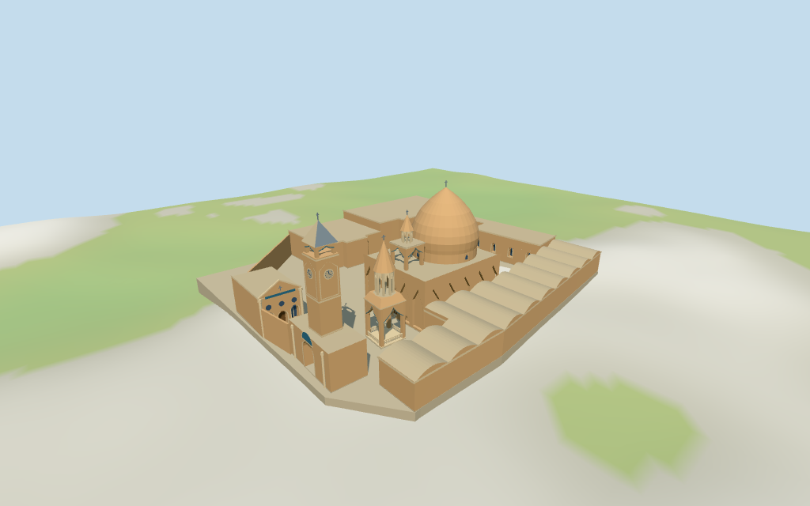

# Vank Cathedral

Individual medium-fi Vank Cathedral/courtyard complex:buff pointed dome,tall blind-niche church walls,open tiled roof belfry,freestanding double-stage belfry,western clock gateway,northwest pavilion and four mapped surrounding ranges. Paved open courtyard preserves the mapped garden. Exact inscriptions/sculpture/tile designs,full interiors,independently verified peripheral facades,forecourt statue/fountain and certified walking excluded.

## Evidence and reconstruction

Published dimensions and reconstructed details are separated in spec.json. Primary references:

- [Reference](https://commons.wikimedia.org/wiki/File:20110106_Vank_Cathedral_Isfahan_Iran_Panoramic_View_(cropped).jpg)
- [Reference](https://commons.wikimedia.org/wiki/File:Vank_Cathedral_of_Isfahan.jpg)
- [Reference](https://commons.wikimedia.org/wiki/File:2023_08_29_17_18_IMG_4716.jpg)

Five existing 256-square running brick,raw limestone,ceramic tile,copper and plain wood graphs. Warm brick church/dome/cones share one graph;stone trim/roofs/paving share limestone. Blue tile and alternating pale/blue metal clock roof supply restrained accents. Flat blue-gray glazing,metric UVs,hard architectural normals,no embedded images.

## Model and axes

9,402 triangles; 28,206 vertices; 8 material groups; 1,132,940 bytes. Native bounds: -33.500, -3.910, -52.913 to 49.950, 28.800, 22.400. Source hash: `sha256:a4e61d237c228b33439c7dd2835dd249280107b87008a821fe7124a17903064a`.

{"x":"east toward large church dome","y":"up","z":"south toward lower service range"}

Standard DEM datum 1583.040460m;estimated common floor 0.6m clears sampled compound peak 0.205m and building perimeter -3.27..0.07m. Foundations follow coarse terrain. Exact courtyard/gate thresholds,absolute altitude and certified walking unverified;no independent survey.

## Reproduce

Run `node packages/worldgen/scripts/generate-additional-landmarks.mjs --ids=vank_cathedral` (or add `--check`). The generator preserves manually edited masters by checking their baseline hashes. Import through the standard authored-model workflow with optimization disabled; then capture all QA cameras, including shared-surface views.

## Pending work

- Eight current unmodified PMTiles building plans retain the approximately23.5x20m church,6x6m freestanding belfry,western gatehouse/northwest pavilion and four surrounding ranges. Named Armenian Vank Cathedral POI is22.16m from the retained reference coordinate,and the current museum POI lies in the north range. The previously unresolved heading is derived from the church long wall and checked against the southwest panorama/western gate picture. No map building has height values:all architectural heights and internal subdivisions are picture-led estimates. No exact-QID polygon match or independent survey claimed.
- Standard DEM datum 1583.040460m;estimated common floor 0.6m clears sampled compound peak 0.205m and building perimeter -3.27..0.07m. Foundations follow coarse terrain. Exact courtyard/gate thresholds,absolute altitude and certified walking unverified;no independent survey.
- Individual medium-fi exterior from three useful church/gateway/pavilion pictures and standard PMTiles/DEM. All heights,main dome/drum/roof-belfry positions,blind niches,openings,clock/gate/upper columns,pale rails,peripheral roof/room subdivisions and courtyard/boundary are picture-led estimates. Northwest pavilion uses a library-like facade;its exact map correspondence/function and the other range facades are unverified. Exact Armenian lettering,tile designs/sculpture,full interiors,forecourt statue/fountain and certified walking excluded. Physical device measurements pending.
- Skyline preserves principal masses,dome and open belfry/gateway voids with coarse piers/four-column upper stages. District adds shared graphs,flat window/closed-door fields,blue tile borders,clock/pavilion rhythms and eight-column upper stages. Street adds actual church/door/pavilion/range recesses and sparse belfry rails. Closeup/master refine dome/cone facets,clock ticks,mullions and railing cadence. Changes in curved profiles,openings and ornament remain visible.

This bundle follows the medium-fi standard. Medium-fi appearance and geographic fit are reviewed separately. Hash-bound visual acceptance is recorded separately after capture inspection.

## Additional geographic data

©OpenStreetMap contributors;Protomaps;Mapzen/USGS terrain tiles.
