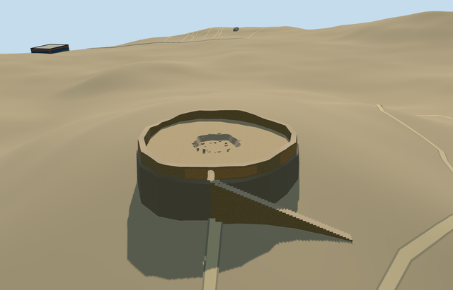

# east_maneckji_tower_of_silence — Maneckji Tower of Silence, Yazd (east)

Reviewed 2026-10-20 in one continuous author/build/inspect/fix round.

## Appearance

Inspected47 current portable/shared/medium-fi/native-site views in one construction/correction pass. Specific eastern Maneckji dakhma retains the mapped irregular base, low damaged roofless ring, sparse ocher plaster remnants, genuinely open northeastern arched passage, narrow supported approach steps, gritty open court, shallow recessed irregular pit/broken lip and sparse rubble. Corrected the overly uniform lower support to a bounded battered raw-stone contact surface and removed the repeated striping of plaster patches during this same pass. The exact damage, fragment inventory and rocky contact remain simplified; this is not an intact historical tower or a generic roofed shell.

## Shared materials and browser levels

Four reused256-square material graphs: stone_drywall, stone_sandstone_raw, stucco and gravel. Rubble masonry supplies the surviving wall and stair sides; tinted raw stone supplies the caps, recessed pit sides, sparse rubble and bounded battered contact; sparse tinted stucco supplies surviving earthen plaster; gravel supplies the dusty court/pit floor. Five source roles merge into four near-level draws. Every shared graph is read once and model eviction disposes geometry. Six current GLBs contain zero embedded images and only canonical shared refs; runtime levels use separate position/normal buffers and equal counted CPU/GPU bytes.

| Level | Triangles | Bytes | Draws |
| --- | ---: | ---: | ---: |
| skyline | 448 | 49268 | 1 |
| district | 1580 | 157780 | 4 |
| street | 2472 | 245256 | 4 |
| closeup | 3420 | 338460 | 4 |

Inspected24 medium-fi views at three distances, noon/late afternoon, Economy/High, neutral silhouette, four matched levels and transitions. Skyline retains the roofless irregular ring, open passage, pit and supported approach; district/nearer levels add actual steps/plaster/rubble. Initial skyline plus district207048bytes, below phone3MB/laptop6MB targets. Synthetic procedural context is generalized and does not reconstruct the lower Yazd precinct. Physical laptop/phone and dense-city timings remain pending. Levels448/1580/2472/3420 triangles; at most four draws.

## Approximate map fit

Independent member east_maneckji_tower_of_silence uses its own OSMway239508111/native circle35184611596943 and anchor54.357023376,31.821894613, heading0/native east-south. Q27702877 remains the shared two-tower site identity; no separate QID is invented. Native nineteen-vertex base is roughly30.44x31.21m, with upper ring inset0.8m for battered rocky contact. Native approach35184755387040 crosses the northeastern rim, giving internal entrance phase-0.8161673919203797rad. Fine portal/damage/pit allocation retains20degree/2m approximation. Only this native circle is replaced, with zero residual. All80 independent resident buildings among81 originals (108 wider records), including the separate western tower, original6m Mapzen terrain, native road inputs and zero-water condition remain unchanged. Failure restores81 originals; all four loaded levels unload with zero live geometry. No ground/water cutout or broad terrain slab is used.

## Limits

Original medium-fi geometry follows actually viewed ordinary2016 exterior and2010 interior pictures. No qualified building height exists: inner wall nominally1.3..2.5m above court,1.75m portal apex, nominal1.2m wall thickness, shallow1m pit with roughly4.35m irregular radius, plaster/broken-block inventory and steps are explicit picture/map approximations. The court sits3.023529m above coarse anchor grade so the recessed pit clears retained native ground; the bounded rocky contact and supported stairs are visualization estimates, not surveyed excavation/hill/foundation geometry. Fine rock damage and exact unseen passage shape remain approximate. No intact historical exposure-grid, roof, bodies/bones, copied label/photo atlas, lower precinct buildings, western tower or whole-hill mesh authored. The subsequent independent Golestan member and paired-site checks complete towers_of_silence_in_yazd; both current member pins are recorded in collectionIntegrationReview.

## Selected checks

Six Khronos files: zero errors/warnings.642 actual mesh/material/contact checks; 47 current inspected views. Scene validation/sim30 and strict selected medium-fi audit pass. Source/runtime/LOD hashes and material bindings verified.

Rebuild: node packages/worldgen/scripts/generate-additional-landmarks.mjs --ids=east_maneckji_tower_of_silence; node packages/worldgen/scripts/import-structure-models.mjs --ids=east_maneckji_tower_of_silence; node packages/tooling/scripts/generate-landmark-lods.mjs --ids=east_maneckji_tower_of_silence --force.

Source: sha256:c02bb5995031733e2385d356db573c57840be55857defd01da2569b64b830b3d

Runtime: sha256:d6c85aed4bea99c6c18418142e7d7210c54536b9638b1e3ac4e82494053352ca

Input: sha256:55b3525644d8143690f9acdea3011157d89aec51503bb5bd7a4b629d05cf1f99

## Viewed ordinary pictures

https://commons.wikimedia.org/wiki/File:Torre_del_silencio,_Yazd,_Ir%C3%A1n,_2016-09-21,_DD_69.jpg — Diego Delso; CC-BY-SA-4.0. Viewed only; no pixels copied.

https://commons.wikimedia.org/wiki/File:Tower_of_Silence_(Yazd)_003.jpg — Petr Adam Dohnalek; CC-BY-SA-3.0-CZ. Viewed only; no pixels copied.

## Paired site check

Five current paired-site renders actually inspected: district/closeup whole site, closeup west entry, closeup east member at its own anchor, and failed-load fallback. Separate models roughly240m apart retain their own anchors/entrance directions under shared siteQ27702877; no centroid GLB or invented member QIDs. Ordinary pictures/standard PMTiles only. Lower precinct remains generalized native context; terrain/fine detail limits remain in each member review. Both members use the same four shared graphs, read once; only two corresponding shells are replaced, all16 independent resident inputs and native terrain/roads remain unchanged. Failure restores18 originals; unloading releases all geometry. Five additional current paired views are pinned in qa.json.

## Placement identifier correction

Placement ID normalized east.maneckji.tower.of.silence to east.maneckji.tower.of.silence for the published lowercase/dot/hyphen grammar. Every spatial field and all six source/runtime/LOD bytes verified unchanged; existing approved images retained without new rendering.
