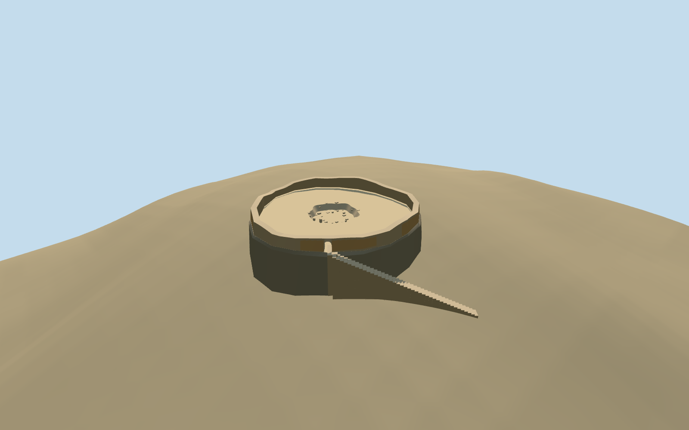

# Maneckji Tower of Silence, Yazd (east)

Specific standing eastern/southeastern Maneckji dakhma at Yazd: irregular mapped ring with low damaged roofless masonry and sparse ocher plaster remnants, genuinely open narrow arched passage, bounded supported approach steps, gritty open court, shallow irregular recessed central pit/broken lip and sparse rubble. Four reused shared rubble/raw sandstone/stucco/gravel graphs. No intact historical tall tower, roof, bodies/bones, copied label/photo atlas, lower precinct buildings, the other dakhma, complete hill or broad terrain slab.

## Evidence and reconstruction

Published dimensions and reconstructed details are separated in spec.json. Primary references:

- [Reference](https://commons.wikimedia.org/wiki/File:Torre_del_silencio,_Yazd,_Ir%C3%A1n,_2016-09-21,_DD_69.jpg)
- [Reference](https://commons.wikimedia.org/wiki/File:Tower_of_Silence_(Yazd)_003.jpg)

Specific standing eastern/southeastern Maneckji dakhma at Yazd: irregular mapped ring with low damaged roofless masonry and sparse ocher plaster remnants, genuinely open narrow arched passage, bounded supported approach steps, gritty open court, shallow irregular recessed central pit/broken lip and sparse rubble. Four reused shared rubble/raw sandstone/stucco/gravel graphs. No intact historical tall tower, roof, bodies/bones, copied label/photo atlas, lower precinct buildings, the other dakhma, complete hill or broad terrain slab.

## Model and axes

3,420 triangles; 10,260 vertices; 4 material groups; 413,348 bytes. Native bounds: -14.248, -6.911, -26.223 to 16.196, 5.409, 16.196. Source hash: `sha256:c02bb5995031733e2385d356db573c57840be55857defd01da2569b64b830b3d`.

{"x":"east","y":"up","z":"south"}

The geographic proposal uses exact-QID OpenStreetMap evidence. Map-derived orientation and estimated architectural details require real-site visual review; preview eligibility is distinct from geographic/fidelity approval. Map attribution: © OpenStreetMap contributors, ODbL-1.0.

## Reproduce

Run `node packages/worldgen/scripts/generate-additional-landmarks.mjs --ids=east_maneckji_tower_of_silence` (or add `--check`). The generator preserves manually edited masters by checking their baseline hashes. Import through the standard authored-model workflow with optimization disabled; then capture all QA cameras, including shared-surface views.

## Pending work

- Specific standing eastern/southeastern Maneckji dakhma at Yazd: irregular mapped ring with low damaged roofless masonry and sparse ocher plaster remnants, genuinely open narrow arched passage, bounded supported approach steps, gritty open court, shallow irregular recessed central pit/broken lip and sparse rubble. Four reused shared rubble/raw sandstone/stucco/gravel graphs. No intact historical tall tower, roof, bodies/bones, copied label/photo atlas, lower precinct buildings, the other dakhma, complete hill or broad terrain slab.
- Q27702877 identifies the two-tower site, not an invented independent member QID. This independent eastern member is OSMway239508111, matching native circle35184611596943 and its cemetery POI. Use its own anchor54.357023376,31.821894613, heading0/native east-south. Native nineteen-vertex outline fixes the roughly30.44x31.21m base; upper ring is inset0.8m to form the bounded battered rocky contact. Native approach35184755387040 crosses the northeastern rim, giving an internal entrance phase near-0.8rad; fine portal/damage/pit inventory retains20degree/2m approximation. Western Golestan is a separate required member and placement about240m away.
- No qualified mapped building height exists. Surviving inner enclosure nominally1.3..2.5m above the court and1.75m doorway apex are picture-led estimates; shallow pit nominal depth1.0m/radius4.2..4.7m,1.2m masonry thickness, individual broken blocks/plaster fragments and approach allocation are approximate, not an archaeological survey. No restored original exposure-grid or furnished historical scene is invented.
- Keep the original6m standard Mapzen hill, native roads/water and every independent building including the western tower and lower precinct. Replace only this eastern native circle. Court/pit floor is bounded to the mapped circle and seated above occupied coarse-ground maxima; pit remains truly recessed without cutting native ground. A bounded battered raw-stone contact surface within the mapped footprint supports the court above coarse grade; its profile is a visual approximation of the rocky tower seat, not newly surveyed hill terrain. Buried feet and narrow supported stairs meet coarse grade. This visualization contact estimate does not claim a surveyed hill profile, excavation or foundation engineering; no whole-hill mesh, broad slab, ground/water cutout or valley flattening.
- Ordinary2016 exterior/2010 interior views carried through construction. Native outline/approach fix the eastern member independently. No qualified height; broken masonry, portal, plaster, pit and steps remain explicit approximations. No roof, complete historical exposure-grid, bodies/bones, other dakhma, lower precinct buildings, whole hill or copied image pixels.

This bundle follows the medium-fi standard. Medium-fi appearance and geographic fit are reviewed separately. Hash-bound visual acceptance is recorded separately after capture inspection.
