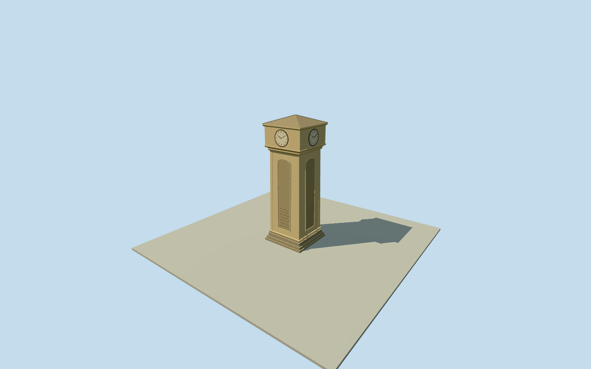

# Markar Clock Tower — Yazd

Whole independent Markar/Ferdowsi clock tower in Markar Square, Yazd: square base and stepped body, four-sided mechanical clock chamber, plain sloped roof, cornices and integral inscription panels. Primary historian Masarrat’s own republished2026interview reports18m height; museum’s written architecture account specifies square plan/sloped plain roof/four clock faces. Exact nativeQ5902355point fixes identity/location only; base/shaft/clock/roof widths, vertical divisions, taper, recesses/inscription panel layout and precise orientation/finish/grade are bounded reconstruction estimates. No mapped footprint, photographic appearance, exact historic inscription/facade census or surveyed height claimed. Separate Markar school, orphanage, museum and whole roundabout/landscape excluded. Every image/figure/video unused.

Authoring state: **review-in-qa.json**. Current completion evidence is in [qa.json](qa.json) and the [completion ledger](../../../../qualla-structures/batches/qualla-002.PROGRESS.md).

- [Markar Clock Tower](https://qualla.com/markar-clock-tower/)

Whole independent Markar/Ferdowsi clock tower in Markar Square, Yazd: square base and stepped body, four-sided mechanical clock chamber, plain sloped roof, cornices and integral inscription panels. Primary historian Masarrat’s own republished2026interview reports18m height; museum’s written architecture account specifies square plan/sloped plain roof/four clock faces. Exact nativeQ5902355point fixes identity/location only; base/shaft/clock/roof widths, vertical divisions, taper, recesses/inscription panel layout and precise orientation/finish/grade are bounded reconstruction estimates. No mapped footprint, photographic appearance, exact historic inscription/facade census or surveyed height claimed. Separate Markar school, orphanage, museum and whole roundabout/landscape excluded. Every image/figure/video unused.

Reported18m height follows historian Hossein Masarrat’s own republished IRNA interview, not a surveyed measurement. Popular4m reports are inconsistent and not used as the whole current tower height; the historian’s report defines this approximate2026reconstruction. Primary museum article supplies square plan, plain sloped roof and fourclockface form; its campus-centre wording is not a physical placement control. Exact original native point is in the roundabout.

Native map supplies a location point only. Estimated6.4m whole base/5.2m shaft/5.8m clock block, width taper, vertical tier divisions, cornices, corner piers, four shaft recesses, clock diameter/dial/tick layout/hand pose, roof pitch/eaves/finial and door/inscription panels are reconstruction estimates. Height18m total is reported, not a physical survey. A square cardinal orientation is approximate within20degrees.

All four faces retained with simple mechanical-clock form. Fine inscription panels use original abstract incised strokes; no exact Persian verse, historical letterform, author’s calligraphy or measured relief/photo appearance reproduced. Clock hand pose is static estimated10:10, not an actual time or operational simulation. Colors/materials are restrained procedural estimates.

Complete independent tower and intrinsic base/roof/clock/inscription exterior only. Separate school/orphanage/museum/campus buildings, roundabout, kerbs/garden/fountain and interiors/clock machinery excluded. Original128m independent source field and raw tiles precede all floor/sections; keep field/frame/floors/main sections unchanged, no masks/cutouts/flattening/reacquisition or picture-driven refit. Provider grade and ground contact approximate; no current-world replacement.

Every image/figure/video unused. Questionable underlying authorship/release and attribution-only photos excluded without questions or source repairs. Primary written historian/museum facts only; no photographic fidelity claimed.

Build: `node content/worldgen/source/places/tj/tjw/markar_clock_tower/models/generate-house.mjs`. Add `--check` to verify exact regeneration. 5868 triangles; 6 materials; no embedded photographs.
