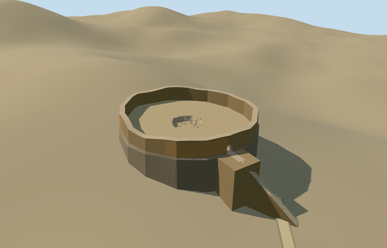

# N0633_WEST — Golestan Tower of Silence, Yazd (west)

Reviewed 2026-10-20 in one continuous author/build/inspect/fix round.

## Appearance

Inspected47 current individual portable/shared/medium-fi/native-site views in one construction/inspection pass, followed by five paired-site views. Specific western Golestan dakhma retains its own seventeen-vertex mapped base, taller surviving roofless rubble ring/worn ocher plaster, genuinely open low eastern arch, broad projecting entry landing/supported approach, open dusty court and smaller recessed irregular pit/broken lip/loose rubble. The two larger eastern pit fragments are not copied into this member. Contact surfaces and fine damage remain simplified rather than an archaeological reconstruction.

## Shared materials and browser levels

Four reused256-square graphs: stone_drywall, stone_sandstone_raw, stucco and gravel. Rubble covers walls/landing/stair sides; tinted raw stone supplies caps/pit/rubble/bounded battered contact, sparse tinted stucco supplies worn plaster, and gravel supplies the court/pit floor. Five source roles merge into four near-level draws. No embedded images or copied pixels; canonical refs/separate runtime position-normal buffers/equal counted CPU-GPU bytes verified in six actual GLBs. Both towers together reuse the same four graphs exactly once and eviction disposes their geometry.

| Level | Triangles | Bytes | Draws |
| --- | ---: | ---: | ---: |
| skyline | 420 | 46360 | 1 |
| district | 1582 | 157280 | 4 |
| street | 2482 | 245848 | 4 |
| closeup | 3372 | 333776 | 4 |

Inspected24 medium-fi frames at three distances, two lighting times, Economy/High, neutral silhouette, four matched levels and transitions. Skyline retains the roofless ring, open eastern passage, smaller pit, landing and ramp; nearer levels add actual steps/plaster/loose blocks. Initial skyline plus district203640bytes, below phone3MB/laptop6MB targets. Procedural context is generalized; no full lower precinct reconstruction is claimed. Physical laptop/phone and dense-city timings remain pending. Levels420/1582/2482/3372 triangles; at most four draws.

## Approximate map fit

Independent western member N0633_WEST uses OSMway239508117/native circle35184611596949 and own anchor54.354849011,31.822962706, heading0/native east-south. The seventeen-vertex base is roughly32.22x29.68m, upper ring inset0.5m for bounded battered contact. Native approach35184755387040 and explicit steps35184964943870 cross the eastern rim near[16.1099,1.6490]m, giving internal portal phase.11201939895971455rad; fine damage/pit/entry allocation retains20degree/2m approximation. Only western circle replaced, zero residual; all17 independent resident inputs (18 originals/83 wider records), original6m terrain/native road inputs and zero-water condition unchanged. Failure restores18 originals; all levels unload cleanly. Both towers together replace only two shells and preserve16 independent inputs; no ground/water cutout or broad slab is used.

## Limits

Original medium-fi geometry follows actually viewed ordinary2016 western exterior and2010 western interior photographs. No qualified height exists: wall nominally2.9..3.8m above court,1.7m doorway apex,1.35m thickness,1.15m pit depth/radius3.3m,5.8x4.8m projecting landing and plaster/rubble inventory are explicit visualization estimates. Court3.996822m above coarse anchor grade keeps the recessed pit clear of native ground. Rocky contact/landing/stair foundations are approximate visualization support, not surveyed hill or excavation engineering. No intact historical exposure-grid/roof, bodies/bones, copied label/photo atlas, lower precinct, eastern tower in this GLB or whole-hill mesh. The two-tower collection is complete only after both independent member reviews and paired loading/placement checks pass.

## Selected checks

Six Khronos files: zero errors/warnings.712 actual mesh/material/contact checks; 47 current inspected views. Scene validation/sim30 and strict selected medium-fi audit pass. Source/runtime/LOD hashes and material bindings verified.

Rebuild: node packages/worldgen/scripts/generate-additional-landmarks.mjs --ids=N0633_WEST; node packages/worldgen/scripts/import-next-1000-models.mjs --ids=N0633_WEST; node packages/tooling/scripts/generate-landmark-lods.mjs --ids=N0633_WEST --force.

Source: sha256:dd389d0b1a10157f2ce7b27476c36525bb236928cc7bb748aa44e83f7421b981

Runtime: sha256:fd39be109efef8df9a2cc55daddf416a96004783ef0a6837a5ace1c5f8c36b55

Input: sha256:7eba6c5c83ae76ee11a6bfd8c734a00aafabc1199d1f4dc7c99e0fede1b82011

## Viewed ordinary pictures

https://commons.wikimedia.org/wiki/File:Torre_del_silencio,_Yazd,_Ir%C3%A1n,_2016-09-21,_DD_68.jpg — Diego Delso; CC-BY-SA-4.0. Viewed only; no pixels copied.

https://commons.wikimedia.org/wiki/File:Tower_of_Silence_(Yazd)_006.jpg — Petr Adam Dohnalek; CC-BY-SA-3.0-CZ. Viewed only; no pixels copied.

## Paired site check

Five current paired-site renders actually inspected: district/closeup whole site, closeup west entry, closeup east member at its own anchor, and failed-load fallback. Separate models roughly240m apart retain their own anchors/entrance directions under shared siteQ27702877; no centroid GLB or invented member QIDs. Ordinary pictures/standard PMTiles only. Lower precinct remains generalized native context; terrain/fine detail limits remain in each member review. Both members use the same four shared graphs, read once; only two corresponding shells are replaced, all16 independent resident inputs and native terrain/roads remain unchanged. Failure restores18 originals; unloading releases all geometry. Five additional current paired views are pinned in qa.json.

## Placement identifier correction

Placement ID normalized next1000.n0633_west to next1000.n0633-west for the published lowercase/dot/hyphen grammar. Every spatial field and all six source/runtime/LOD bytes verified unchanged; existing approved images retained without new rendering.
