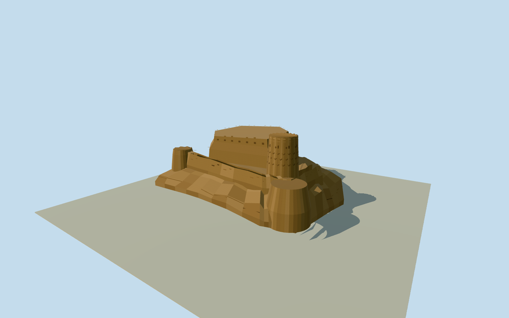

# Naryn Castle, Meybod

The surviving earthen citadel at Meybod, with irregular adobe ramparts on an eroded mound, a round tower bearing geometric adobe patterns and the stepped inner keep.

Authoring state: **review-in-qa.json**. Current completion evidence is in [qa.json](qa.json) and the [completion ledger](../../../../qualla-structures/batches/qualla-003.PROGRESS.md).

- [Naryn Castle, Meybod](https://qualla.com/naryn-castle-meybod/)

The model depicts the photographed upper adobe citadel as it survived in 2009, within the named mapped polygon. The wider archaeological precinct is outside this asset.

The placement uses the original terrain field. The mound section, wall and tower heights, and exact positions of structures within the mapped outline are visual estimates.

The model reproduces the visible tower bands, keep massing and curtain damage. Unsighted wall faces and individual openings are approximate, and the exterior asset omits interior remains.

Build: `node content/worldgen/source/places/tj/tjw/naryn_castle_meybod/models/generate-naryn-castle-meybod.mjs`. Add `--check` to verify exact regeneration. 2818 triangles; 3 materials; no embedded photographs.
