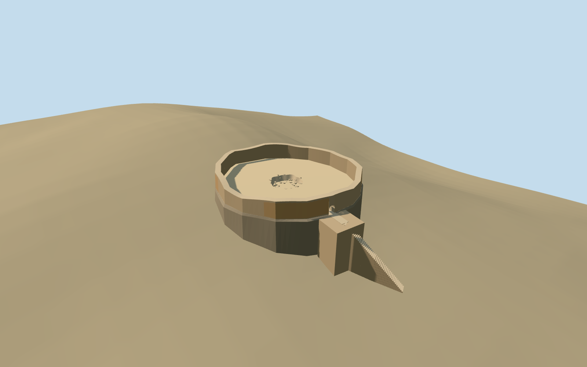

# Golestan Tower of Silence, Yazd (west)

Specific standing western/northwestern Golestan dakhma at Yazd: separately mapped irregular broad ring with taller surviving roofless masonry and worn ocher plaster, genuinely open low eastern arched passage, projecting rectangular entrance landing and supported approach steps, gritty open court and smaller irregular recessed pit/broken lip/loose rubble. Four reused shared rubble/raw sandstone/stucco/gravel graphs. No intact historical tall tower, roof, bodies/bones, copied label/photo atlas, lower precinct buildings, eastern dakhma, complete hill or broad terrain slab.

## Evidence and reconstruction

Published dimensions and reconstructed details are separated in spec.json. Primary references:

- [Reference](https://commons.wikimedia.org/wiki/File:Torre_del_silencio,_Yazd,_Ir%C3%A1n,_2016-09-21,_DD_68.jpg)
- [Reference](https://commons.wikimedia.org/wiki/File:Tower_of_Silence_(Yazd)_006.jpg)

Specific standing western/northwestern Golestan dakhma at Yazd: separately mapped irregular broad ring with taller surviving roofless masonry and worn ocher plaster, genuinely open low eastern arched passage, projecting rectangular entrance landing and supported approach steps, gritty open court and smaller irregular recessed pit/broken lip/loose rubble. Four reused shared rubble/raw sandstone/stucco/gravel graphs. No intact historical tall tower, roof, bodies/bones, copied label/photo atlas, lower precinct buildings, eastern dakhma, complete hill or broad terrain slab.

## Model and axes

3,372 triangles; 10,116 vertices; 4 material groups; 407,584 bytes. Native bounds: -16.110, -6.616, -14.841 to 28.830, 7.622, 14.841. Source hash: `sha256:dd389d0b1a10157f2ce7b27476c36525bb236928cc7bb748aa44e83f7421b981`.

{"x":"east","y":"up","z":"south"}

The geographic proposal uses exact-QID OpenStreetMap evidence. Map-derived orientation and estimated architectural details require real-site visual review; preview eligibility is distinct from geographic/fidelity approval. Map attribution: © OpenStreetMap contributors, ODbL-1.0.

## Reproduce

Run `node packages/worldgen/scripts/generate-additional-landmarks.mjs --ids=west_golestan_tower_of_silence` (or add `--check`). The generator preserves manually edited masters by checking their baseline hashes. Import through the standard authored-model workflow with optimization disabled; then capture all QA cameras, including shared-surface views.

## Pending work

- Specific standing western/northwestern Golestan dakhma at Yazd: separately mapped irregular broad ring with taller surviving roofless masonry and worn ocher plaster, genuinely open low eastern arched passage, projecting rectangular entrance landing and supported approach steps, gritty open court and smaller irregular recessed pit/broken lip/loose rubble. Four reused shared rubble/raw sandstone/stucco/gravel graphs. No intact historical tall tower, roof, bodies/bones, copied label/photo atlas, lower precinct buildings, eastern dakhma, complete hill or broad terrain slab.
- Q27702877 identifies the two-tower site; this independent western Golestan member is OSMway239508117, native circle35184611596949 and its cemetery POI. Use its own native-outline anchor54.354849011,31.822962706, heading0/east-south. The seventeen-vertex base is roughly32.22x29.68m, with upper ring inset0.5m for bounded battered contact. Native approach35184755387040 and explicit steps35184964943870 cross the eastern rim near[16.1099,1.6490]m, fixing internal eastern portal direction. Fine portal/landing/damage/pit allocation retains20degree/2m approximation. Eastern Maneckji is a separate required asset/placement about240m away; no independent member QIDs are invented.
- No qualified mapped building height exists. Picture-led inner surviving wall nominally2.9..3.8m above the court,1.7m doorway apex,1.35m wall thickness and shallow1.15m pit/radius3.3m are visualization estimates. Projecting entry landing nominally5.8x4.8m, worn plaster and loose block inventory are approximate. No complete historical exposure-grid, furnished burial scene or excavation survey is claimed.
- Keep the original6m standard Mapzen hill, native roads/water and every independent building including the eastern dakhma and lower precinct. Replace only the western native circle. Court/pit floor stays above occupied coarse native terrain; pit is truly recessed without a ground cutout. Bounded battered raw-stone contact within the mapped outline supports the court; buried feet and the narrow steps/projecting entry landing contact coarse grade. Rocky seat and foundation dimensions are visualization estimates, not surveyed hill/excavation engineering. No whole-hill mesh, broad slab, ground/water cutout or valley flattening.
- Ordinary2016 exterior/2010 interior views carried through construction. Native outline/approach and explicit steps fix the western member independently. No qualified height; broken masonry, portal, plaster, pit and steps remain explicit approximations. No roof, complete historical exposure-grid, bodies/bones, eastern dakhma, lower precinct buildings, whole hill or copied image pixels.

This bundle follows the medium-fi standard. Medium-fi appearance and geographic fit are reviewed separately. Hash-bound visual acceptance is recorded separately after capture inspection.
