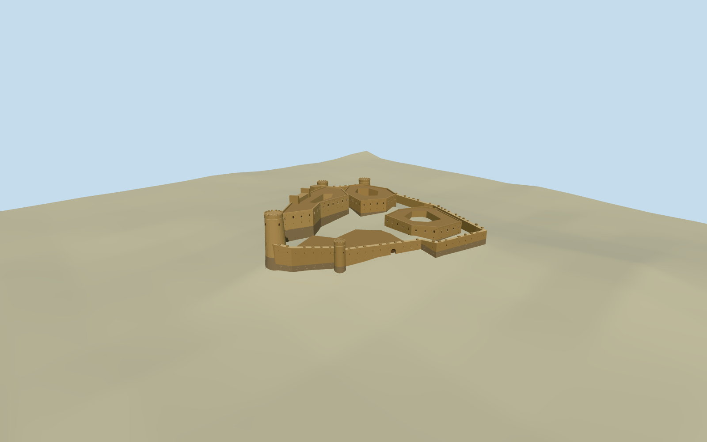

# Bahla Fort

Bahla Fort as photographed in 1885, with terraced adobe enclosures, stone plinths, weathered parapets, a high wind tower and three main building groups.

Authoring state: **review-in-qa.json**. Current completion evidence is in [qa.json](qa.json) and the [completion ledger](../../../../qualla-structures/batches/qualla-004.PROGRESS.md).

- [Bahla Fort](https://qualla.com/bahla-fort/)

The 1885 exterior uses the standing enclosure as its geographic outline. The placement and height of inner terraces, courtyards and obscured elevations are approximate.

Only the main fort is represented. The Friday Mosque, separate settlement buildings and longer oasis wall are outside its scope.

Build: `node content/worldgen/source/places/tk/tk0/bahla_fort/models/generate-bahla-fort.mjs`. Add `--check` to verify exact regeneration. 10489 triangles; 6 materials; no embedded photographs.
