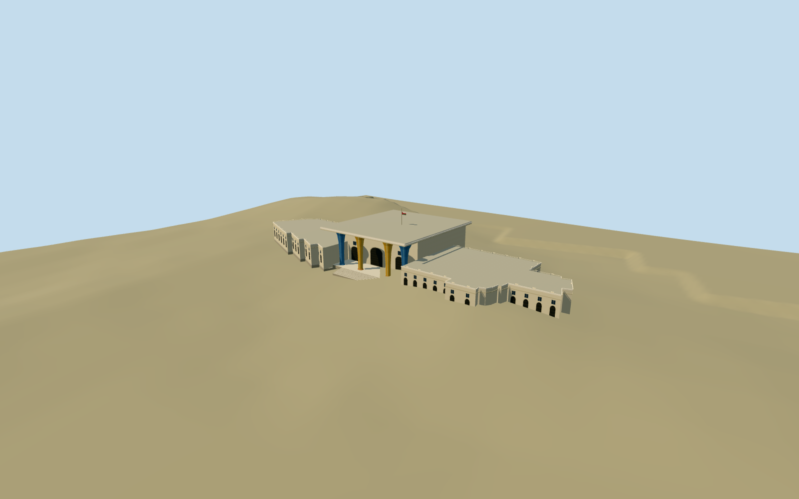

# Al Alam Palace

The standing Al Alam ceremonial palace in Old Muscat, with the colorful flared columns, flat projecting roof and two white wings.

Authoring state: **review-in-qa.json**. Current completion evidence is in [qa.json](qa.json) and the [completion ledger](../../../../qualla-structures/batches/qualla-003.PROGRESS.md).

- [Al Alam Palace](https://qualla.com/al-alam-palace/)

Masonry heights, spacing and exact placement of the gold and blue colors, column profiles and wing openings are estimates made from written descriptions and the mapped plan.

The original terrain is unmodified. Floor and threshold heights are estimated.

No photograph, drawing, pattern or texture was used. The Qualla photo’s file-level public-domain label does not resolve rights in the depicted architecture.

Build: `node content/worldgen/source/places/tk/tk1/al_alam_palace/models/generate-al-alam-palace.mjs`. Add `--check` to verify exact regeneration. 5188 triangles; 6 materials; no embedded photographs.
