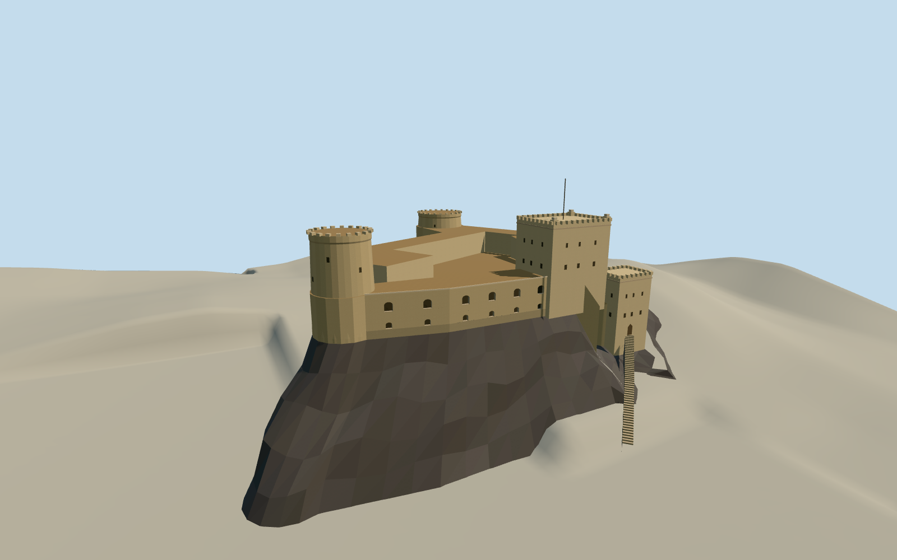

# Al Jalali Fort, Muscat

The harbor fort on its rocky ridge with staggered round and square towers, the west arches and steep south approach.

Authoring state: **review-in-qa.json**. Current completion evidence is in [qa.json](qa.json) and the [completion ledger](../../../../qualla-structures/batches/qualla-003.PROGRESS.md).

- [Al Jalali Fort](https://qualla.com/al-jalali-fort/)

The August 2024 harbor photograph controls the western exterior. The eastern and inland details, exact elevation of the outer towers and local stair alignment are interpreted from the map and written descriptions.

The underlying public composite terrain is preserved, including its coarse coastal and offshore values. The short rock apron is estimated geometry of the occupied ridge under the masonry. It is separate from the independent terrain.

The represented exterior covers the fort and its lower stair tower. The Al Alam Palace and surrounding harbor structures are separate sites.

Build: `node content/worldgen/source/places/tk/tk1/al_jalali_fort/models/generate-al-jalali-fort.mjs`. Add `--check` to verify exact regeneration. 4387 triangles; 6 materials; no embedded photographs.
