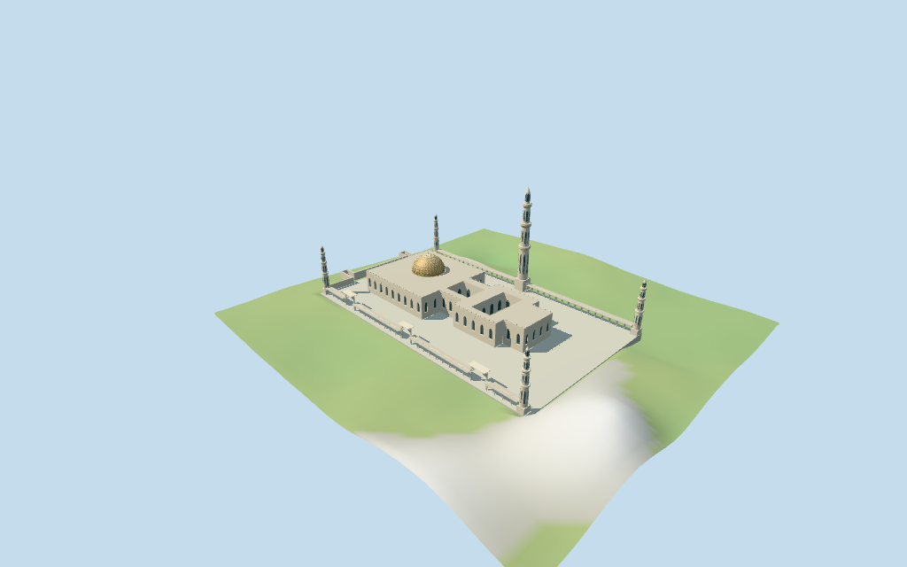

# Sultan Qaboos Grand Mosque

Individual medium-fi Sultan Qaboos Grand Mosque: exact mapped main plan with two open courtyard holes, warm hemispherical dome and cream diamond lattice, one 91.5 m northern minaret and four 45 m corner minarets, six open pointed perimeter colonnades, three elevated gate ranges, pale pointed window/entry fields, stepped parapet and separate western auxiliary ranges. Main/corner tower positions and total tagged heights are controlled. Podium, dome top, low range heights, facade facing, internal levels and all fine architectural rhythm are explicit visualization estimates. Six existing shared 256² graphs serve seven merged material roles and four independent LODs. No generic stand-in, copied photographic textures, fine inscriptions/artwork or furnished interiors.

## Evidence and reconstruction

Published dimensions and reconstructed details are separated in spec.json. Primary references:

- [Reference](https://commons.wikimedia.org/wiki/File:Muscat,_moschea_del_sultano_qaboos,_esterno_01.jpg)
- [Reference](https://commons.wikimedia.org/wiki/File:Muscat,_moschea_del_sultano_qaboos,_cortile_03_cupola.jpg)

Six existing shared 256² coursed limestone, raw limestone, membrane, marble, cast bronze and plain wood graphs serve seven merged roles including local opaque blue-grey panes. Metric UVs, linear colors and no embedded images. Dome lattice is coarse original geometry, not a photographed texture or exact faience/carving reproduction.

## Model and axes

26,946 triangles; 80,838 vertices; 7 material groups; 3,237,772 bytes. Native bounds: -146.537, -6.908, -55.099 to 96.594, 90.613, 82.253. Source hash: `sha256:95d3c92b9681e597cad3bf17c9e95adf350fa1c3e80c508f1b9b9f8f17c8bbc8`.

{"x":"approximately east along first main edge","y":"up","z":"approximately south"}

Normal viewer DEM datum 13.009335527692382 m; working floor -0.886580763182782 m is the median of 242 outside-podium samples at 1 m offset plus 0.3 m. 3375 raw central-podium samples span -6.299770062965261..12.58198604660615 m. Adaptive foundations support the approximate central court podium and separate western auxiliary controls. Preview terrain seats the podium and 1.5 m margin. Exact paving/garden boundaries, thresholds, stairs, irrigation, drains and present terrain joins remain unverified.

## Reproduce

Run `node packages/worldgen/scripts/generate-additional-landmarks.mjs --ids=N0464` (or add `--check`). The generator preserves manually edited masters by checking their baseline hashes. Import through the standard authored-model workflow with optimization disabled; then capture all QA cameras, including shared-surface views.

## Pending work

- Retained Q1548443 reference anchor [58.389166666,23.583888888] is unchanged. Its older record was reference-only. Current named POI 17593908033892 identifies Sultan Qaboos Grand Mosque within main building 52776570385584. Main raw outline has 18 vertices and two four-vertex courtyard holes. Dome part 35185642976769 supplies its own 19-vertex plan. Five separately mapped minaret bases fix the tall northern tower and four corner towers. Six narrow perimeter roof ranges, three intervening elevated gate ranges and four western auxiliary wall/range controls are retained. The paved central court is an approximate rectangular podium derived from the bounding limits of the four mapped corner towers; it is not a separately surveyed ground polygon. Western thin auxiliary controls keep their own foundations outside that podium. Heading -0.003787873596683811 rad follows the first main edge, positive X approximately east and positive Z south. Facade facing and internal architectural divisions remain visualization estimates. Detached visitor entrance/shop, gardens, roads and surrounding city remain host content.
- Current main aggregate height is 20 m (layer 1); main minaret 91.5 m; four corner minarets 45 m. Dome has min_height 20 m and no top height; perimeter ranges/gates/western auxiliary controls have no heights. Main roof honors 20 m. Picture-led estimates: podium 0.7 m; low colonnade ranges 7.2 m; gateway arches to 13.5 m; west auxiliary ranges 6.5 m. Dome starts at 20 m, hemispherical warm inner shell rises about 14.2 m and cream lattice sits 0.18 m above it, with small finial to 37 m. Tower totals honor the current tags; shaft tiers, projecting balconies, slit fields and caps use estimated proportions. Lattice pattern, parapets, windows, entrance niches and all internal levels are coarse original reconstruction, not copied artwork or surveyed engineering.
- Normal viewer DEM datum 13.009335527692382 m; working floor -0.886580763182782 m is the median of 242 outside-podium samples at 1 m offset plus 0.3 m. 3375 raw central-podium samples span -6.299770062965261..12.58198604660615 m. Adaptive foundations support the approximate central court podium and separate western auxiliary controls. Preview terrain seats the podium and 1.5 m margin. Exact paving/garden boundaries, thresholds, stairs, irrigation, drains and present terrain joins remain unverified.
- Current named map geometry supports the older reference-only identity. Main and minaret totals are tagged; dome top and profiles, internal levels, colonnades, gate heights, facade rhythm, merlons and lattice pattern are estimates. The central podium is an approximate rectangle from corner tower limits, not an exact paved or garden survey. Western auxiliary controls retain thin raw outlines. Two main roof courts stay open. Fine inscriptions/carvings, exact geometric art, ornamented paving, fixtures, trees, visitor entrance/shop and furnished interiors omitted. No collision-certified interior or physical-device timing claim.

This bundle follows the medium-fi standard. Medium-fi appearance and geographic fit are reviewed separately. Hash-bound visual acceptance is recorded separately after capture inspection.

## Additional geographic data

©OpenStreetMap contributors; Protomaps; Mapzen/USGS terrain tiles.
