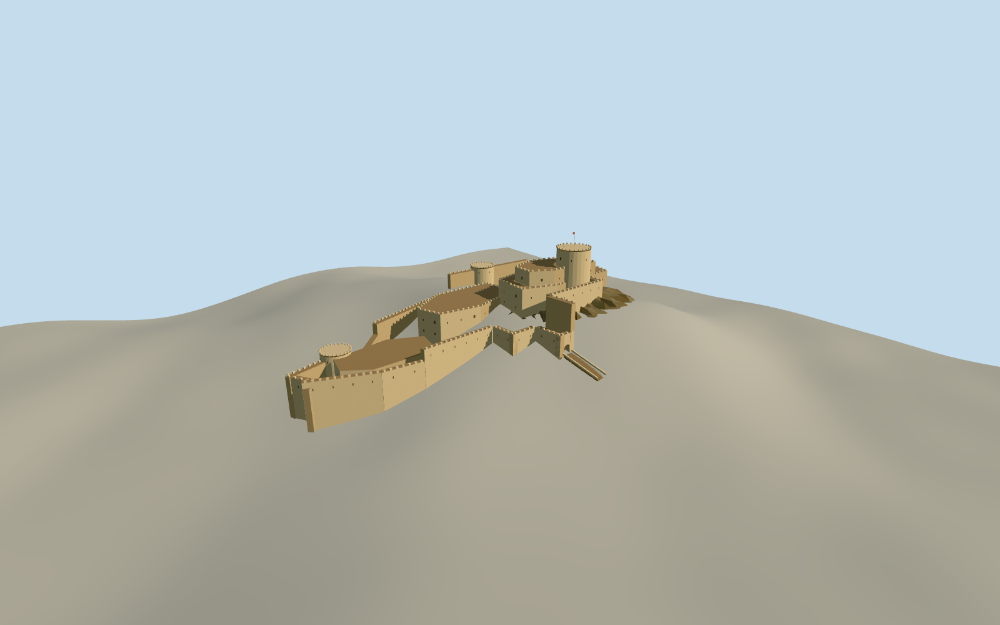

# Nakhal Fort

Nakhal Fort’s pale walls and round crenellated towers follow the exposed rock beneath a high fortified keep.

Authoring state: **review-in-qa.json**. Current completion evidence is in [qa.json](qa.json) and the [completion ledger](../../../../qualla-structures/batches/qualla-003.PROGRESS.md).

- [Nakhal Fort](https://qualla.com/nakhal-fort/)

The original ground grid is preserved. Exposed rock masses integral to the fortress are approximated near the mapped rocky centre.

Wall tops, interior partitions, stair construction and modern restoration details are representative estimates.

Palm groves, visitor amenities, interiors and modern road features are outside the authored scope.

Build: `node content/worldgen/source/places/tk/tk1/nakhal_fort/models/generate-nakhal-fort.mjs`. Add `--check` to verify exact regeneration. 8464 triangles; 6 materials; no embedded photographs.
