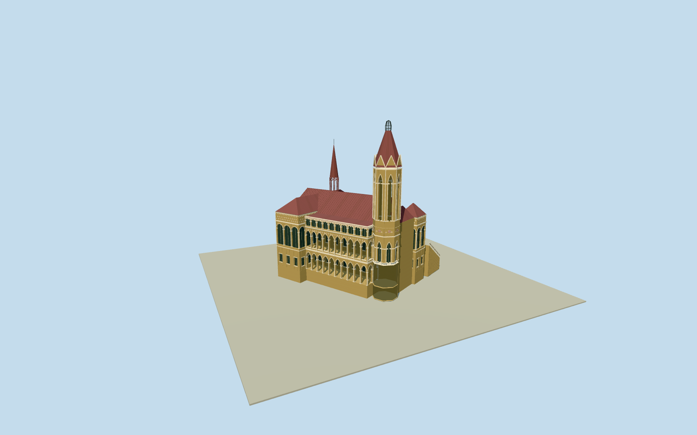

# Frere Hall (2009)

Whole Frere Hall as the unmodified author photograph published by2009: complete two-storey VenetianGothic hall, long pointed-arch verandas, full interior hall envelope and hidden rear, red gabled main roof with geometric clerestory, two hipped endpavilions, whole octagonal belfry with tall lancets/hipped spire/open iron crown, thin open roofstage and spire, east porch and intrinsic double-flight stairs. Six native building components/Q3924620 bound. Hidden plan/sections/registration/metric heights and historic grade are bounded estimates, not survey. Exclude garden/park/trees/roads/people/nearby structures/interior murals/copied figurative art/lettering; do not substitute frontage for wholehall.

Authoring state: **review-in-qa.json**. Current completion evidence is in [qa.json](qa.json) and the [completion ledger](../../../../qualla-structures/batches/qualla-002.PROGRESS.md).

- [Frere Hall](https://qualla.com/frere-hall/)

ActualQ3924620/wholeFrereHall six native componentways66controls. Smallroundcomponent484206542 isthin roofspire; largeoctagonal484206546 tallbelfry. Namednode3735483787 isleisurepark, not buildinganchor. Mainhalltwo floors fromoriginalphoto/primarytext, not mapped4/5/6/8pseudo-levels. Wholehiddenrear/sections/heights/registration±3m/bearing±3degrees are estimates. All1077reservationsclear.

Whole Frere Hall as the unmodified author photograph published by2009: complete two-storey VenetianGothic hall, long pointed-arch verandas, full interior hall envelope and hidden rear, red gabled main roof with geometric clerestory, two hipped endpavilions, whole octagonal belfry with tall lancets/hipped spire/open iron crown, thin open roofstage and spire, east porch and intrinsic double-flight stairs. Six native building components/Q3924620 bound. Hidden plan/sections/registration/metric heights and historic grade are bounded estimates, not survey. Exclude garden/park/trees/roads/people/nearby structures/interior murals/copied figurative art/lettering; do not substitute frontage for wholehall.

Immutableindependentoriginalfield/frame beforeallfloors/mainsections/geometry. Neverflatten/reacquire/reframe/refitfloorsafterrender.

Wholehiddenrear/roofplan/verandacensus/geometricinlay/sections/heights/metricregistration are boundedphotographicestimates; no exactsurveygate. No copiedinteriormurals/artwork/signage/trees/garden.

Two-storeyhallwithupperarcade/clerestory/fullenclosedmainhall/wholehiddenrear, distincthippedendpavilions, octagonalbelfry/realopenlancets/redsteepspire/opencrown, thinopenroofspire andeastdoubleflightstairs. Lowerarcadepartlytreeoccluded/hiddenrearandstairdetails estimated. Geometricdiamondinlayrepresentedwithauthoredsimplegeometry; no copiedmurals/figurativeart.

Archivephotoauthorupload2009-11-13 is latestpublicationbound, capturedaynotproved; dated2009appearance only. Contemporary4/5/6/8mappedlevelsnotused asfloors. Currentparkpointnotbuilding. Registration±3m/bearing±3degrees/height±20% estimated.

IndependenturbanDEMmayconceal lowerfoundations or slightlyintersectstairs. Originalfield/mainsections retained; exactmetric/gradefit notrequired.

Build: `node content/worldgen/source/places/tk/tkr/frere_hall/models/generate-house.mjs`. Add `--check` to verify exact regeneration. 42993 triangles; 6 materials; no embedded photographs.
