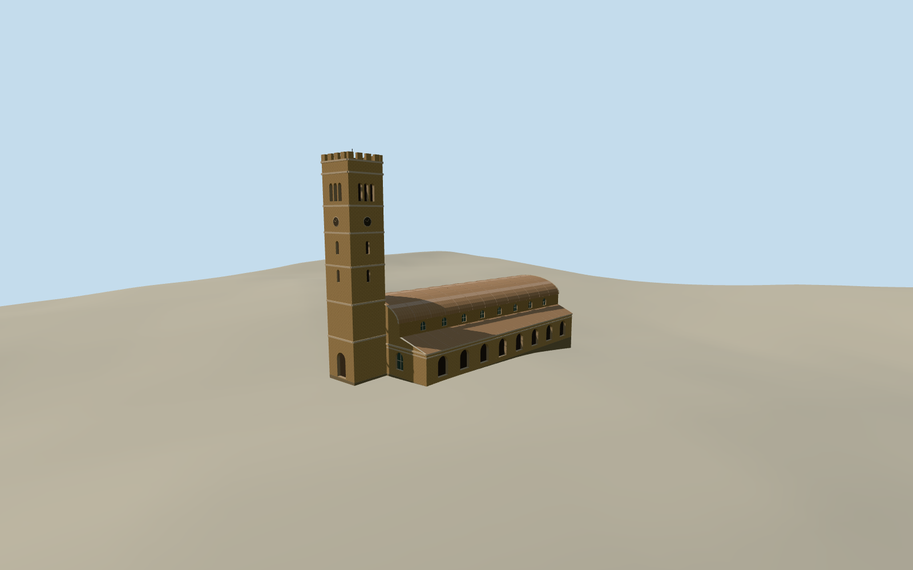

# Holy Trinity Cathedral, Karachi

Buff sandstone cathedral with a reduced crenellated clock tower, barrel nave roof, high arched lights and aisle arcades.

Authoring state: **review-in-qa.json**. Current completion evidence is in [qa.json](qa.json) and the [completion ledger](../../../../qualla-structures/batches/qualla-003.PROGRESS.md).

- [Holy Trinity Cathedral, Karachi](https://qualla.com/holy-trinity-cathedral-karachi/)

The model represents circa 2002 with the shortened tower and barrel roof. The chosen date is the archive’s approximate year, and rear openings and clock face detail are simplified.

The named mapped perimeter fixes the scale and tower placement. The approximately 35 m tower height and surviving tier proportions follow the exterior photograph and published descriptions. Side aisle and roof divisions are reconstructed.

Original elevation samples are retained. The south and north foundations and threshold placement follow approximate contact with the independent composite field.

Build: `node content/worldgen/source/places/tk/tkr/holy_trinity_cathedral_karachi/models/generate-holy-trinity-karachi.mjs`. Add `--check` to verify exact regeneration. 8526 triangles; 6 materials; no embedded photographs.
