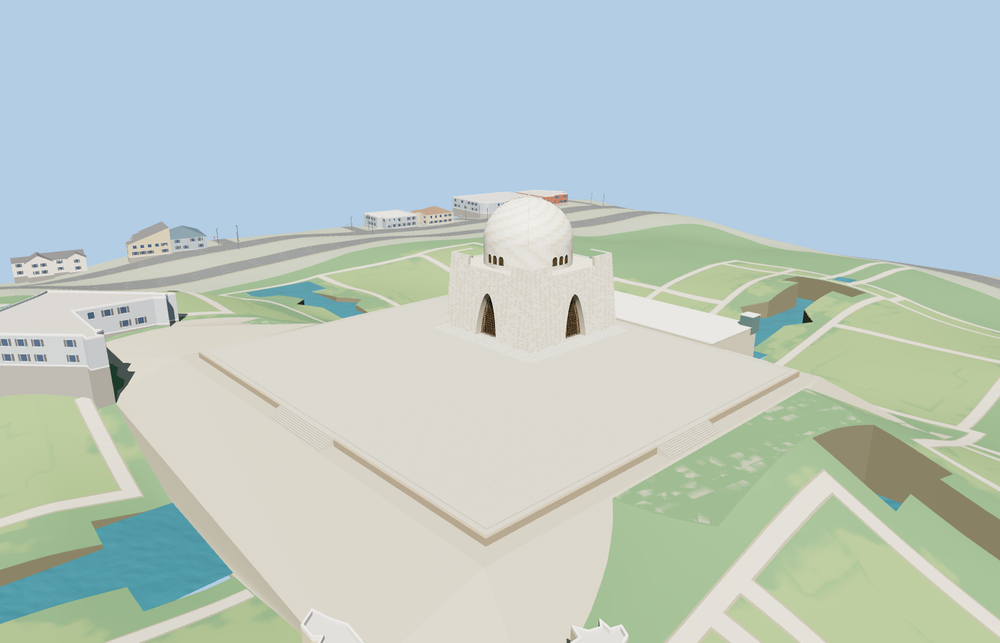

# Mazar-e-Quaid

Mazar-e-Quaid with tapered marble façades, deep pointed copper-screen arches, the perforated dome drum, two levels of stairs and the asymmetrical raised plaza.

The 45,863-triangle source rebuilds byte for byte. Skyline, district, street and close-up use 993, 3,993, 14,491, 44,215 triangles. The first two tiers total 406,620 bytes. Six GLBs validated and 38 current views were inspected.

All tiers pass four portal recess checks, four terrace stair joins, four deck clearance checks and eight probes beyond the model. The cap lies 1.62 m below the sampled deck. The viewer retains 14 independent buildings, 129 mapped road parts and the surrounding garden and pool context. Unloading restores the original terrain geometry. Failed loading retains all eight mapped site features.

The mapped drum controls the anchor and the mapped straight wall controls the heading. The four stone walls are reconstructed from the visible square plan and photographs. Individual panel sizes and accessory structures are approximate. The standard elevation tile contains a raised mound under the podium. The viewer caps the terrain within the occupied terrace only while the model is resident. The adjacent gardens, reflecting pools and visitor interiors are outside the modeled scope. Physical-device timings are unmeasured.

Rebuild with `node packages/worldgen/scripts/generate-mazar-e-quaid.mjs`. Append `--check` to compare exact bytes. Use `--ids=mazar_e_quaid` for targeted import, LOD, placement and readiness.
