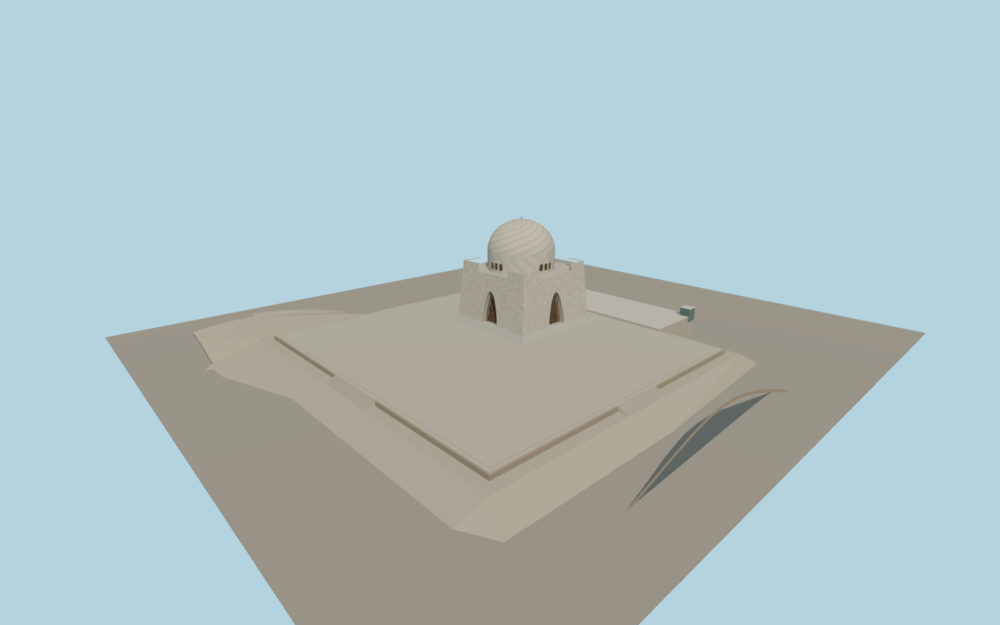

# Mazar-e-Quaid

Mazar-e-Quaid with tapered marble façades, deep pointed copper-screen arches, the perforated dome drum, two levels of stairs and the asymmetrical raised plaza.

Run `node packages/worldgen/scripts/generate-mazar-e-quaid.mjs` to rebuild the source master. Append `--check` to compare the exact bytes. Use `--ids=mazar_e_quaid` for targeted import, LOD generation and placement.

The mapped drum controls the anchor and the mapped straight wall controls the heading. The four stone walls are reconstructed from the visible square plan and photographs. Individual panel sizes and accessory structures are approximate.

The standard elevation tile contains a raised mound under the podium. The viewer caps the terrain within the occupied terrace only while the model is resident. The adjacent gardens, reflecting pools and visitor interiors are outside the modeled scope.

Original geometry follows the repository license. Map data is © OpenStreetMap contributors under ODbL-1.0 via Protomaps. Terrain samples are described in terrain-grid.json. Ordinary pictures stay local and are not redistributed or used as textures. Current acceptance:qa.json.
