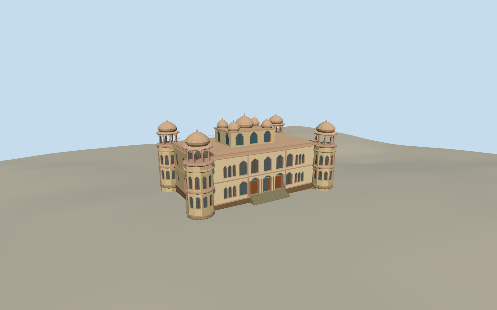

# Mohatta Palace

Clifton’s Mohatta Palace with two-tone sandstone, arched windows, four open corner chhatris and a five-domed roof pavilion.

Authoring state: **review-in-qa.json**. Current completion evidence is in [qa.json](qa.json) and the [completion ledger](../../../../qualla-structures/batches/qualla-003.PROGRESS.md).

- [Mohatta Palace](https://qualla.com/mohatta-palace/)

The restored exterior is represented using the May 2005 camera date. The August 2008 entrance photo contributes the doorway and tile decoration in the same restored museum period.

The mapped building and turret footprints fix the main position and scale. Front windows, corner chhatris and dome grouping follow the photographs. Unseen elevations, roof joinery, ornament, tile motifs and dome heights are estimates.

The terrain field is unchanged. Local heights and the masonry threshold are approximate. The estate walls, lawns and neighboring buildings are outside the model.

Build: `node content/worldgen/source/places/tk/tkr/mohatta_palace/models/generate-mohatta-palace.mjs`. Add `--check` to verify exact regeneration. 23524 triangles; 6 materials; no embedded photographs.
