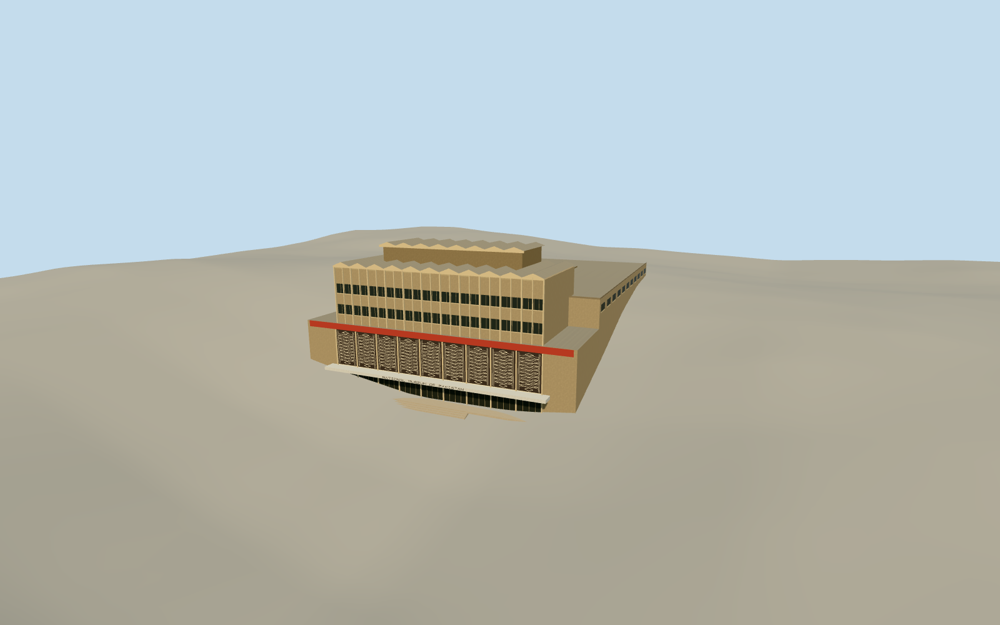

# National Museum of Pakistan

The garden entrance has a projecting sign canopy under nine cream masonry screens set against dark openings. The red fascia separates this base from the repeated concrete fins, two rows of inset glazing and two stepped folded rooflines.

Authoring state: **review-in-qa.json**. Current completion evidence is in [qa.json](qa.json) and the [completion ledger](../../../../qualla-structures/batches/qualla-003.PROGRESS.md).

- [National Museum of Pakistan](https://qualla.com/national-museum-of-pakistan/)

The cleared 2008 image establishes the west façade pattern and finish. The exact height, depth of the upper pavilion, courtyard elevations, and south, north and east elevations are approximate.

Unmodified composite terrain rises toward the rear. The approach datum is approximate, and higher original elevation samples conceal parts of the lower side and rear walls. The courtyard extent is mapped, and its floor elevations are estimated.

Build: `node content/worldgen/source/places/tk/tkr/national_museum_of_pakistan/models/generate-national-museum-of-pakistan.mjs`. Add `--check` to verify exact regeneration. 3824 triangles; 4 materials; no embedded photographs.
