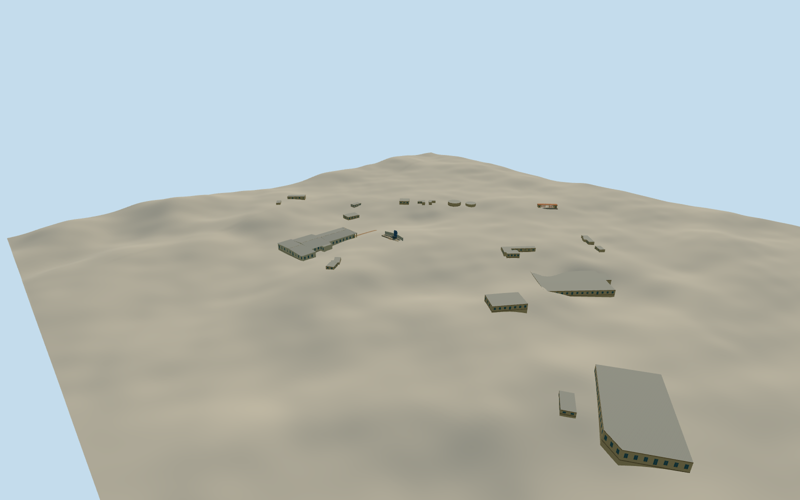

# Pakistan Air Force Museum

Pakistan Air Force Museum at Karachi in November 2016, with the glazed Archive Gallery, public entrance, Martyrs’ Monument and mapped visitor buildings.

Authoring state: **review-in-qa.json**. Current completion evidence is in [qa.json](qa.json) and the [completion ledger](../../../../qualla-structures/batches/qualla-003.PROGRESS.md).

- [Pakistan Air Force Museum](https://qualla.com/pakistan-air-force-museum/)

The model depicts the public museum’s November 2016 exterior. The Archive Gallery and visitor buildings follow mapped outlines. Roof sections, glazing, colors after accounting for nighttime illumination and the gallery vestibule depth are estimated.

The public entrance and memorial positions are approximate. The native mapped roads and plaza establish the local context and the cleared photographs establish form.

Original terrain remains unchanged. Foundations and visitor path grades are estimated. Exact memorial inscriptions, aircraft displays and material inside the main exhibit room are outside the modeled scope.

Build: `node content/worldgen/source/places/tk/tkr/pakistan_air_force_museum/models/generate-pakistan-air-force-museum.mjs`. Add `--check` to verify exact regeneration. 5654 triangles; 5 materials; no embedded photographs.
