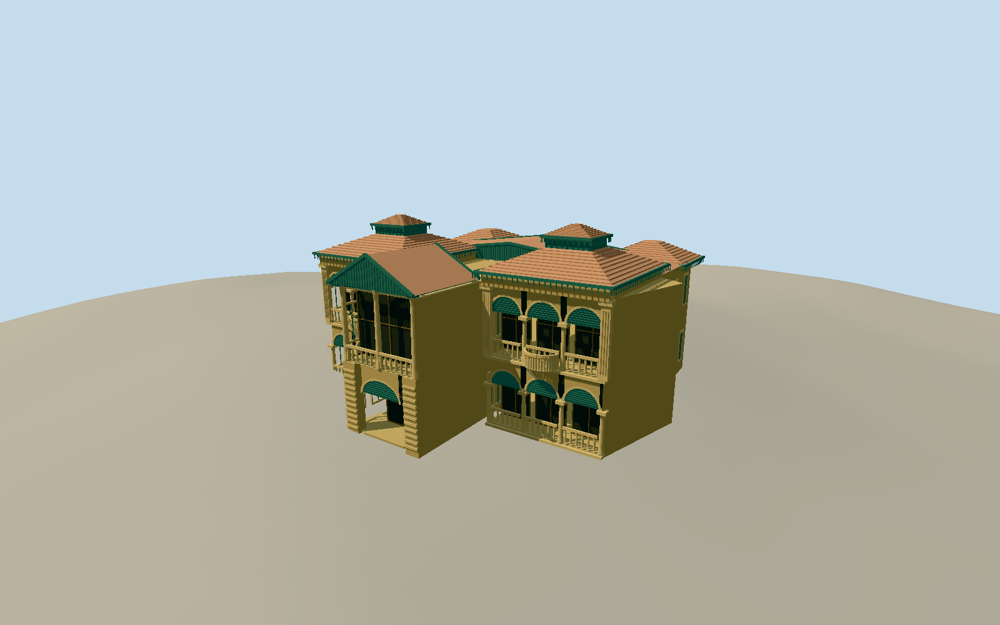

# Quaid-e-Azam House

Whole named surviving two-storey Quaid-e-Azam main house: original26vertex native outline including projecting central porch and rear wings; yellow limestone/rusticated plinth, twin front three-arch bays on both levels, open recessed loggias with physical columns/arches, green louvered fanlights and timber glazed screens, paired projecting round stone balconies, central green gabled porch, separate tiled hips/caps and rear/side walls/roof volumes. Detached annexe/auditorium, out-houses, offices/garages/guards/kitchen, garden fountain and grounds are separate and excluded. Use recessed rooms/screens behind real open loggia arches; keep paired3arch bays, segmented stone archivolts, fluted corner piers and simplified capitals, green louvered fanlights/wooden screens, round cantilevered balustrade balconies with scalloped bowl supports, central green timber gabled porch/physical fretwork, distinct hipped red tile roof/cap. Native foot outline supplies all lower wall courses; no parcel rectangle or fountain. Photograph controls visible front; roof/side/rear census and dimensions explicitly bounded. Freeze independent field first.

Authoring state: **review-in-qa.json**. Current completion evidence is in [qa.json](qa.json) and the [completion ledger](../../../../qualla-structures/batches/qualla-002.PROGRESS.md).

- [Quaid-e-Azam House](https://qualla.com/quaid-e-azam-house/)

Exact named native buildingway535257326/FormerlyFlagstaffHouse/tourismmuseum/building2levels, all26original perimeter vertices retained. Qualla story coordinate is about290m south-east and is not used for geographic placement. Local+Zwest-southwest/front, +Xsouth-southeast at fixed heading-1.0985963rad follows the original longer front wall. Upper round balconies, front bay/porch/roof partitions and hidden sections are bounded photographic interpretations within original ground plan, not independently surveyed features. Separate neighboring buildingways535257329/535257332/535257335/535257337 excluded.

One exact4896x3672Miansari66own-workCC0original individually inspected after Qualla-first30family inventory. All local house photographs require attribution; unrelated PD FaizMahal excluded. No photographic textures or generated bitmap.

Original complete medium-fi main-house exterior. Native two-storey outline controls ground perimeter; photographer front controls paired three-arch loggias, semicircular balconies, green fanlights/screens/gable, mouldings and separate red tiled hips/caps. Height13.9m, front partition/bearing, balcony sections, fine fluting/capital/fretwork/tile census and hidden roof/side/rear forms are bounded estimates, not measured elevations.

Operator describes the main limestone/timber/red-tile house, annexe and out-houses separately. Detached auditorium/annexe/offices/garages/guard/kitchen buildings, fountain, garden/compound, flags/signs/people and interiors excluded; no whole-site pad.

Independent160m65x65field/4225samples/one rawTerrariumtile unchanged after acquisition.2.5mgrid and4.33moutputpixels may oversample coarser native DEM and include urban/vegetation returns. Preview replaceFootprint=false; actual compatible host ground/threshold contact unverified.

Build: `node packages/worldgen/scripts/generate-authored-places.mjs --ids=quaid_e_azam_house`. Add `--check` to verify exact regeneration. 31789 triangles; 6 materials; no embedded photographs.
